# tribonian-us

*Named after Tribonian, the jurist who compiled Justinian's Code (statutes) and Digest (jurists' opinions) into one body of law to read.*

Turns the US Code and court opinions into dense PDFs for the reMarkable, plus Obsidian notes.

> Not legal advice and not a citator. The good-law check and the co-citation map are reading aids built from
> CourtListener data; read the opinions they point to.
> What has been measured, and what hasn't: [VALIDATION.md](VALIDATION.md).

## How to support

### The data sources

Almost everything here rests on [CourtListener](https://www.courtlistener.com/), run by the non-profit
[Free Law Project](https://free.law/): the opinions, dockets, citation graph, parentheticals and bulk data.

- **Donate:** <https://donate.free.law/forms/supportflp>
- **Add documents:** the [RECAP extension](https://free.law/recap/) copies documents you buy from PACER (the federal courts' paid records system) into
  CourtListener's free archive, which is where this project's RECAP dockets come from.

The US Code (Office of the Law Revision Counsel) and Supreme Court filings (supremecourt.gov) are government
sources and take no donations.

### The tools used

| Tool | What it does here | Support |
|---|---|---|
| TeX Live / pdflatex | typesets every PDF | [TeX Users Group](https://tug.org/donate.html) |
| lxml | parses the US Code XML and opinion HTML | [lxml: support the project](https://lxml.de/#support-the-project) |
| NumPy, SciPy | co-citation matrices and statistics | [NumFOCUS](https://numfocus.org/donate) (choose the project) |
| igraph | co-citation clustering | [igraph on Open Collective](https://opencollective.com/igraph) |
| Obsidian | the note vault | an optional [Catalyst license](https://obsidian.md/pricing) |

### tribonian-us

tribonian-us isn't accepting support at this time.

## What it makes

| US Code | A case: profile and good-law check | A co-citation sub-cluster |
|---|---|---|
| 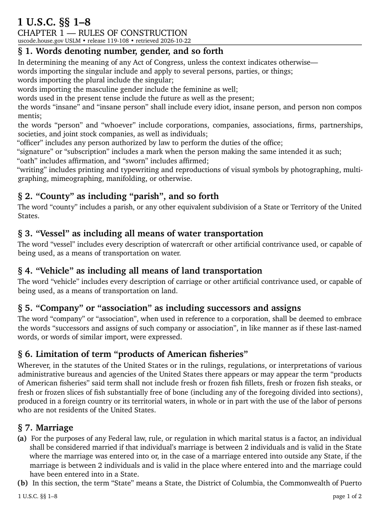 | 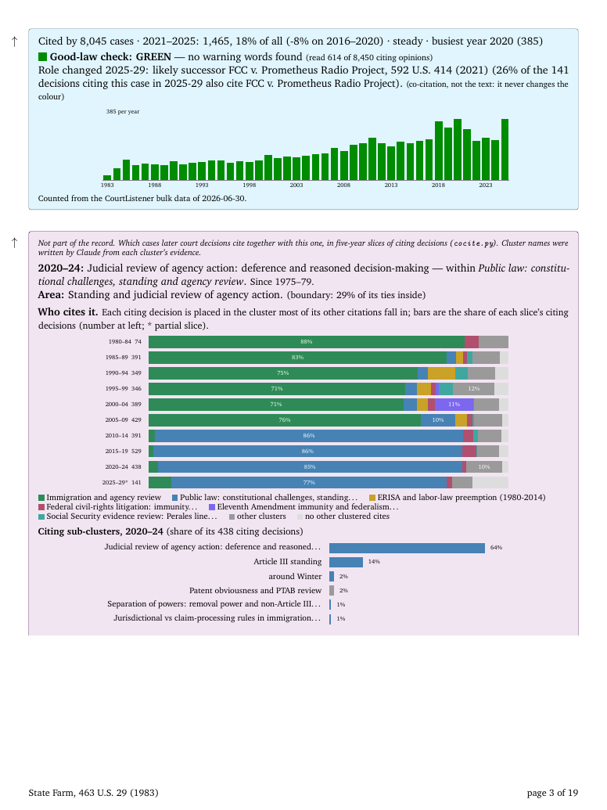 | 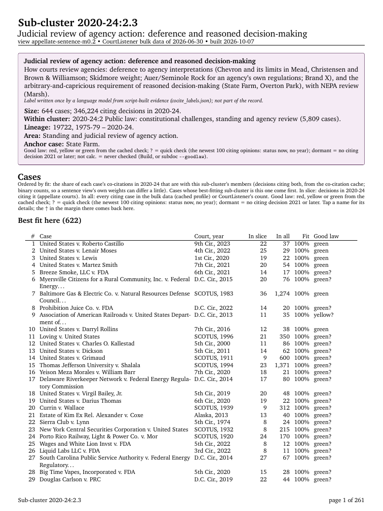 |
| **A deep US Code section and how courts cite it** | **A Supreme Court docket** | **The district court docket below it** |
| 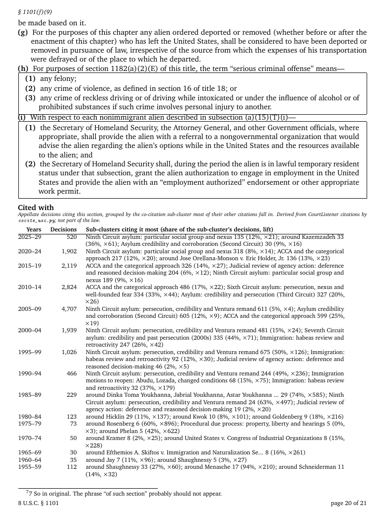 | 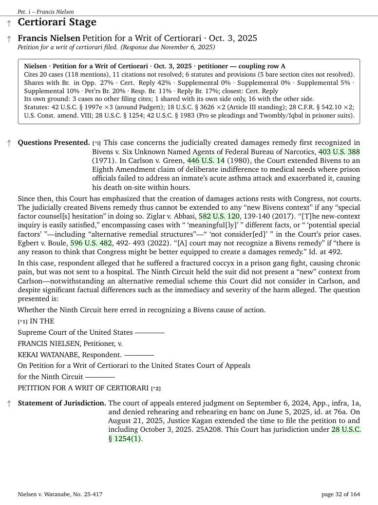 | 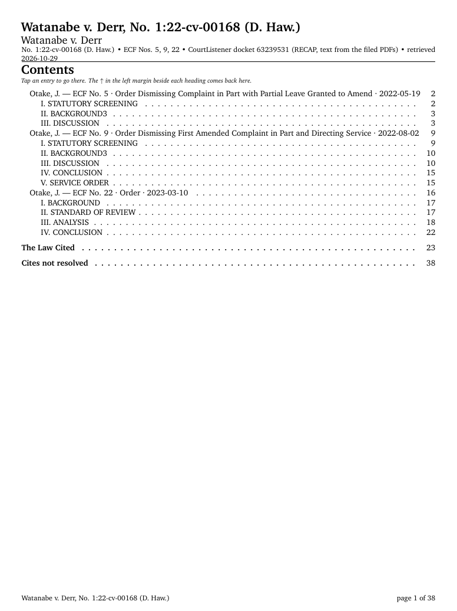 |

Full sample PDFs and a sample note are in [`examples/`](examples/).

And a desktop browser over all of it (`gui/`, Rust):

| Start | An area's history graph |
|---|---|
| 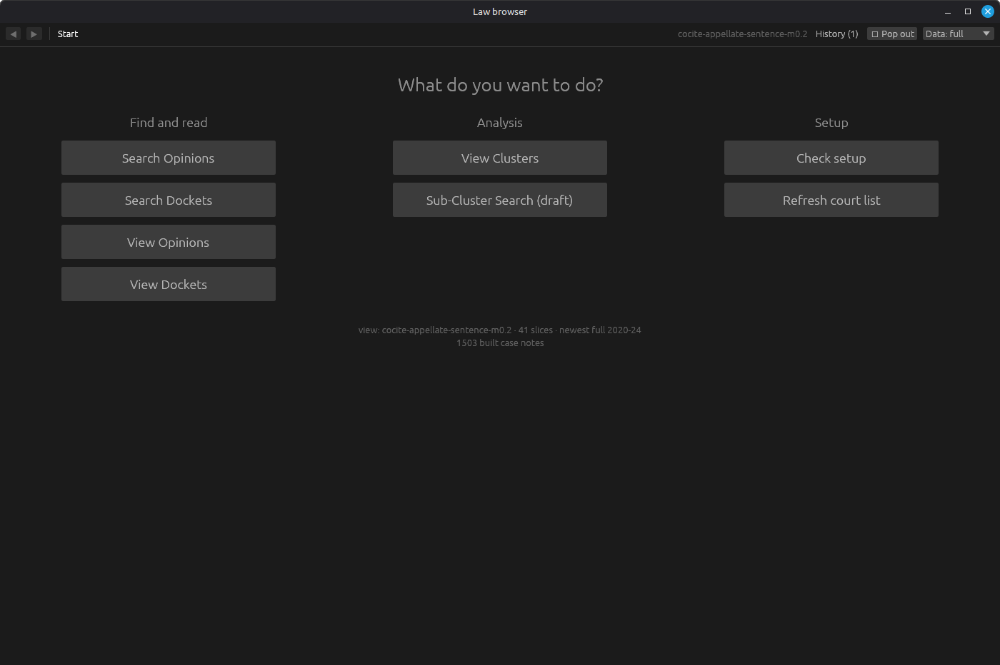 | 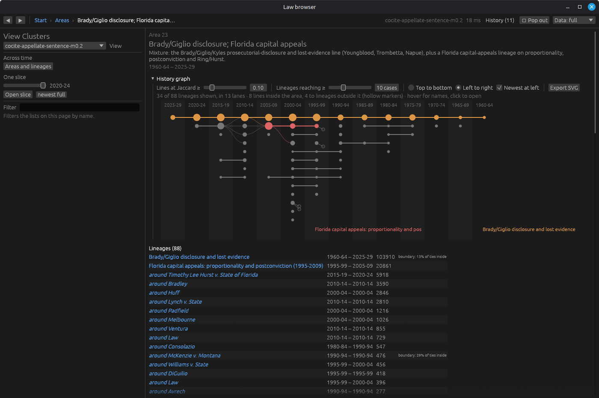 |
| **A case page** | **Search what later courts said** |
| 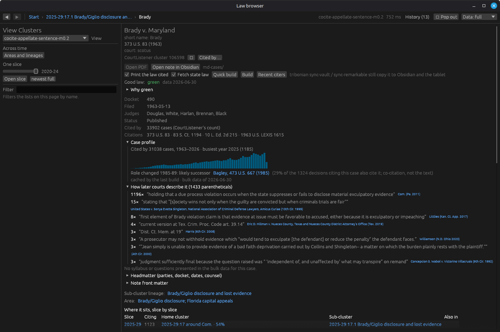 | 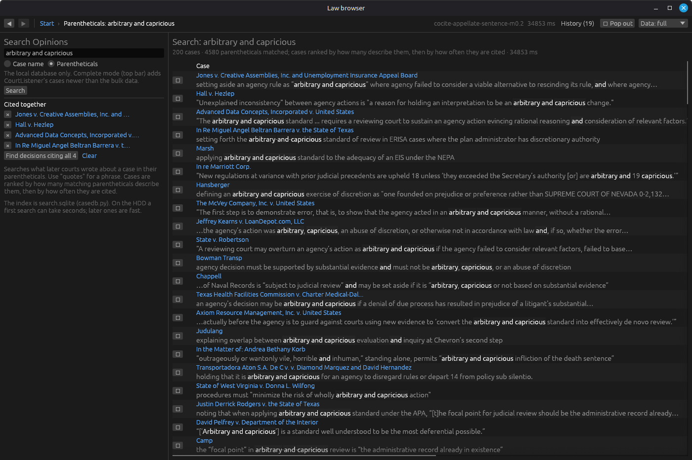 |
| **View Dockets: federal and state courts** | **A docket: its documents, what's in RECAP, what's on PACER** |
| 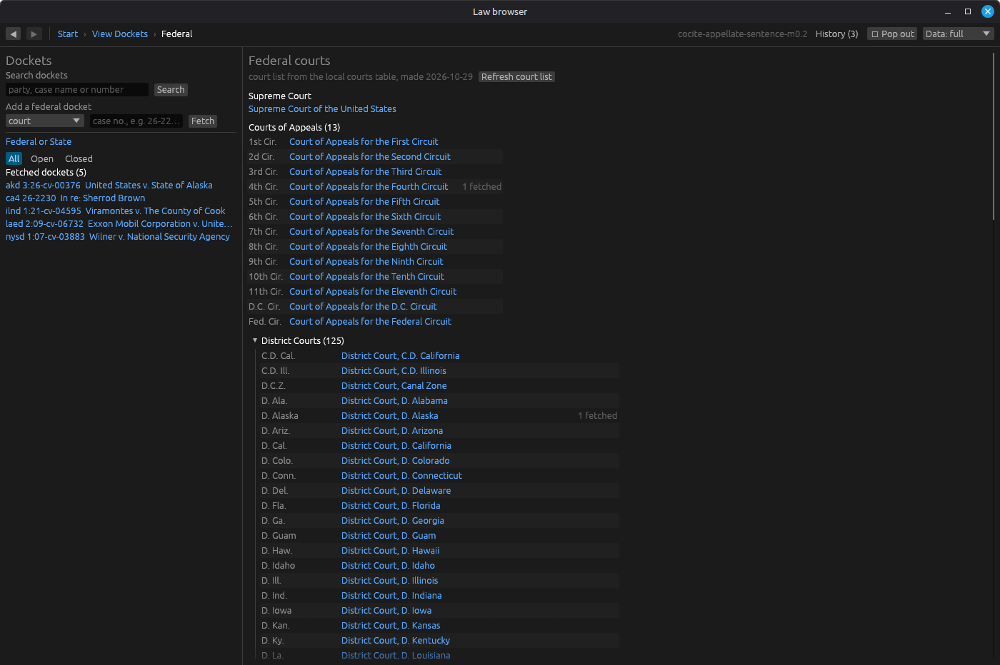 | 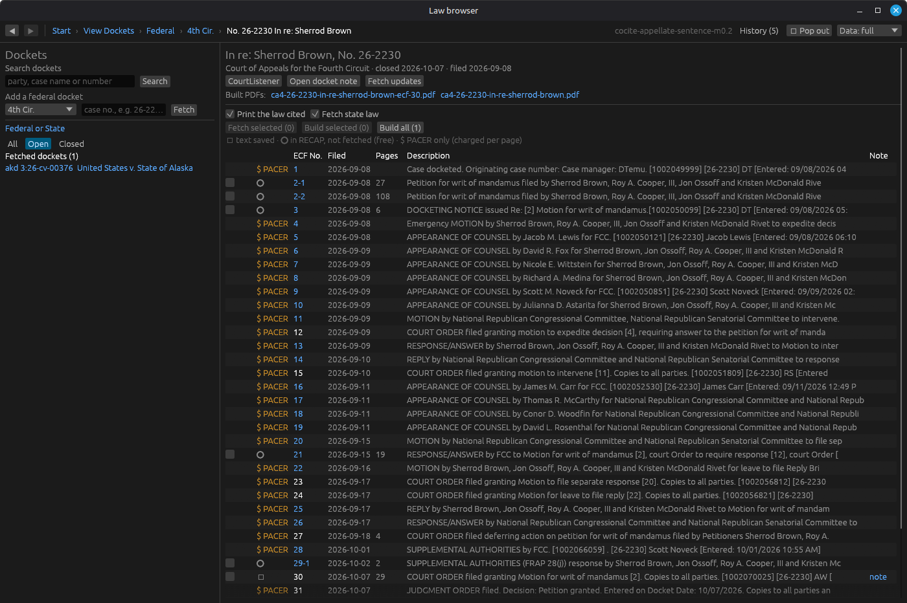 |

**Sub-Cluster Search from a draft:** CourtListener semantic search per five-year slice, re-ranked by semantic score and grouped by co-citation sub-cluster

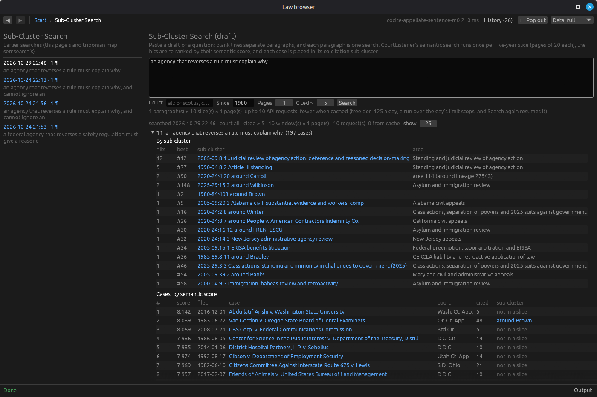

## Getting started

A walk from an empty machine to everything working: US Code PDFs, case notes, the local CourtListener database,
the co-citation map and the GUI. Each stage works on its own, so you can stop after any of them.
After any stage, `tribonian check` shows what is there, whether each database answers a query, and the fix for
anything missing (see [Database health](#database-health)).

| You want | Stages |
|---|---|
| US Code PDFs and notes | 1, 2 |
| Court opinions by citation, no local database (`tribonian case build --no-goodlaw`) | 1, 3, 6 |
| Pending Supreme Court cases (`tribonian scotus`) | 1 (no account) |
| Good-law check, case profiles, `find`, citation walks | 1, 3, 4 |
| Co-citation clusters, areas, sub-cluster explainers | 1, 3, 4, 5 |
| Desktop browser (`gui/`) | 1, 4, 5, 8 |
| Obsidian and reMarkable | 7 |

### 1. Install

Linux (tested on Debian/Ubuntu, Python 3.10). For macOS and Windows, see [INSTALL.md](INSTALL.md).

```
git clone https://github.com/deembed/tribonian-us.git && cd tribonian-us
sudo apt install texlive-latex-extra texlive-fonts-extra texlive-plain-generic \
                 poppler-utils curl lbzip2 libsecret-tools
python3 -m venv ~/.venvs/tribonian && . ~/.venvs/tribonian/bin/activate
pip install -e '.[test]'            # the `tribonian` command; -e: edits to src/ take effect at once
mkdir -p xml bulk db                # db/ must exist before stage 4, or the opinion text lands beside the main database
python -m pytest -q                 # smoke tests; no network, no database
tribonian check                     # what is installed and loaded so far, with a fix for each gap
```

`tribonian` with no arguments lists the commands; `tribonian <command> --help` shows each one's options.
With the distro's packages instead of pip's (`sudo apt install python3-lxml python3-numpy python3-scipy
python3-igraph`), make the venv with `--system-site-packages` and install with `pip install --no-deps -e .`.

**The work folder.** Everything the commands read and write (`xml/`, `cases/`, `md*/`, `pdf/`, `build/`,
`state/`, `bulk/`, `db/`) lives in one folder, and every command runs there, so relative paths in arguments
(`xml/usc05.xml`, `cases/<file>.json`) are relative to it. In a checkout it is the checkout itself, as above;
set `work_dir` in the config file (or `TRIBONIAN_WORK`) to keep the data elsewhere. `tribonian` prints it at
the bottom of its command list, and `tribonian check` shows where the value came from.

`bulk/` and `db/` can be symlinks to another disk, or set `bulk_dir` and `opinions_db` in the config file
(see [Configuration](#configuration)). Put `db/` on the fastest disk:
the opinion text is read hard by the good-law check and `tribonian cocite positions`.

### 2. US Code (no account)

1. Download the XML from the Office of the Law Revision Counsel: <https://uscode.house.gov/download/download.shtml>,
   "XML" for all titles (one zip) or for single titles.
2. Unzip into `xml/`, so you have `xml/usc01.xml`, `xml/usc02.xml`, ...
3. Build:

```
tribonian build usc          # -> pdf/<n>-usc-ch<NN>.pdf (one per chapter) and md/t<NN>/ch<NN>/ notes
tribonian build --todo usc   # what would be built, without building
```

When a new release point comes out, replace the files in `xml/` and rerun; only changed titles are rebuilt.

The notes built now have no `## Cited with`, `## Cited by` or `## Recent appellate cites` sections; those need
stage 5, whose last step rewrites the notes. The PDFs don't change.

### 3. CourtListener account and API token

1. Make a free account at <https://www.courtlistener.com/> and copy your API token from your profile's API page.
2. Store it, either way:

```
secret-tool store --label='CourtListener API' service courtlistener   # GNOME keyring (paste the token)
export COURTLISTENER_TOKEN=...                                         # or an environment variable
```

3. Check it: `tribonian case fetch --cite "463 U.S. 29"` then `tribonian case usage`.

The free tier allows 5 requests a minute, 50 an hour, 125 a day; commands pace themselves and resume from the
cache. With a paid tier set `CL_LIMITS=10,75,300` (your limits).

### 4. Local database (CourtListener bulk data)

The good-law check, case profiles, `find`, `casemap.py` and everything in stage 5 read this, not the API.

1. Open the bulk-data listing:
   <https://com-courtlistener-storage.s3-us-west-2.amazonaws.com/list.html?prefix=bulk-data/>
2. Download these seven files from **one** quarterly set (same date on all), into `bulk/`, keeping their names
   (`<name>-YYYY-MM-DD.csv.bz2`):

| File | Loaded as |
|---|---|
| `courts-…` | `courts` |
| `citations-…` | `cites` |
| `parentheticals-…` | `parens` |
| `citation-map-…` | `edges` |
| `opinion-clusters-…` | `clusters` |
| `dockets-…` | `dockets` |
| `opinions-…` (by far the largest) | `db/opinions.sqlite` |

```
cd bulk
D=2026-06-30      # the date of the set you picked
for f in courts citations parentheticals citation-map opinion-clusters dockets opinions; do
  curl -fLO -C - "https://com-courtlistener-storage.s3-us-west-2.amazonaws.com/bulk-data/$f-$D.csv.bz2"
done
cd ..
```

(`-C -` resumes an interrupted download.) Then load:

```
tribonian db load      # every file in bulk/, smallest first; a finished table is skipped, so rerun after an interruption
tribonian db status    # each table: file, rows, when loaded
tribonian db index     # full-text index for case2md.py find (load rebuilds it when clusters or parentheticals change)
tribonian db courtindex   # dockets by court: View Dockets lists a court's opinions locally (load builds it with dockets)
```

Disk: the opinion text alone is about 110 GB in `db/opinions.sqlite`; the main database (`bulk/courtlistener.sqlite`)
is about 25 GB; plus the downloads themselves, which you can delete once `status` shows every table loaded.
A load stops on a truncated file ("incomplete download?") instead of loading part of it.

Check it: `tribonian map goodlaw --cite "467 U.S. 837" --quick` should come back red.

**Updating:** CourtListener publishes a new set each quarter (last day of March, June, September, December).
Download the new set, `tribonian db load --force <name>` for each table, then redo stage 5 from `prep`.

### 5. Citation maps (co-citation clusters)

Case notes read two co-citation views built from appellate citing decisions:

- `appellate-sentence-m0.2` (`NOTE_VIEW` in `cocite.py`): clusters, sub-clusters, areas, "What it draws on";
  pairs weighted by same-sentence co-citation.
- `appellate` (binary): the "likely successor" line in the case profile (`cocite_shift.py` was evaluated there).

Run in this order; each step reads what the one before wrote.

```
tribonian cocite prep                                                    # 1. one pass over the database -> bulk/cocite-cache/
tribonian cocite build --courts appellate                                # 2. binary view -> bulk/cocite-appellate.sqlite
tribonian cocite positions                                               # 3. where every citation sits in the text (all cores, resumable)
tribonian cocite positions --status                                      #    shards done / to do; rerun step 3 until none are left
tribonian cocite positions --index                                       # 4. sort those rows by decision -> cocite-cache/posidx/
tribonian cocite build --courts appellate --weight sentence --mix 0.2    # 5. the note view -> bulk/cocite-appellate-sentence-m0.2.sqlite
```

`build` re-attaches the tracked lineage labels (`data/cocite_labels.json`) by itself. Then the areas and the vault
notes, once per view you want them in (the same flags pick the view):

```
V="--courts appellate --weight sentence --mix 0.2"
tribonian cocite areas $V --method cpm --resolution 0.5 --shrink 10 --consensus 20   # 6. group lineages into areas
tribonian cocite labels check $V                                         #    stable / drifted / displaced / orphaned labels
tribonian cocite status $V                                               #    per slice: nodes, cut, modularity vs chance
tribonian cocite vault $V                                                # 7. md-cocite/: Co-citation map.md, Areas/, Lineages/
```

Then the US Code in the map, and the US Code notes again so they get their `## Cited with` section:

```
tribonian cocite usc-extract                 # 8. every US Code cite in the opinion text -> cocite-cache/usc/ (all cores, resumable)
tribonian cocite usc-map                     # 9. old Code numbers -> current, from xml/ (also sharpens case notes' old-cite marks)
tribonian cocite usc-profile                 # 10. sections per sub-cluster, note view -> cocite-cache/usc/profile-<view>.sqlite
tribonian cocite usc-citedby                 # 11. most cited and newest appellate decisions per section -> cocite-cache/usc/citedby.sqlite
MD_ONLY=1 tribonian build usc            # 12. rewrite the US Code notes (notes only, every title; PDFs untouched)
```

Each US Code note then ends with three derived sections, each left out until its step has run:

- **Cited with** (step 10): per five-year slice, the co-citation sub-clusters whose appellate decisions cite the section most.
- **Cited by** (step 11): the 20 decisions from any court citing the section that later decisions cite most
  (decisions citing each one in the local citation map). A reused number gets a separate list for cites before the reuse.
- **Recent appellate cites** (step 11): Supreme Court, circuit and state supreme and appellate decisions citing it,
  per year for the last 5 years, then the 20 newest by filing date. It stops at the bulk data's date.

Cases link to your case note when you have one, otherwise to CourtListener. `--top` and `--years` change the
list length and the years counted; `tribonian usc --no-cocite` leaves all three out.

Optional:

```
tribonian cocite areas --courts appellate --method cpm --resolution 0.5 --shrink 10 --consensus 20   # areas for the binary view too (GUI)
tribonian cocite subdoc 2020-24:2.3          # explain one sub-cluster -> md-cocite/Sub-clusters/, pdf/Co-citation/
```

Check it: `tribonian cocite note --cite "463 U.S. 29"` previews the co-citation section State Farm's note will get.

A rebuild of the bulk data or a schema change in `cocite.py` means rerunning from `prep` (read commands say
"rebuild with tribonian cocite build" when a view is out of date). `positions` only redoes shards whose extractor
`VERSION` changed.

### 6. First cases

```
tribonian map get --cite "463 U.S. 29"            # from the local database, no API -> cases/*.json + note
tribonian case fetch --cite "463 U.S. 29"          # or from the API, when you have no local database
tribonian case build cases/463-u-s-29_*.json       # -> md-cases/, pdf/   (--quick-goodlaw: fast check; --no-goodlaw without the database)
tribonian map map --cite "463 U.S. 29"            # notes for the case's whole sub-cluster (needs stage 5)
tribonian build cases                             # build every case PDF that is missing or out of date
tribonian scotus fetch 25-579 && tribonian scotus build 25-579   # a pending Supreme Court case (no account)
```

### 7. Obsidian and reMarkable

```
VAULT=~/Obsidian/usc-vault DRY=1 tribonian sync-vault  # see what it would do; it mirrors (and deletes) inside 08-Reference/ only
VAULT=~/Obsidian/usc-vault tribonian sync-vault
tribonian sync-remarkable --dry-run                    # needs rmapi paired first (RMAPI_HOST for rmfakecloud)
tribonian sync-remarkable
```

Install [`rmapi`](https://github.com/ddvk/rmapi) and run it once to pair with the reMarkable cloud, or with a
self-hosted [rmfakecloud](https://github.com/ddvk/rmfakecloud) (`RMAPI_HOST=http://<host>:3000`).

### 8. Desktop browser

Needs Rust 1.85+ (<https://rustup.rs/>) and stages 4–5.

```
cd gui
cargo run --release              # no setup: the app reads the scripts' settings
```

The app runs `.tribonian check --paths` at start, so it uses the same files and the same config file as the scripts.
Its own settings (default view, Obsidian vault, interpreter) go in the config file's `[gui]` table (see
[Configuration](#configuration)).

```
```

Details in [`gui/README.md`](gui/README.md).

## Everyday use

```
tribonian case fetch --cite "463 U.S. 29"   # 1. get a case (or drop new XML into xml/)
tribonian build                             # 2. build every PDF that is missing or out of date
tribonian sync-vault                        # 3. notes -> Obsidian vault
tribonian sync-remarkable                   # 4. PDFs -> reMarkable
```

## Folders

All of these are in the work folder (the checkout, unless `work_dir` says otherwise); the code is in
`src/tribonian/`, one module per command, with the shell scripts in `src/tribonian/sh/`.

| Folder | What's in it | Written by |
|---|---|---|
| `xml/` | US Code, USLM XML from [uscode.house.gov](https://uscode.house.gov/download/download.shtml) | you |
| `cases/` | one `.json` per case with full text; `cases/recap/<court>/` for district and appeals court dockets | `tribonian case fetch`, `tribonian map get`/`stubs` |
| `cases/stubs/` | cases known only from the citation graph (no text yet) | `tribonian map map` |
| `cases/unparsed/` | text fetched but not in a format `build` can read; left out of builds | `tribonian map stubs --api` |
| `cases/scotus/` | pending Supreme Court dockets: `<docket>.json` plus `<docket>/` with the filed PDFs and their text; `_recent.json` + `_recent/` (recent opinions, grants, orders) | `tribonian scotus fetch`, `tribonian scotus recent` |
| `md/` | US Code notes, one per section, in `t<NN>/ch<NN>/` | `tribonian build` |
| `md-cases/` | case notes (full and stub); subfolders such as `FOIA/` and `Pending SCOTUS/` | `tribonian case`, `map`, `scotus` |
| `md-cocite/` | co-citation notes: `Co-citation map.md`, `Areas/`, `Lineages/`; `Sub-clusters/<slice>/` explainers | `tribonian cocite vault`, `tribonian cocite subdoc` |
| `pdf/` | the PDFs; case PDFs mirror `md-cases/` subfolders; `Co-citation/<slice>/` sub-cluster explainers | `tribonian build`, `tribonian case build`, `tribonian scotus build` |
| `build/` | `.tex`, logs, scratch; disposable | the build |
| `state/` | `built.tsv` (what each job built), skip stamps, `rm_manifest.json` (what is on the tablet); keep | `tribonian build`, `tribonian sync-remarkable` |
| `build/cocite/` | co-citation evidence files, benchmark output, shift eval | `tribonian cocite` |
| `bulk/`, `db/` | CourtListener bulk files and the local SQLite databases | `tribonian db` |
| `tests/` | smoke tests: `python -m pytest` | you |

Everything the scripts generate is ignored by git (`.gitignore`); tracked are the code, the docs, `tests/`, `src/tribonian/data/cocite_labels.json` and `cocite_gold.json` (hand- and model-written inputs that can't be rebuilt), and `templates/`.

## `tribonian build` — build everything out of date, in parallel

```
tribonian build                  # everything out of date
tribonian build cases            # only cases/ and cases/recap/   (or: usc)
tribonian build --todo           # list what would be built; build nothing
tribonian build --stubs cases    # fill stub notes first (casemap.py stubs), then build
FORCE=1 tribonian build          # rebuild regardless of dates (after changing a generator)
tribonian build list.txt         # build exactly the jobs in a list, always
tribonian build build/failed_jobs.txt   # retry last run's failures
```

Sources it scans: `xml/*.xml` (one PDF per chapter), `cases/*.json`, `cases/recap/<court>/*.json`.

How it decides what to build: `state/built.tsv` records the PDF that each successful job made. A job gets built when it has no record, its PDF is gone, or its source is newer than its PDF. Failures aren't recorded, so the next run retries them. The list of jobs that were due is saved in `build/todo.txt`.

Environment settings:

| Variable | Default | Effect |
|---|---|---|
| `JOBS` | number of cores | parallel jobs |
| `STYLE` | `boxes` | `boxes` or `rails` |
| `FONT` | `XCharter` | LaTeX font package |
| `EXTRA` | — | US Code generator flags, e.g. `"--credits --notes"` |
| `MD_ONLY` | — | `1`: notes only, no PDFs (ignores dates, records nothing) |
| `FORCE` | — | `1`: ignore dates |
| `STUB_ARGS` | — | options passed to `tribonian map stubs` with `--stubs` |
| `SCRATCH` | `build` | where per-job scratch folders go |

List file format (one PDF per line, `#` for comments):

```
cases/463-u-s-29_motor-vehicle-mfrs....json       # a case (cases/recap/... = a docket)
xml/usc05.xml /us/usc/t5/s552 /us/usc/t5/s552a    # these sections in one PDF
xml/usc05.xml /us/usc/t5/ptI/ch5                  # one chapter
xml/usc05.xml                                     # a whole title
```

After a run, failures are in `build/failures.txt`, and pdflatex logs for failed builds are in `build/<name>.log`.

## `tribonian usc` (usc2md.py) — one US Code selection → notes + LaTeX

`tribonian build` runs this for every chapter. Run it yourself for one section or any selection:

```
tribonian usc xml/usc05.xml --list-chapters
tribonian usc xml/usc05.xml --list                           # section identifiers
tribonian usc xml/usc05.xml --section /us/usc/t5/s552        # -> md/t05/.../5-usc-552.md and pdf/5-usc-552.pdf
tribonian usc xml/usc05.xml --chapter /us/usc/t5/ptI/ch5
tribonian usc xml/usc08.xml --section /us/usc/t8/s1101 --credits
```

Sections are named by their full identifier (`/us/usc/t8/s1101`, not `1101`); `--list` prints them.
Other flags: `--all`, `--name`, `--credits` (source credits under headings), `--notes` (editorial and statutory notes), `--no-cocite`, `--style`, `--font`.
Without `--out`, the notes go to `md/` and the PDF is compiled into `pdf/` (the `.tex` stays in `build/`). With `--out DIR`, it writes the `.md` tree and the `.tex` into DIR and stops; that is what `tribonian build` does before compiling.

The PDF ends with the same derived sections as the note (Cited with, Cited by, Recent appellate cites, when built; see step 11), with the newest 10 recent cites instead of 20 and no links to other notes.

## `tribonian case` (case2md.py) — court opinions (CourtListener)

Each case note and PDF has, above the opinions:

- **Case profile** (light-blue box in the PDF): cited-by counts per year as a bar chart, the last 5 full years against the 5 before (rising / steady / falling), and the **good-law check**. It needs the local database; the counts are cached in `cases/citedby/<cluster>/profile.json` and recounted when the bulk data changes.
- **Headmatter** (yellow box in the PDF): parties, docket number, dates, counsel, from the published report (Harvard CAP), when the cluster has it.
- **What it draws on** (orange box in the PDF, after the co-citation box): where the cases this one cites sit in the co-citation map, each cited case's sub-cluster in the newest full slice, with counts, shares, areas and how many cited cases are unclustered (`cocite.draws_on`, bibliographic coupling). It works for any case, so for a case the map doesn't hold (cited too rarely, recent, unpublished) it is the main placement. Every build; well under a second.
- **Coupled with** (pale orange box): the cases citing the most of the same cases, rare shared citations weighted up. Only when `tribonian map coupling` has cached `cases/citedby/<cluster>/coupling.json` for the case, or with `build --coupling`, which computes it first.

Good-law check: no language model, just the words later courts use about this case, next to its citations and in sentences that name it ("Chevron is overruled."). It reads every citing opinion from a court that could overrule the case (up to 1,500), plus the 500 newest from any court.

- **red** — "overruled", "abrogated", "superseded", "overturned", "reversed"/"vacated" as subsequent history right after the citation ("…, 467 U.S. 837 (1984), overruled by …"), "X is overruled", "we overrule X", "(overruling X)" — from a court that could overrule it, or from two lower courts.
- **yellow** — any other such word, "on other grounds", or softer words right next to the citation ("questioned", "called into doubt", "declined to follow", "limited to its facts") three times, or twice from a court above.
- **green** — none found in what was read.

Not counted: hypotheticals and arguments ("unless Roe is overruled", "defendant argues that Apodaca has been overruled", "the Court will declare…"), the case doing the overruling ("Brown … (overruling Plessy)"), negated or quoted softer words, and another case with the same name ("Aguilar v. Texas" for Aguilar v. Felton).

The chart's bars take the colour of the status as of that year. It is a pointer to what to read (the opinions behind the flag are listed), not a citator.

```
tribonian map goodlaw --cite "467 U.S. 837"               # the check for one case, with its evidence
tribonian map goodlaw --cite "467 U.S. 837" --show Loper  # plus every citation in opinions mentioning "Loper"
tribonian map goodlaw --cite "467 U.S. 837" --quick      # quick check: only the newest 100 citing opinions (--quick N)
tribonian goodlaw-eval collect                                # read the 60 test cases once (slow; resumable)
tribonian goodlaw-eval score -v                               # score each ruleset; -v lists the misses
tribonian goodlaw-eval show "410 U.S. 113" R9                 # one test case under one ruleset
```

**Quick good-law check** (`--quick`, `--quick-goodlaw`, the GUI's Quick build, `subdoc --goodlaw`): reads only the newest 100 citing opinions from any court, so it gives the status now but not the year it changed (`"mode": "quick"` in profile.json; shown as "(quick)"). A full Build redoes a quick result; a quick request keeps a current full one. Measured on `goodlaw_eval.py`'s 60 cases: 34 of 40 overruled cases red, 4 yellow, 2 green (full check 37/2/1); 19 of 20 never-overruled cases green (full check 14). The test cases are all Supreme Court cases overruled loudly; lower-court overrulings may be flagged less often by later citers.

`goodlaw_eval.py` tests the rules on 40 Supreme Court cases whose overruling year is known (set A tuned the rules; set B is a soft check) and 20 that were never overruled. A hit is red from one year before to five years after the overruling. The current rules (R9): set A 17 of 20 hits, controls 8 green, 2 yellow, 0 red; set B 18 of 20, controls 6 green, 4 yellow, 0 red. (The first version: 13 and 16 hits, 3 controls red.) Set B was consulted once during tuning (the same-name rule came from it), so it is a soft check, not a clean holdout; the controls were watched throughout. After changing the rules in `casemap.py`, bump `GOODLAW_VERSION` and rerun `score`.

```
tribonian case fetch --cite "463 U.S. 29"         # or --cluster 110991   (uses the API)
tribonian case build cases/463-u-s-29_*.json      # -> md-cases/, build/, pdf/   (--no-pdf: notes only; --no-goodlaw: skip the slow good-law check; --quick-goodlaw [N]: the quick check instead, newest 100 citing opinions; --coupling: compute the coupled cases first; --fetch / --fetch-state-law: get the cited federal / state law that is not local)
tribonian case find glomar                        # search your notes, then the local database (--max N results per list)
tribonian case find glomar --get 3                # take result 3 from the database and build it
tribonian case recap fetch --docket 4949363       # the court's orders and opinions (uses the API)
tribonian case recap fetch --docket 4949363 --docs 35,55,12-1   # these documents (12-1 = attachment); --all: everything
tribonian case recap build cases/recap/<court>/<docket>.json             # --docs 35,55: only these
tribonian case usage                              # API requests used; --days N for history
```

- **Cite tints:** every cite in the PDF has a faint tint: green when it resolved (the case is in CourtListener or the local database; the law's text is local), red when it did not (no such case or provision found, or not fetched yet), orange when the law has no source here. The PDF ends with *Cites not resolved*, the red and orange ones with their reasons and pages. `CITE_MARKS=0` turns the tints off.
- **The Law Cited:** the PDF ends with every statute, constitutional provision and regulation the opinions cite (federal and state), once each, with its text where it is stored locally; every cite in the opinion links to its entry, and the note lists them under "The law cited". The text is today's, not the law as of the decision; a cite's edition parenthetical ("(West 2019)") is shown beside it. State law that is not local is fetched with `--fetch-state-law` (the GUI's "Fetch state law" checkbox, on by default); a code with no usable source prints "source error" and why. For a code whose site has a page per section (or per chapter), this fetch is sparse: only the cited sections' pages, so the local title is partial until `tribonian state fetch` gets the whole of it. Different states are fetched side by side, each one a request at a time. See [State law cites](#state-law-cites).
- **Where notes go:** a note that already exists anywhere in `md-cases/` is rewritten in place, so moving a note (inside `md-cases/`, not in the vault) is how you file it. New notes follow the `FOLDERS` table in the script (for example, Freedom of Information Act and Privacy Act cases go to `FOIA/`).
- **Old US Code cites:** every Code cite in the opinion text is checked against the current Code (`xml/`, plus `usc_map.json` from `tribonian cocite usc-map` when it exists), judged at the year the cite is as of: its edition parenthetical ("(1976 ed., Supp. V)" ≈ 1981), else the decision year. A changed one is highlighted yellow and tagged: **mv** renumbered (struck, current number given), **rep** repealed (struck; successor given when the stub names one), **om** omitted (struck), **pre** current section enacted after the cite, so the number meant something else (struck), **nf** not in the current Code (struck), **amd** same number, amended since (highlighted, not struck; year of the latest amendment). Section level only, and approximate: a tag means look closer. `USC_MARKS=0` turns it off. Check one cite: `tribonian usc-status "42 U.S.C. § 1973(b)" --year 1986`.
- **API token:** `COURTLISTENER_TOKEN`, or the GNOME keyring (`secret-tool store --label courtlistener service courtlistener`).
- **Rate limits:** free tier 5 a minute, 50 an hour, 125 a day; set `CL_LIMITS=10,75,300` for a paid tier. Requests pace themselves. At the daily limit a command stops cleanly, and rerunning it resumes from the cache.
- **Usage log:** `cases/_api_log.json` keeps the last 24 hours (used for the limits). `cases/_api_history.tsv` keeps every request (time, command, API path). Any command that made requests ends with `CourtListener API: N requests by this command; M of 125 left today`.

## `tribonian scotus` (scotus.py) — a pending Supreme Court case (supremecourt.gov, no API limit)

```
tribonian scotus fetch 25-579                        # the Court's docket + every filed PDF -> cases/scotus/ (rerun: only new filings)
tribonian scotus build 25-579                        # -> pdf/Pending SCOTUS/<slug>.pdf, md-cases/Pending SCOTUS/<slug>.md + a note per filing
tribonian scotus build 25-579 --amici --appendix     # amicus briefs in the PDF too; keep the appendices
tribonian scotus build 25-579 --depth 1 --text 1     # also case notes for the decision below and every cited case, then tribonian build
tribonian scotus build 25-579 --no-goodlaw --no-pdf  # skip the good-law check of the cited cases; skip pdflatex
tribonian scotus build 25-579 --fetch --fetch-state-law   # first get the cited federal (C.F.R.) and state law that is not local
tribonian scotus recent [--json] [--days 365]        # the Court's last year: opinions, grants, orders -> cases/scotus/_recent.json
```

- **`recent`:** reads the slip-opinion pages (`opinions/slipopinion/<term>`), the Granted & Noted lists (`orders/<term>grantednotedlist.pdf`) and every order list and miscellaneous order of the last year (`orders/ordersofthecourt/<term>`, PDFs kept in `cases/scotus/_recent/`), and writes `cases/scotus/_recent.json` atomically. There is no public list of all pending cert petitions; one appears only when the Court acts on it. The GUI's SCOTUS page shows the result.
- **`fetch`:** reads the docket's JSON feed and downloads each linked PDF (proofs of service and certificates skipped) to `cases/scotus/<docket>/`, with `pdftotext -layout` beside it. Not CourtListener, so no rate limit.
- **`build`:** one PDF in parts: the question presented, the decision below (from the local database), the cert-stage filings, the merits filings. Notes: the docket note and one per filing, each with a Statutes cited list. Amicus notes are always written; `--amici` puts the briefs in the PDF as well. `--font`, `--style` and `--no-pdf` as for `tribonian case build`.
- **Authorities and their status:** each filing's reporter citations resolved through the local database, and which filings share them. Two tables: *Common authorities* (one row per case both sides cite, with its good-law status and each side's mentions, plaintiff below on the left) and *Each side's own* (two columns, one per party). Status comes from `tribonian map goodlaw`, cached per case; red is a lead to check, not a holding. `--no-goodlaw` skips it (slow the first time).
- **`--depth N`:** the crawl `tribonian map map --depth` does, rooted at the decision below and the filings' authorities: full text for the first `--text` steps (default 1), stubs beyond; `--max` (3000) stops a runaway crawl. It writes the same `cases/*.json` and notes, so `tribonian build` builds their PDFs; rerun `tribonian scotus build` afterwards so its notes link to them.
- **The Law Cited:** the PDF's last part is every provision the filings cite: the law in question first (the questions presented and the parties' provisions-involved sections), then by who cites it (both parties, petitioners, respondent, amici only), each with its mention counts and its text where it is local. Every cite in the PDF links to its entry. Forms that don't name their state ("Penal Code § 187") are read as the court below's state (a circuit: its states).
- **Not a `tribonian build` job:** `tribonian build` has no scotus job kind (`cases/scotus/` is not scanned), so `tribonian scotus build` makes the PDF itself. Rerun it after new filings arrive.

## `tribonian map` (casemap.py) — citation graph (no API unless `--api`, `recent` or `semsearch`)

```
tribonian map get --cite "401 U.S. 402"          # one case from the local database -> cases/*.json + note
tribonian map map --cite "463 U.S. 29"           # notes for the root's co-citation sub-cluster (the default, --by cluster)
tribonian map map --cite "463 U.S. 29" --depth 2 # the citation walk instead: everything within 2 citation steps
tribonian map citedby cases/463-u-s-29_*.json    # "Cited by" section: who cites it, for what
tribonian map coupling --cluster 9493818         # coupled cases: who cites the same (rare) cases -> coupling.json
tribonian map stubs --list                       # stub notes, most-cited first
tribonian map stubs                              # fill stubs from the local database
tribonian map stubs --api --max 20               # fall back to CourtListener for the rest
tribonian map stubs brown 108283                 # only matching note names or cluster IDs
tribonian map fixlinks                           # give bare courtlistener.com/opinion/<id>/ links in md-cases/ their slug
tribonian map semsearch "plain-language text"    # semantic search (API), re-ranked, grouped by sub-cluster
tribonian map semsearch --file draft.md --since 1980 --court scotus   # one search per paragraph of a draft
```

- **`map --by cluster`** (the default): the cases in the root's sub-cluster lineage in the newest full slice of `cocite.py`'s case-note view, plus cases that joined it since, heaviest first, up to `--cluster-max` (60); all get full text (`--text 0`: stubs only). `--scope all` takes every lineage the root has belonged to; `--courts` picks another `cocite.py` view.
- **`map --depth N`** (or `--by depth`): the citation walk. `--text K` gives full text to the first K steps (default `depth - 1`); the outer ring becomes stubs. `--max` (3000) caps either kind of map.
- **`citedby`:** options are `--list`, `--full`, `--level`, `--sample-over`, `--margin`, `--top`, `--steps` and `--min-run`; see `tribonian map citedby -h`.
- **`coupling`:** bibliographic coupling. For each case it cites, cited by df decisions (at most `--max-df`, default 2000; more-cited ones are left out and counted), every other decision citing it scores log(N/df), N = decisions citing anything; the top `--top` (30) by total score, with the shared cited cases. Reads `bulk/cocite-cache/` (run `tribonian cocite prep` first), a few seconds for most cases, up to half a minute for a case citing 150+ cases on a cold disk. Prints a table (`--json`: the JSON) and caches `cases/citedby/<cluster>/coupling.json` with the bulk data's stamp; never run by a build. The GUI's "Find coupled cases" runs it.
- **`stubs`:** a stub becomes a full case only if `build` can read its text. Otherwise it stays a stub and the output says why. After filling stubs, run `tribonian build cases`, or use `tribonian build --stubs` to do both.
- **`semsearch`:** CourtListener's semantic search (`semantic=true`), one search per date window per paragraph: the five-year slices of the case-note view ending in or after `--since` (default 1980; `--since 1700` for all; `--window START:END` sets windows by hand), `--pages` pages of 20 per window (default 1), only cases cited more than `--cited-gt` times (default 5; 0 = off: an uncited case can't be in a slice, so it could never get a sub-cluster). Windows exist because the server's own order has a strong recency boost: one undated search returns only recent cases. The server orders hits by its keyword (bm25) score with a recency boost, so everything is re-ranked by `meta.score.semantic`; records of one decision (same name without "Revisions: …", same date) collapse to the most-cited one. Each hit gets its sub-cluster and area from the co-citation view, as of the newest complete slice it is in. Writes `cases/semsearch/<slug>/results.json` (`--out DIR` to choose), with a per-paragraph roll-up by sub-cluster. Cost: paragraphs × windows × pages requests through the shared throttle; raw responses are cached in `cases/semsearch/_cache/`, so reruns are free and a run stopped at the daily limit resumes. The GUI's "Sub-Cluster Search (draft)" runs it.
- **`fixlinks`:** takes no options (it is handled before argparse); rewrites notes and saved Cited-by sections in place and needs the local database.

## `tribonian db` (casedb.py) — local CourtListener database

```
tribonian db load                  # every bulk file in bulk/, smallest first; finished tables skipped
tribonian db load citation-map     # one table: courts citations citation-map parentheticals
                                  #            opinion-clusters dockets opinions
tribonian db status
tribonian db columns               # per bulk file: columns loaded, columns left out
tribonian db index                 # full-text index for case2md.py find
tribonian db courtindex            # dockets by court, for a court's opinions in View Dockets
tribonian db case cases/<case>.json   # smoke test
```

The bulk files are in `bulk/` (`CL_BULK`), the database is `bulk/courtlistener.sqlite` (`CL_DB`), and the opinion text (about 110 GB) is in `db/opinions.sqlite` (`CL_OPS_DB`).

## `tribonian cocite` (cocite.py) — co-citation clusters, five years at a time

```
tribonian cocite prep                  # one pass over the database -> bulk/cocite-cache/ (rerun after a bulk load)
tribonian cocite build                 # cluster every slice, then link clusters across slices into lineages
tribonian cocite build --slices 2005   # one slice (2005-09) only
tribonian cocite status
tribonian cocite case --cite "463 U.S. 29"      # its clusters and top co-cited partners, slice by slice
tribonian cocite cluster 2005-09:3              # one cluster: members, sub-clusters, what it came from / turned into
tribonian cocite cluster 2010-14:1.3            # one sub-cluster
tribonian cocite tree 2010                      # one slice: clusters, each with its sub-clusters
tribonian cocite note --cite "463 U.S. 29"     # preview the ## Co-citation section a case note gets (appellate view)
tribonian cocite lineage 17                     # one lineage across slices
tribonian cocite subdoc 2020-24:2.3              # explain one sub-cluster -> md-cocite/Sub-clusters/2020-24/ + pdf/Co-citation/2020-24/
tribonian cocite subdoc 2020-24:2.3 --goodlaw    # the same, after the quick good-law check on members never checked (--goodlaw full: the slow one)
tribonian cocite together --cite "550 U.S. 544" --cite "556 U.S. 662"   # same cluster? decisions citing both
tribonian cocite diag                           # citing decisions per slice, by court level
tribonian cocite build --courts appellate       # only appellate citing decisions -> bulk/cocite-appellate.sqlite
tribonian cocite tree 2010 --courts appellate   # every read command takes --courts too
tribonian cocite shift --cite "375 U.S. 384" --courts appellate   # good-law signals from cluster change, per slice transition
tribonian cocite shift --eval --courts appellate                   # the same, scored on goodlaw_eval.py's cases
```

Two cases are co-cited when one later decision cites both. Citing decisions are sliced by filing year. In each slice:

- **Nodes:** cases cited by 0.002% of the slice's decisions (`--min-cited-frac`), never fewer than 5 (`--min-cited`). The share keeps slices comparable as court output and coverage grow; `status` shows the cut each slice used.
- **Pairs:** cited together by `--min-support` (5) or more decisions. Decisions citing more than `--max-cites` (150) nodes are left out.
- **Clusters:** Leiden (modularity). Each case also gets a share in every cluster, so it can belong to several (`--share`, 0.15, lists it in a non-home cluster). Partners are ranked by cosine; lift is shown alongside.
- **Sub-clusters:** every cluster of `--split-over` (20) or more is clustered again (`1.3` = sub-cluster 3 of cluster 1). The split is kept only if it beats every one of `--nulls` (5) rewired copies of the cluster and their mean by `--sub-z` (4) standard deviations; otherwise the cluster stays whole.
- **Chance baseline:** each slice's modularity is compared with its own rewired copies, so `status` column "above" can be compared across slices.
- **Court views:** `--courts` keeps only citing decisions from those levels (scotus, circuit, district, state-supreme, state-appellate, other; shortcuts `appellate`, `federal`). The cited cases can come from any court. Each view has its own results file.
- **Lineage:** clusters and sub-clusters in adjacent slices that are each other's best match (Jaccard >= `--carry`, 0.2) share a lineage.

Housekeeping: `prep` must be rerun after a bulk load. Read commands (`status`, `case`, `cluster`, `tree`, `note`, `lineage`, `together`, `shift`, ...) open the results read-only and never touch a running build; when the file's schema is older than the code they exit with "rebuild with tribonian cocite build", and after such a schema bump `build` must be rerun in each view (each `--courts`/`--weight`/`--mix` combination is its own file).

**Proximity weights (`--weight`, `--mix`; `cocite_positions.py`):**

```
tribonian cocite positions                      # where every citation sits: one row per occurrence -> bulk/cocite-cache/pos/ (all cores, resumable)
tribonian cocite positions --status             # shards done / to do
tribonian cocite positions --show 690840        # one opinion's rows, with context
tribonian cocite positions --sample 2000        # random opinions: rates and speed, nothing written
tribonian cocite positions --index              # sort the rows by decision -> cocite-cache/posidx/, needed by build --weight
tribonian cocite build --courts appellate --weight sentence             # pairs weighted by same-sentence co-citation -> cocite-appellate-sentence.sqlite
tribonian cocite build --courts appellate --weight sentence --mix 0.2   # binary pairs kept, re-weighted -> cocite-appellate-sentence-m0.2.sqlite
tribonian cocite note --cite "463 U.S. 29" --courts appellate --weight sentence --mix 0.2   # read commands take the same flags to pick the file
tribonian cocite prox-evidence --courts appellate --slice 2010          # blind reading file: pairs by sentence share -> build/cocite/, key kept apart
```

- `--weight decision|paragraph|sentence|string|kernel:<chars>` replaces "decisions citing both" with a weight from where the citations sit. Nodes and `--min-support` are unchanged. `--mix α` keeps the binary pairs and weights them α × support + (1 − α) × proximity; α = 1 is the binary build. The results file is named by view, weight and mix: `cocite-appellate-sentence-m0.2.sqlite`. Case notes read that file (`NOTE_VIEW` in `cocite.py`).
- `positions` is the one text pass; any new weighting is a cheap pass over the stored rows. After changing the extractor, bump its `VERSION` and the stale shards are redone.
- `prox-evidence` options: `--n`, `--min-support`, `--per-case`, `--passages`, `--window`, `--seed`.

**Labels, areas and the vault:**

```
tribonian cocite evidence --courts appellate                 # build/cocite/evidence-<view>.jsonl: the biggest unlabelled lineages, with evidence
tribonian cocite evidence --courts appellate --family-of "463 U.S. 29"   # every sub-cluster lineage under this case's cluster, labelled together
tribonian cocite evidence --courts appellate --stale         # lineages whose labels drifted or were displaced
tribonian cocite labels import labels.jsonl                  # descriptions -> data/cocite_labels.json (git-tracked)
tribonian cocite labels match --courts appellate             # re-attach labels to lineages after a rebuild
tribonian cocite labels check --courts appellate             # stable / drifted / displaced / orphaned counts
tribonian cocite labels list --courts appellate
tribonian cocite areas --courts appellate --method cpm --resolution 0.5 --shrink 10 --consensus 20   # the settled setting: group lineages into areas
tribonian cocite areas --courts appellate --grid "cpm:0.5,1@0,10;modularity:1,2"   # score settings against data/cocite_gold.json, write nothing
tribonian cocite area-evidence --courts appellate            # build/cocite/areas-<view>.jsonl, for naming the areas (--top 80)
tribonian cocite gold-common cocite-appellate cocite-appellate-sentence-m0.2   # benchmark names every listed view can score -> build/cocite/gold-common.json
tribonian cocite vault --courts appellate                    # md-cocite/: Co-citation map.md, Areas/, Lineages/ (--min-size 30, --core 12, --link-min 0.1, --out)
```

- **Labels:** a language model writes a name and description per lineage from the evidence file; `labels import` stores them with a fingerprint (the lineage's heaviest cases) so they re-attach after a rebuild. `evidence` options: `--top`, `--top-clusters`, `--min-slices`, `--min-size`, `--redo`, `--family`, `--min-family-size`.
- **Areas:** sub-cluster lineages pooled over all slices into broad areas. The settled flags are `--method cpm --resolution 0.5 --shrink 10 --consensus 20` (`--consensus-rounds` 6, `--consensus-tau` 0.5; `--split-over` 150, `--sub-z`, `--nulls` for splitting giants). `--grid` scores many settings against `--gold` (default `data/cocite_gold.json`) by pairwise F1 and writes nothing; `--sweep` compares resolutions. The grid line's two extra columns, `gold.med` (median lineages in the areas holding benchmark lineages) and `nongold` (share of those areas' lineages outside the benchmark), say how much of each area the benchmark actually grades. Why these settings: `ARCHITECTURE.md` §7.4.
- **`gold-common`:** needs a `--grid` run in each view first (it reads the `gold-missing-<view>.json` each one writes), then intersects the benchmark so two views are scored on the same names.
- **`vault`:** generator-owned notes; `tribonian sync-vault` mirrors them. Fixed headings so a personal map of content can transclude them; starter in `templates/cocite-personal-moc.md`.

**Sub-cluster explainer (`subdoc`, in `cocite_subdoc.py`):** one note and one PDF per sub-cluster in one slice (an unsplit cluster is its own: `2020:27`). Sections: the label and description (marked as written by a language model), where it sits (cluster, lineage, area); a table of every member with decisions citing it in the slice, citing cases in all (cached profile, else CourtListener's count), fit and good law ("?" = quick check), in two groups: cases whose best-fitting sub-cluster is this one, then cases that fit better elsewhere (with that sub-cluster); each ordered by fit, the share of the case's co-citations in the slice that are with this sub-cluster's members (decisions citing both, from `cocite-cache/` with the slice's own filters; binary counts, so a sentence view's weights can differ a little; without the cache, the share of its pair weight inside, `nodes.subw / nodes.weight`); the lineage's timeline, merges and splits, and the cases that joined or left it on either side of the slice, grouped by the sub-cluster they came from or went to; then each case: citations, good law (cached; red/yellow warnings; grey = dormant), successor line, other clusters it ties to, the three members it travels with most, and every parenthetical group (up to 8, as on case notes; cached profile, else read live). Default view: the case-note view; `--view appellate` etc. picks another (files then go under a `<view>/` folder). `--json` prints the data and writes nothing; `--no-pdf`; `--font`. No language model runs. The GUI's sub-cluster pages queue it ("Explain").

**Good-law signals (`shift`, in `cocite_shift.py`):** per slice transition, four signals: (1) a later-decided successor B, cited by at least 25% of the decisions citing A and growing at least 3 times faster; (2) A's sub-cluster lineage breaks; (3) A's citing count falls further than 90% of cases like it (same decade, similar count); (4) A slides from the core of its sub-cluster to the edge. On `goodlaw_eval.py`'s cases (appellate view), signal 1 fires at the overruling for 37 of 41 and names the overruling decision for 35, but it also fires for 11 of the 20 never-overruled cases (a newer leading case taking over: Heller→Bruen, Twombly→Iqbal). No signal fires before an overruling more often than chance. Case notes show signal 1 as a line in the case-profile box ("Role changed 2005-09: likely successor Bowles ..."); it never changes the good-law colour. Every transition of the eval: `build/cocite/shift-eval-<view>.tsv`.

Results go to `bulk/cocite.sqlite` (`CL_COCITE_DB`). Derived and disposable: a slice is rebuilt when the bulk load or the parameters change. `cocite.summary(cluster_id)` returns what a case note will show.

## Syncing

- **`tribonian sync-vault`:** mirrors `md/` into `$VAULT/08-Reference/USC` (default vault `~/Obsidian/usc-vault`), `md-cases/` into `08-Reference/Cases` and `md-cocite/` into `08-Reference/Co-citation`. It deletes anything in those vault folders that isn't in the source, so keep your own notes elsewhere in the vault. It refuses to run when a source holds fewer than 90% of the notes already in the vault (a partial build); `FORCE=1` overrides. Options: `VAULT=/path`, `DRY=1`, `FORCE=1`. `tribonian build` exits non-zero when any job failed, so `tribonian build && tribonian sync-vault` is safe.
- **`tribonian sync-remarkable`:** uploads new or changed PDFs to the tablet through rmapi (reMarkable cloud, or rmfakecloud when `RMAPI_HOST` is set), under `/LawFormatter/Laws/USC/Title-NN/`, `/LawFormatter/Laws/Cases/...` and `/LawFormatter/Laws/Co-citation/<slice>/` (sub-cluster explainers). It never deletes on the tablet. `state/rm_manifest.json` records what was uploaded. Use `--dry-run` to see the plan. A changed PDF **replaces** the tablet copy and its pen annotations go with it, so more than 10 replacements in one run stop unless `--yes` is given. Builds are byte-reproducible (`SOURCE_DATE_EPOCH` plus a fixed PDF trailer ID), so rebuilding an unchanged source does not count as a change.

## Database health

`check.py` answers two questions about each piece: is it there, and does it give a query result? Run it after
a first install, after loading new bulk data, or when a script or the GUI stops finding things.

```
tribonian check           # every tool and database: there? answers a query? the fix if not
tribonian check --api     # also one live CourtListener request (uses 1 of the day's API requests)
tribonian check --json    # the same as JSON (the GUI reads this)
```

The first group, Configuration, shows the config file (found, readable, unknown keys, the token's file
permissions), then the value in effect for each setting and where it came from: the variable, the file or the
default (see [Configuration](#configuration)). It flags an old `gui/gui.toml`, and on WSL it flags databases on a
Windows drive.

Each line is `OK`, `WARN` (works, but something is missing or old), `FAIL` (not there or not answering) or `--`
(skipped). Every `WARN` and `FAIL` line comes with the command that fixes it. The check opens every database
read-only and writes nothing. It exits 1 when not even `api` mode is ready.

### What it probes

Each database probe looks up one known case, Motor Vehicle Mfrs. Ass'n v. State Farm (463 U.S. 29, cluster
110991), through an index. That keeps the whole check under a second, even with the data on a hard disk.

| Group | Check | Query result it expects |
|---|---|---|
| Configuration | the config file, each setting, an old `gui/gui.toml`, WSL drives, the rmapi config | the file parses; the value in effect and where it came from (variable, file or default) |
| Tools | Python packages, pdflatex (XCharter, tcolorbox, ulem), pdftotext, rmapi | importable / found by `kpsewhich` |
| CourtListener API | token (`COURTLISTENER_TOKEN` or `secret-tool`); live request with `--api` | cluster 110991 comes back |
| Main database | `courtlistener.sqlite`, then each loaded table | `courts`: scotus · `citations`: 463 U.S. 29 → 110991 · `opinion-clusters`: its name · `opmap`: its opinion ids · `citation-map`: who cites it · `parentheticals`: how many · `dockets`: its docket number |
| Opinion text | `opinions.sqlite` | the opinion text decompresses and contains "arbitrary and capricious" |
| Built from the data | search index, co-citation views, cluster labels, citing-sentence index | a name search for "State Farm"; the view's schema, slices, and State Farm's cluster |
| US Code | title XML, US Code citation data | `usc01.xml` parses into sections; map, profiles and Cited-by tables present |

### Data modes

The last lines of the report name the data mode the install supports, and what each higher mode still needs.

| Mode | Local data | From the API |
|---|---|---|
| `api` | none | everything |
| `lite` | the small bulk tables: courts, citations, citation map, parentheticals, clusters, opmap | opinion text |
| `full` | lite + `opinions.sqlite` | only cases newer than the bulk data |

pdflatex and rmapi are checked but don't block any mode, because notes alone need neither. Lite still needs
the opinions bulk file once, because opmap (opinion id → case) is built from it. For now `check.py` only reports
the mode; the scripts don't yet switch their behaviour by mode.

### Common warnings

| You see | Meaning | Fix |
|---|---|---|
| `opinions.sqlite ... (dangling link)` | `db/opinions.sqlite` is a symlink to a disk that isn't mounted | mount the disk, or set `CL_OPS_DB` |
| `a load is running` | `tribonian db load` or `opmap` holds the lock file | wait for it; reads now can fail with "database is locked" |
| `probe case 110991 not found (a --limit sample?)` | the table loaded, but without State Farm | reload it in full: `tribonian db load --force <table>` |
| `opmap ... STALE` | opmap was built from an older opinions file | `tribonian db opmap` |
| `older schema, skipped` (GUI) | a co-citation view built before the current schema; the app doesn't open it | rebuild it with `tribonian cocite build ...`, or move it out of `bulk_dir` |
| `Config file ... ignored` | the config file doesn't parse | fix the line it names |
| `holds the API token but other users can read it` | the config file is group- or world-readable | `chmod 600 ~/.config/tribonian-us/config.toml` |
| `Old GUI config (gui/gui.toml)` | the old GUI file still exists and overrides `[gui]` | move its settings into the config file, then delete it |
| `app reads X, scripts use Y` (GUI) | a path in the old `gui.toml` overrides the scripts' path | delete it from `gui.toml` |
| `Data paths ... the app's own defaults` (GUI) | `tribonian check --paths` didn't run (interpreter or repo not found) | start the app from the repo's `gui/` folder; check `[gui] python` |

### In the GUI

**Check setup** on the start screen runs `tribonian check --json`. A checkbox adds the live API request. The app then
adds its own checks:

- The config file it read (through the scripts), whether an old `gui.toml` is still in use, and whether the data
  paths came from the scripts.
- `repo_dir` holds the scripts and `bulk_dir` exists.
- The co-citation views: how many it can read, which it skips (older schema), and whether `default_view` is
  among the readable ones.
- The app and the scripts use the same main database, opinion text, search index and co-citation folder
  (symlinks are followed). They differ only when an old `gui.toml` overrides a path.

The button turns red when the app couldn't start up (no scripts found, a broken `gui.toml`) or the default
view is missing. Each fix has a **Copy** button.

## State law cites

Every state code with a formula has a `[ST.code.cite]` table in its formula file (`src/tribonian/data/formulas/XX.toml`;
Colorado, Connecticut and Maryland in `state_formulas.toml`): how courts cite it (Bluebook forms and the courts' own),
the shape of its section numbers, and which fetch item (title, chapter, code) a cite falls in. The schema is in
`statecites.py`. Codes cited in court but with no source we can use (Purdon's Pennsylvania Statutes, the
LexisNexis-only states AR, GA, MS, TN, most administrative codes) have a cite-only table: their cites are recognized and
the appendix says "source error" and why. A cite's text comes from the state's built USLM (`law/<st>/uslm/`).

```
tribonian state cites                   # check every table's examples: key, item, and the text where it is built
tribonian state cites CA NY --fetch     # also fetch and build each example's item (network)
tribonian state fetch CO ccr 8-1404-1   # Code of Colorado Regulations: a regulations code (kind = "regs", fetch = "resolve")
```

- **Forms that don't name the state** ("Pen. Code, § 187", "R.C. 2903.01") count only in a case from that state: the court's state, a circuit's states, or with no court known the state the text names most.
- **Short forms** ("§ 12955") take the latest full cite whose numbers have that shape; a number within 100 of a U.S.C. section cited in full is that title's.
- **Regulations codes** use the same machinery: a formula with `kind = "regs"`, a resolver for publishers whose current version has no fixed URL (`statelaw.RESOLVERS`), and a transform for the file (`docx-styles` for Word). Colorado's CCR is the first.

## State law: files you download by hand

Where every state's law comes from, what's missing and why: [DATASOURCES.md](DATASOURCES.md).

A few publishers refuse our fetcher (they answer their app's empty page instead of the file). We never work around a
refusal; instead you download the official file once in a browser and put it where the formula expects it. The
fetch then uses it like any other download (`manual = true` in the formula; it records the URL and the file's date).

| State | File | Save as | Refresh |
|---|---|---|---|
| IN | https://iga.in.gov/ic/2026/2026-Indiana-Code-html.zip (the "ZIP (HTML only)" link on https://iga.in.gov/laws/ic/downloads) | `law/in/ic/_bulk/2026-Indiana-Code-html.zip` | each new code year: update the year in `IN.toml` |

If a fetch says `download <url> in a browser and save it as <path>`, that file belongs in this table.
Keys for APIs live in your shell profile, never in the repo: `NYSENATE_API_KEY` (free, https://legislation.nysenate.gov/).

## Other

- **`tribonian link-audit [md]`:** counts US Code notes with no wikilinks in or out, grouped by title and heading type.
- **`tribonian serve`:** one long-running process the GUI talks to, a JSON request per line on stdin and a reply per line on stdout (ops: `ping`, `law.text`, `law.fetch`, `quit`; protocol in `src/tribonian/serve.py`). Try it: `echo '{"id":1,"op":"law.text","key":"usc:5:552a"}' | tribonian serve`.

## Running things at the same time

- **`tribonian map stubs` during `tribonian build usc`:** safe; they don't share files.
- **Two `tribonian build` runs at once:** works. The only side effect is that one PDF may be rebuilt on the next run, because both runs update `state/built.tsv`.
- **Case builds in parallel:** safe; they lock `cases/_index.json` while updating it.

## Configuration

Settings live in one optional file, `~/.config/tribonian-us/config.toml`. Copy `config.example.toml` to start one.
On native Windows the file is `%APPDATA%\tribonian-us\config.toml`, and `TRIBONIAN_CONFIG=/path` points
elsewhere. Each setting is read in this order:

1. its environment variable, for a one-off override such as `CL_DB=... tribonian db status`
2. the config file
3. the default

`tribonian check` lists the value in effect for each setting and where it came from. The GUI reads the same file:
its data paths come from the scripts (`tribonian check --paths`), and its own settings come from the `[gui]` table.
The old `gui/gui.toml` is still read and overrides `[gui]`; Check setup flags it.

| Config key | Variable | Default | What |
|---|---|---|---|
| `work_dir` | `TRIBONIAN_WORK` | the checkout; `~/.local/share/tribonian-us` for a non-editable install | where every input and output lives; commands run there |
| `courtlistener_token` | `COURTLISTENER_TOKEN` | keyring (`secret-tool`) | CourtListener API token; in the file, `chmod 600` it |
| `api_limits` | `CL_LIMITS` | `5,50,125` | API limits per minute, hour, day (raise for a paid tier) |
| `bulk_dir` | `CL_BULK` | `bulk/` | folder with the bulk `*.csv.bz2` files |
| `main_db` | `CL_DB` | `<bulk_dir>/courtlistener.sqlite` | main database |
| `opinions_db` | `CL_OPS_DB` | `db/opinions.sqlite` | opinion text |
| `search_db` | `CL_SEARCH_DB` | beside `main_db` | full-text index |
| `cocite_db` | `CL_COCITE_DB` | beside `main_db` | co-citation results (`cocite-<view>.sqlite` beside it) |
| `[gui] default_view` | — | `cocite-appellate-sentence-m0.2` | view the GUI opens |
| `[gui] obsidian_vault`, `obsidian_cases_dir` | — | none, `08-Reference/Cases` | Obsidian links on case pages |
| `[gui] python` | — | `python3` | interpreter the GUI runs `python -m tribonian` with (the venv's, if you made one) |

Paths may start with `~`. A relative path, in the file or in a variable, is relative to the work folder.

Build and sync options are environment variables only:

| Variable | Default | Used by | What |
|---|---|---|---|
| `JOBS` | number of cores | `build` | parallel builds |
| `STYLE`, `FONT`, `EXTRA`, `MD_ONLY`, `FORCE`, `SCRATCH`, `STUB_ARGS` | see `tribonian build` | `build` | build options |
| `PDFLATEX_TIMEOUT` | `1800` | `case`, `build` | seconds per pdflatex pass |
| `USC_MARKS` | `1` | `case` | `0` turns off the old-US-Code-cite check |
| `VAULT` | `~/Obsidian/usc-vault` | `sync-vault` | Obsidian vault to mirror into |
| `DRY`, `FORCE` | off | `sync-vault` | dry run; skip the partial-build guard |
| `RMAPI` | `rmapi` on `PATH`, else `~/.local/bin/rmapi` | `sync-remarkable` | rmapi binary |
| `RMAPI_HOST` | unset (official cloud) | `sync-remarkable` (via rmapi) | rmfakecloud address, e.g. `http://<host>:3000` |
| `RMAPI_CONFIG` | `~/.config/rmapi/rmapi.conf` | `sync-remarkable` | rmapi token file from pairing |

### Windows

Native Windows works: see [INSTALL.md](INSTALL.md). The config file is `%APPDATA%\tribonian-us\config.toml`,
and the token goes in it (there is no keyring lookup on Windows).

WSL (the Windows Subsystem for Linux) works too. There, the config file is in the WSL home (`~/.config/...`), and
the GUI shows on the Windows desktop through WSLg (Windows 11). Keep the databases on the Linux file system
(`~/...`), not on a Windows drive (`/mnt/c`, `/mnt/d`): access through `/mnt/<letter>` is slow, and SQLite locking
there is unreliable. `tribonian check` warns when a database is on one. WSL has no keyring service by default, so
put the token in the config file.

## Requirements

- Python 3.10 or newer with `lxml`, and numpy, scipy and python-igraph for `tribonian cocite` (`pyproject.toml`): `pip install -e .`, or the distro packages (see [Install](#1-install))
- pdflatex (TeX Live) with the XCharter, tcolorbox and ulem packages
- `pdftotext` (poppler-utils), for RECAP and Supreme Court filings
- `curl`, for `tribonian scotus fetch`
- `lbzip2` or `pbzip2` (optional), to load bulk files on every core
- `secret-tool`, for a token stored in the keyring
- `rmapi`, for `tribonian sync-remarkable`
- Rust 1.85 or newer, for `gui/`
- Linux, macOS or Windows: see [INSTALL.md](INSTALL.md) for each

Tests: `python -m pytest` from the repo root. No database or network; the fixture builds are skipped when `xml/usc01.xml`, a `cases/*.json` or pdflatex is missing.

## Local databases and how they map to CourtListener

`tribonian db load` reads CourtListener's quarterly bulk files (`bulk/<name>-YYYY-MM-DD.csv.bz2`) and keeps only the columns these scripts use. The IDs are CourtListener's own, so a local row and the website/API record are the same object.

**`bulk/courtlistener.sqlite`** — the citation graph and case metadata:

| Table | Bulk file | What's in it | CourtListener API equivalent |
|---|---|---|---|
| `courts` | `courts` | court ID, citation abbreviation, names, jurisdiction | `/courts/` |
| `cites` | `citations` | every reporter citation of a cluster (volume, reporter, page, type) | `citations` field of `/clusters/` |
| `edges` | `citation-map` | which opinion cites which, and how many times (`depth`) | `/opinions-cited/` |
| `parens` | `parentheticals` | the parentheticals courts wrote about a cited opinion, with a score | none: [bulk data only](https://wiki.free.law/c/courtlistener/help/api/rest/v4/case-law), so `find` and `citedby` can do things the API can't |
| `clusters` | `opinion-clusters` | one row per decision: names, date, citation count, judges, status, summary, syllabus, docket link | `/clusters/` |
| `dockets` | `dockets` | court, docket number, case name, nature of suit, cause, dates, judge, PACER case ID | `/dockets/` |
| `loaded` | — | which bulk file each table came from, and when it was loaded | — |

**`db/opinions.sqlite`** — `opinions` table from the `opinions` bulk file: one row per opinion (majority, concurrence, dissent…), with cluster, type and author. The text is compressed, and only the first available text field is kept (for example `html_with_citations`, which carries the Harvard-format tags `build` reads). The API equivalent is `/opinions/`.

**`bulk/search.sqlite`** — built by `tribonian db index`, not downloaded: full-text (FTS5) indexes of case names and parenthetical text, used by `tribonian case find`. It's rebuilt automatically when clusters or parentheticals are reloaded.

**Joins:** `cites.cluster_id` and `opinions.cluster_id` → `clusters.id`; `clusters.docket_id` → `dockets.id`; `edges.citing`/`edges.cited` and `parens.described`/`parens.describing` → `opinions.id`; `dockets.court_id` → `courts.id`.

## CourtListener bulk data not loaded locally

Files in the same bulk-data folder (`https://com-courtlistener-storage.s3-us-west-2.amazonaws.com/bulk-data/`, listing at `list.html?prefix=bulk-data/`). They're regenerated quarterly (last day of March, June, September and December). Sizes are from the 2026-06-30 set, compressed.

| Bulk file | What it adds | Size |
|---|---|---|
| `fjc-integrated-database` | Federal Judicial Center case records for federal civil, criminal and bankruptcy cases (filing and termination, disposition, nature of suit), matched to dockets | 280 MB |
| `originating-court-information` | the lower court behind an appeal: docket number, judge, dates | 21 MB |
| `oral-arguments` | metadata for oral-argument recordings (case, court, date, duration, file location). The audio files themselves are separate downloads. | 684 MB |
| `people-db-people`, `-positions`, `-educations`, `-political-affiliations`, `-races`, `-retention-events`, `-schools` | the judges database: biographies, appointments and courts served, education, appointing president | about 2 MB together |
| `search_opinioncluster_panel`, `search_opinion_joined_by`, `search_opinioncluster_non_participating_judges` | which judges sat on each decision, joined each opinion, or didn't take part (links to the judges database) | 5 MB |
| `financial-disclosures` and `-investments`, `-gifts`, `-debts`, `-agreements`, `-reimbursements`, `-non-investment-income`, `-spousal-income` | judges' financial disclosure reports | about 45 MB |
| `unmatched-citations` | citations found in opinion text that don't resolve to a case in CourtListener | 216 MB |
| case-law embeddings | vector embeddings of the opinions (ModernBERT model), for semantic search; published separately from the CSV files | about 2 TB |
| `schema-YYYY-MM-DD.sql` | the database schema for all of the above, including every column not kept locally | — |

Columns `casedb.py` doesn't load are still in the files already downloaded to `bulk/`. `tribonian db columns` lists, for each file, the columns loaded and the ones left out, and shows every column of the files that aren't loaded at all. Keeping one means adding it to `TABLES` in `casedb.py` and reloading that table with `tribonian db load --force <name>`.

**API only, no bulk file:** RECAP docket entries and filed documents (what `tribonian case recap fetch` uses), and anything newer than the last quarterly export.

## History

Development started on 2026-09-18 in a private repository, and the full commit history is kept here. Before
publishing, that history was rewritten to take out personal details (a name and a home-network address), so commit
hashes differ from the private copy; the code, messages and dates are otherwise as they were. In the screenshots in
`docs/img/`, the recent-search and page-history lists are blurred out.

## License and how this was written

MIT — see `LICENSE`.

Most of the code and documentation in this repository was written by Claude (Anthropic's AI model), working from my specifications, design decisions and review. The design, the selection and arrangement of the parts, and the edits are mine. Parts that are purely AI-generated may not be protected by copyright; the MIT license covers whatever is, and the no-warranty terms apply to all of it.

### Data sources and licenses

The repository holds code only. The scripts download data and build PDFs and notes on your own machine; none of
that data or output is in this repository or published by it. What each source says about reuse:

| Source | What the scripts take from it | Terms |
|---|---|---|
| [CourtListener](https://www.courtlistener.com/), [Free Law Project](https://free.law/) | opinions, dockets, citations, parentheticals, bulk files, API results | Bulk files carry the Creative Commons [Public Domain Mark](https://creativecommons.org/publicdomain/mark/1.0/) ("free of known copyright restrictions", [bulk-data page](https://wiki.free.law/c/courtlistener/help/api/bulk-data/bulk-legal-data)). API use is under CourtListener's terms of service (linked from its site footer) and its rate limits. Every case PDF names its CourtListener cluster and every case note links its CourtListener page. |
| [Caselaw Access Project](https://case.law/) (Harvard Law School Library), via CourtListener | opinion text marked "Harvard CAP text" | See case.law for its terms. |
| [Office of the Law Revision Counsel](https://uscode.house.gov/) | US Code XML | A work of the US government, not subject to copyright (17 U.S.C. § 105). |
| [supremecourt.gov](https://www.supremecourt.gov/) | docket JSON, the Clerk's questions presented, filed briefs | Court records are public; briefs are written by the parties' and amici's counsel and are reproduced only in your local build, as filed. |
| State legislatures and secretaries of state | statutes, regulations, constitutions (planned) | Terms differ by state; some claim copyright in their compilations (for example Minnesota, Washington, Nevada, Mississippi, Florida's administrative code). Each state's terms, as found, are in `src/tribonian/data/state_law_sources.toml`. |
| [OpenJurist](https://openjurist.org/code) | state statutes, as a fallback only (planned) | States the statute text is public domain; its own additions are under a license it is still finalizing. Text taken from it is labelled "via OpenJurist, current through YYYY". |

`data/cocite_labels.json` (cluster and area names) was written by a language model.
