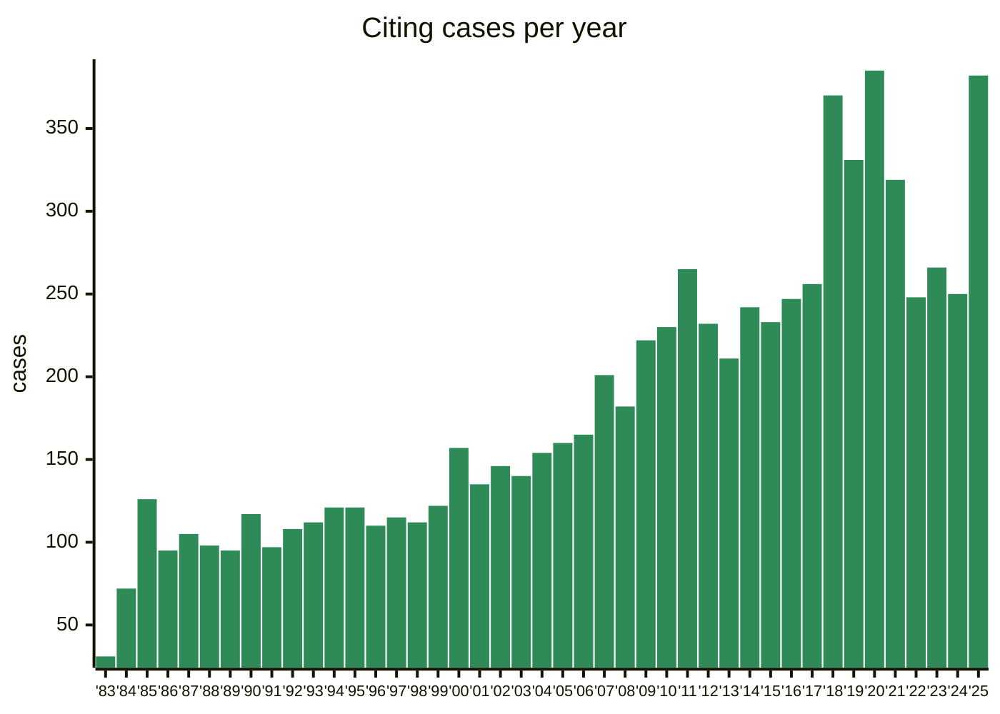
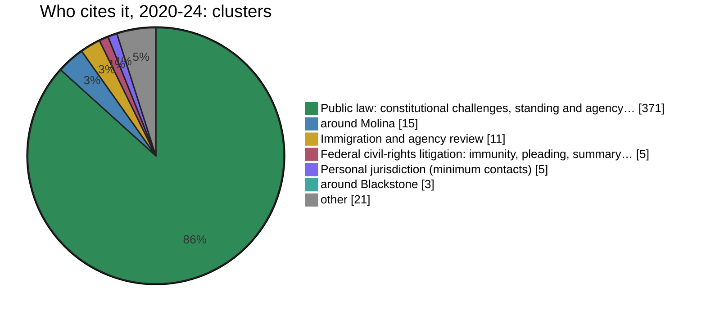
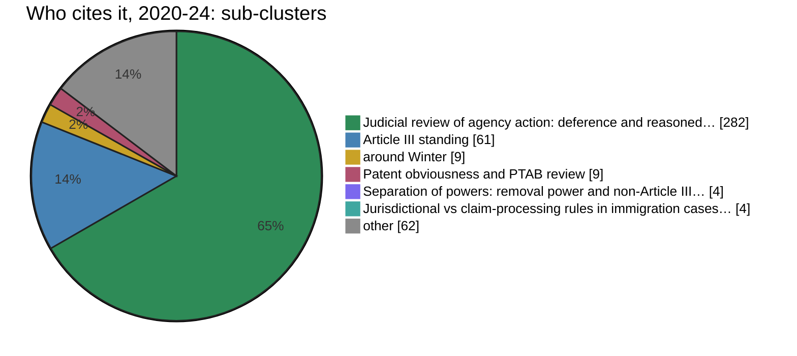

# Motor Vehicle Mfrs. Assn. of United States, Inc. v. State Farm Mut. Automobile Ins. Co., 463 U.S. 29 (1983)

## Case profile

Cited by 8,045 cases · 2021–2025: 1,465, 18% of all (-8% on 2016–2020) · steady · busiest year 2020 (385). *Counted from the CourtListener bulk data of 2026-06-30.*

**Good-law check: GREEN** — no warning words found. Read 614 of 8,450 citing opinions (every one from a court that could overrule it, plus the 500 newest).

Role changed 2025-29: likely successor FCC v. Prometheus Radio Project, 592 U.S. 414 (2021) (26% of the 141 decisions citing this case in 2025-29 also cite FCC v. Prometheus Radio Project). *Co-citation, not the text: it never changes the colour.*

## Co-citation

*Which cases later court decisions cite together with this one, in five-year slices of citing decisions. Clusters from `cocite.py`; cluster names and descriptions were written by Claude from each cluster's evidence and are not part of the record.*

**2020-24:** [[Judicial review of agency action- deference and reasoned decision-making|Judicial review of agency action: deference and reasoned decision-making]] — within *[[Public law- constitutional challenges, standing and agency review (cluster)|Public law: constitutional challenges, standing and agency review]]*. Since 1975-79.

**Area:** [[Standing and judicial review of agency action|Standing and judicial review of agency action]]. *(boundary: only 29% of its ties are inside this area)*

### Where it sits

*The cluster this case belongs to in each slice, and its share of the case's co-citation weight; then the sub-cluster within it.*

| Slice | Cited by | Cluster | Share | Also in |
|---|---:|---|---:|---|
| 1980-84 | 74 | `7` [[Immigration and agency review (cluster)\|Immigration and agency review]] | 97% |  |
| 1985-89 | 391 | `8` [[Immigration and agency review (cluster)\|Immigration and agency review]] | 92% |  |
| 1990-94 | 349 | `8` [[Immigration and agency review (cluster)\|Immigration and agency review]] | 83% |  |
| 1995-99 | 346 | `7` [[Immigration and agency review (cluster)\|Immigration and agency review]] | 89% |  |
| 2000-04 | 389 | `9` [[Immigration and agency review (cluster)\|Immigration and agency review]] | 76% |  |
| 2005-09 | 429 | `8` [[Immigration and agency review (cluster)\|Immigration and agency review]] | 85% |  |
| 2010-14 | 391 | `6` [[Public law- constitutional challenges, standing and agency review (cluster)\|Public law: constitutional challenges, standing and agency review]] | 97% |  |
| 2015-19 | 528 | `3` [[Public law- constitutional challenges, standing and agency review (cluster)\|Public law: constitutional challenges, standing and agency review]] | 95% |  |
| 2020-24 | 437 | `2` [[Public law- constitutional challenges, standing and agency review (cluster)\|Public law: constitutional challenges, standing and agency review]] | 98% |  |
| 2025-29 (partial) | 141 | `3` [[Public law- constitutional challenges, standing and agency review (cluster)\|Public law: constitutional challenges, standing and agency review]] | 96% |  |

| Slice | Sub-cluster | Share | Area |
|---|---|---:|---|
| 1980-84 | `7.1` [[Judicial review of agency action- deference and reasoned decision-making\|Judicial review of agency action: deference and reasoned decision-making]] | 75% | [[Standing and judicial review of agency action\|Standing and judicial review of agency action]] |
| 1985-89 | `8.2` [[Judicial review of agency action- deference and reasoned decision-making\|Judicial review of agency action: deference and reasoned decision-making]] | 57% | [[Standing and judicial review of agency action\|Standing and judicial review of agency action]] |
| 1990-94 | `8.1` [[Judicial review of agency action- deference and reasoned decision-making\|Judicial review of agency action: deference and reasoned decision-making]] | 65% | [[Standing and judicial review of agency action\|Standing and judicial review of agency action]] |
| 1995-99 | `7.1` [[Judicial review of agency action- deference and reasoned decision-making\|Judicial review of agency action: deference and reasoned decision-making]] | 76% | [[Standing and judicial review of agency action\|Standing and judicial review of agency action]] |
| 2000-04 | `9.1` [[Judicial review of agency action- deference and reasoned decision-making\|Judicial review of agency action: deference and reasoned decision-making]] | 69% | [[Standing and judicial review of agency action\|Standing and judicial review of agency action]] |
| 2005-09 | `8.1` [[Judicial review of agency action- deference and reasoned decision-making\|Judicial review of agency action: deference and reasoned decision-making]] | 84% | [[Standing and judicial review of agency action\|Standing and judicial review of agency action]] |
| 2010-14 | `6.1` [[Judicial review of agency action- deference and reasoned decision-making\|Judicial review of agency action: deference and reasoned decision-making]] | 87% | [[Standing and judicial review of agency action\|Standing and judicial review of agency action]] |
| 2015-19 | `3.2` [[Judicial review of agency action- deference and reasoned decision-making\|Judicial review of agency action: deference and reasoned decision-making]] | 78% | [[Standing and judicial review of agency action\|Standing and judicial review of agency action]] |
| 2020-24 | `2.3` [[Judicial review of agency action- deference and reasoned decision-making\|Judicial review of agency action: deference and reasoned decision-making]] | 73% | [[Standing and judicial review of agency action\|Standing and judicial review of agency action]] |
| 2025-29 (partial) | `3.10` [[Agency review after Loper Bright (2025)\|Agency review after Loper Bright (2025)]] | 76% | [[Class actions, separation of powers and 2025 suits against government\|Class actions, separation of powers and 2025 suits against government]] |

### Who cites it

*Each citing decision is placed in the cluster (and sub-cluster) most of its other citations fall in, so this shows what kinds of cases use this one.*

| Slice | Decisions | Top citing clusters | Top citing sub-clusters |
|---|---:|---|---|
| 1980-84 | 74 | `7` [[Immigration and agency review (cluster)\|Immigration and agency review]] 88%; `8` [[Labor law- NLRA and collective bargaining (cluster)\|Labor law: NLRA and collective bargaining]] 5%; `2` [[Federal civil-rights litigation- immunity, pleading, summary judgment (cluster)\|Federal civil-rights litigation: immunity, pleading, summary judgment]] 4% | `7.1` [[Judicial review of agency action- deference and reasoned decision-making\|Judicial review of agency action: deference and reasoned decision-making]] 55%; `7.2` [[Agency deference- Udall to Chevron (1965-89)\|Agency deference: Udall to Chevron (1965-89)]] 15%; `7.3` [[NEPA and record review of agency action (1970s)\|NEPA and record review of agency action (1970s)]] 4% |
| 1985-89 | 391 | `8` [[Immigration and agency review (cluster)\|Immigration and agency review]] 83%; `6` [[Public law- constitutional challenges, standing and agency review (cluster)\|Public law: constitutional challenges, standing and agency review]] 3%; `11` [[ERISA and labor-law preemption (1980-2014) (cluster)\|ERISA and labor-law preemption (1980-2014)]] 2% | `8.2` [[Judicial review of agency action- deference and reasoned decision-making\|Judicial review of agency action: deference and reasoned decision-making]] 43%; `8.1` [[Agency deference- Udall to Chevron (1965-89)\|Agency deference: Udall to Chevron (1965-89)]] 20%; `8.8` [[Natural gas and energy rate regulation\|Natural gas and energy rate regulation]] 6% |
| 1990-94 | 349 | `8` [[Immigration and agency review (cluster)\|Immigration and agency review]] 75%; `9` [[ERISA and labor-law preemption (1980-2014) (cluster)\|ERISA and labor-law preemption (1980-2014)]] 8%; `20` [[Social Security evidence review- Perales line, mostly Ninth Circuit (cluster)\|Social Security evidence review: Perales line, mostly Ninth Circuit]] 3% | `8.1` [[Judicial review of agency action- deference and reasoned decision-making\|Judicial review of agency action: deference and reasoned decision-making]] 58%; `20.1` [[NLRB review- Universal Camera, Wright Line and successorship\|NLRB review: Universal Camera, Wright Line and successorship]] 4%; `9.7` [[Federal preemption\|Federal preemption]] 3% |
| 1995-99 | 346 | `7` [[Immigration and agency review (cluster)\|Immigration and agency review]] 71%; `14` [[ERISA and labor-law preemption (1980-2014) (cluster)\|ERISA and labor-law preemption (1980-2014)]] 4%; `23` [[Social Security evidence review- Perales line, mostly Ninth Circuit (cluster)\|Social Security evidence review: Perales line, mostly Ninth Circuit]] 4% | `7.1` [[Judicial review of agency action- deference and reasoned decision-making\|Judicial review of agency action: deference and reasoned decision-making]] 60%; `7.2` [[Article III standing\|Article III standing]] 5%; `23.1` [[NLRB review- Universal Camera, Wright Line and successorship\|NLRB review: Universal Camera, Wright Line and successorship]] 3% |
| 2000-04 | 389 | `9` [[Immigration and agency review (cluster)\|Immigration and agency review]] 71%; `8` [[Eleventh Amendment immunity and federalism (late 1990s) (cluster)\|Eleventh Amendment immunity and federalism (late 1990s)]] 11%; `11` [[Public law- constitutional challenges, standing and agency review (cluster)\|Public law: constitutional challenges, standing and agency review]] 4% | `9.1` [[Judicial review of agency action- deference and reasoned decision-making\|Judicial review of agency action: deference and reasoned decision-making]] 66%; `8.1` [[Article III standing\|Article III standing]] 6%; `9.7` [[NLRB review- Universal Camera, Wright Line and successorship\|NLRB review: Universal Camera, Wright Line and successorship]] 3% |
| 2005-09 | 429 | `8` [[Immigration and agency review (cluster)\|Immigration and agency review]] 76%; `9` [[Public law- constitutional challenges, standing and agency review (cluster)\|Public law: constitutional challenges, standing and agency review]] 10%; `15` [[ERISA and labor-law preemption (1980-2014) (cluster)\|ERISA and labor-law preemption (1980-2014)]] 3% | `8.1` [[Judicial review of agency action- deference and reasoned decision-making\|Judicial review of agency action: deference and reasoned decision-making]] 75%; `9.1` [[Article III standing\|Article III standing]] 4%; `2.4` [[Texas statutory construction and agency deference\|Texas statutory construction and agency deference]] 2% |
| 2010-14 | 391 | `6` [[Public law- constitutional challenges, standing and agency review (cluster)\|Public law: constitutional challenges, standing and agency review]] 86%; `1` [[Federal civil-rights litigation- immunity, pleading, summary judgment (cluster)\|Federal civil-rights litigation: immunity, pleading, summary judgment]] 3%; `15` [[Immigration and agency review (cluster)\|Immigration and agency review]] 2% | `6.1` [[Judicial review of agency action- deference and reasoned decision-making\|Judicial review of agency action: deference and reasoned decision-making]] 74%; `6.3` [[Article III standing\|Article III standing]] 5%; `6.6` [[Federal preemption\|Federal preemption]] 2% |
| 2015-19 | 529 | `3` [[Public law- constitutional challenges, standing and agency review (cluster)\|Public law: constitutional challenges, standing and agency review]] 86%; `1` [[Federal civil-rights litigation- immunity, pleading, summary judgment (cluster)\|Federal civil-rights litigation: immunity, pleading, summary judgment]] 4%; `34` [[Lineage 11080 (around Daubert) (cluster)\|around Teva Pharm. United States, Inc. v. Sandoz, Inc.]] 2% | `3.2` [[Judicial review of agency action- deference and reasoned decision-making\|Judicial review of agency action: deference and reasoned decision-making]] 70%; `3.3` [[Article III standing\|Article III standing]] 6%; `3.4` [[Federal powers- commerce clause and separation of powers (2010s)\|Federal powers: commerce clause and separation of powers (2010s)]] 2% |
| 2020-24 | 438 | `2` [[Public law- constitutional challenges, standing and agency review (cluster)\|Public law: constitutional challenges, standing and agency review]] 85%; `26` [[Lineage 11080 (around Daubert) (cluster)\|around Molina]] 3%; `16` [[Immigration and agency review (cluster)\|Immigration and agency review]] 3% | `2.3` [[Judicial review of agency action- deference and reasoned decision-making\|Judicial review of agency action: deference and reasoned decision-making]] 64%; `2.1` [[Article III standing\|Article III standing]] 14%; `2.8` [[Lineage 30578 (around Winter)\|around Winter]] 2% |
| 2025-29 (partial) | 141 | `3` [[Public law- constitutional challenges, standing and agency review (cluster)\|Public law: constitutional challenges, standing and agency review]] 77%; `15` [[Immigration and agency review (cluster)\|Immigration and agency review]] 6%; `28` [[Lineage 12343 (around In re Stallworth) (cluster)\|around In re Stallworth]] 2% | `3.10` [[Agency review after Loper Bright (2025)\|Agency review after Loper Bright (2025)]] 48%; `3.4` [[Preliminary injunctions and stays against the government (2025)\|Preliminary injunctions and stays against the government (2025)]] 12%; `3.2` [[Article III standing\|Article III standing]] 6% |

**Usually cited with, 2020-24** (decisions citing both, and their share of the 437 decisions citing this case; then the pair's weight, which also counts citations in one sentence):

- [[556-us-502-fcc-v-fox|FCC v. Fox, 556 U.S. 502 (2009)]] · 104 · 24% · weight 35.2
- [[371-us-156-burlington-truck-lines-inc-v-u|Burlington Truck Lines, Inc. v. United States, 371 U.S. 156 (1962)]] · 75 · 17% · weight 58.2
- [[207-l-ed-2d-353-department-of-homeland-securit|Department of Homeland Security v. Regents of Univ. of Cal., 207 L. Ed. 2d 353 (2020)]] · 65 · 15% · weight 24.2
- [[579-us-211-encino-motorcars|Encino Motorcars, 579 U.S. 211 (2016)]] · 61 · 14% · weight 17.0
- [[419-us-281-bowman-transp|Bowman Transp, 419 U.S. 281 (1975)]] · 59 · 14% · weight 22.2
- [[332-us-194-securities-exchange-commission|Securities & Exchange Commission v. Chenery Corp., 332 U.S. 194 (1947)]] · 55 · 13% · weight 23.8
- Allentown Mack, 522 U.S. 359 (1998) · 20 · 5% · weight 9.6
- Cir, 926 F.3d 1061 (2019) · 6 · 1% · weight 4.4

> [!info]- Judicial review of agency action: deference and reasoned decision-making (written by Claude from the cluster evidence; not part of the record)
> How courts review agencies: deference to agency interpretations (Chevron and its limits in Mead, Christensen and Brown & Williamson; Skidmore weight; Auer/Seminole Rock for an agency's own regulations; Brand X), and the arbitrary-and-capricious requirement of reasoned decision-making (State Farm, Overton Park), with NEPA review (Marsh).

> [!info]- Agency review after Loper Bright (2025) (written by Claude from the cluster evidence; not part of the record)
> The post-Chevron reorganization: Loper Bright Enterprises v. Raimondo overruling Chevron, cited with State Farm's reasoned-decision-making review, Kisor on Auer deference, Skidmore, FCC v. Prometheus, Fox and Encino. It succeeds 18342, with State Farm rather than Chevron at the centre. A partial slice.

*Codes like `5.3` are sub-cluster 3 of cluster 5 in that slice: `tribonian cocite cluster 2020-24:5.3 --courts appellate-sentence-m0.2`.*

## What it draws on

*Where the 19 cases this one cites sit in the co-citation map: each cited case's sub-cluster in 2020-24, the newest full slice (bibliographic coupling: a case placed by what it cites, so it works for any case). Counted from the citations; sub-cluster names were written by Claude from each cluster's evidence and are not part of the record.*

| Sub-cluster | Cites | Share | Area |
|---|---:|---:|---|
| `2.3` [[Judicial review of agency action- deference and reasoned decision-making\|Judicial review of agency action: deference and reasoned decision-making]] | 8 | 42% | [[Standing and judicial review of agency action\|Standing and judicial review of agency action]] |
| `2.13` [[Religion clauses- Establishment and Free Exercise\|Religion clauses: Establishment and Free Exercise]] | 1 | 5% | [[First Amendment and individual liberties\|First Amendment and individual liberties]] |
| `4.11` [[Lineage 29738 (around Malesko)\|around Ziglar]] | 1 | 5% | [[Section 1983, qualified immunity and prisoner rights\|Section 1983, qualified immunity and prisoner rights]] |
| `293` around Federal Power Commission v. Hope Natural Gas Co. | 1 | 5% | [[Standing and judicial review of agency action\|Standing and judicial review of agency action]] |

**Unclustered:** 8 of the 19 cited cases are in no sub-cluster of 2020-24 (cited too rarely then).

**Areas:** [[Standing and judicial review of agency action|Standing and judicial review of agency action]] 47% · [[First Amendment and individual liberties|First Amendment and individual liberties]] 5% · [[Section 1983, qualified immunity and prisoner rights|Section 1983, qualified immunity and prisoner rights]] 5%

## Coupled with

*Cases that cite the most of the same cases as this one, rare shared citations counting more: each shared cited case, cited by df decisions, adds log(N/df), N = 6,977,679 decisions citing anything. Cited cases cited by more than 2,000 decisions are left out (6 of this case's 19). Computed 2026-10-30 13:08 from the bulk data of 2026-06-30 by `tribonian map coupling`. Not part of the record.*

1. Columbia Broadcasting System, Inc. v. Federal Communications Commission and United States of America, Democratic National Committee and Republican National Committee, Intervenors. Democratic National Committee v. Federal Communications Commission and United States of America, Republican National Committee, Intervenor (454 F.2d 1018, cadc, 1971) · score 31.9 · 3 shared: State of New York v. United States; Labor Board; Greater Boston Television Corp. v. Federal Communications Commission
2. Columbia Broadcasting System, Inc. v. Federal Communications Commission (454 F.2d 1018, cadc, 1971) · score 31.9 · 3 shared: State of New York v. United States; Labor Board; Greater Boston Television Corp. v. Federal Communications Commission
3. Department (980 P.2d 701, wash, 1999) · score 31.7 · 3 shared: State of New York v. United States; Industrial Union; Donovan
4. Aviation West Corp. v. Department of Labor & Industries (138 Wash. 2d 413, wash, 1999) · score 31.7 · 3 shared: State of New York v. United States; Industrial Union; Donovan
5. Industrial Union Department, Afl-Cio v. James D. Hodgson, Secretary, Department of Labor, Environmentaldefense Fund, Inc., Intervenor (499 F.2d 467, cadc, 1974) · score 31.3 · 3 shared: Chrysler Corp. v. Department of Transportation; Greater Boston Television Corp. v. Federal Communications Commission; Permian Basin Area Rate Cases
6. International Ladies' Garment Workers' Union v. Raymond J. Donovan (722 F.2d 795, cadc, 1983) · score 31.2 · 3 shared: State of New York v. United States; Greater Boston Television Corp. v. Federal Communications Commission; Atchison Co
7. Ceramica Regiomontanam, S.A. v. United States (636 F. Supp. 961, cit, 1986) · score 30.8 · 3 shared: State of New York v. United States; Haig; Bob Jones University v. United States
8. Edwin I. Hatch v. Federal Energy Regulatory Commission (654 F.2d 825, cadc, 1981) · score 30.2 · 3 shared: American Trucking; Labor Board; Atchison Co
9. Kindred Nursing Centers East, LLC v. National Labor Relations Board (727 F.3d 552, ca6, 2013) · score 30.2 · 3 shared: American Trucking; Labor Board; Atchison Co
10. Kindred Nursing Centers East v. NLRB (ca6, 2013) · score 30.2 · 3 shared: American Trucking; Labor Board; Atchison Co
11. Local 777, Democratic Union Organizing Committee, Seafarers International Union of North America, Afl-Cio v. National Labor Relations Board, Yellow Cab Company and Checker Taxi Company, Inc. v. National Labor Relations Board, Local 777, Democratic Union, Etc., Intervenor (603 F.2d 862, cadc, 1979) · score 29.5 · 3 shared: Labor Board; Greater Boston Television Corp. v. Federal Communications Commission; Atchison Co
12. Local 777, Democratic Union Organizing Committee v. National Labor Relations Board (603 F.2d 862, cadc, 1978) · score 29.5 · 3 shared: Labor Board; Greater Boston Television Corp. v. Federal Communications Commission; Atchison Co
13. Paralyzed Veterans of America, and Disabled American Veterans, and National Organization of Veterans' Advocates, Inc., and National Association of Black Veterans, John J. Castillo, and Joseph Holmes v. Secretary of Veterans Affairs (345 F.3d 1334, cafc, 2003) · score 29.4 · 3 shared: Labor Board; Atchison Co; Sperry & Hutchinson
14. Borusan Mannesmann Boru Sanayi ve Ticaret A.S. v. United States (222 F. Supp. 3d 1255, cit, 2017) · score 29.4 · 3 shared: Labor Board; Atchison Co; Sperry & Hutchinson
15. Paralyzed Veterans of America v. Secretary of Veterans Affairs (345 F.3d 1334, cafc, 2003) · score 29.4 · 3 shared: Labor Board; Atchison Co; Sperry & Hutchinson
16. American Federation of Labor and Congress of Industrial Organizations v. Raymond J. Donovan, Secretary of Labor (757 F.2d 330, cadc, 1985) · score 29.4 · 3 shared: American Trucking; Donovan; Bob Jones University v. United States
17. Bowen (476 U.S. 610, scotus, 1986) · score 29.2 · 3 shared: Industrial Union; Donovan; Sperry & Hutchinson
18. Northwest Environmental Defense Center, Public Employees for Environmental Responsibility Northwest Sportfishing Industry Association, Northwest Power and Conservation Council, Intervenor v. Bonneville Power Administration, Confederated Tribes and Bands of the Yakama Indian Nation v. Bonneville Power Administration (477 F.3d 668, ca9, 2007) · score 29.1 · 3 shared: Industrial Union; Greater Boston Television Corp. v. Federal Communications Commission; Atchison Co
19. Bpa (477 F.3d 668, ca9, 2007) · score 29.1 · 3 shared: Industrial Union; Greater Boston Television Corp. v. Federal Communications Commission; Atchison Co
20. International Brotherhood Of Teamsters, Chauffeurs, Warehousemen And Helpers Of America v. United States (735 F.2d 1525, cadc, 1984) · score 29.1 · 3 shared: American Trucking; Donovan; Permian Basin Area Rate Cases
21. International Brotherhood of Teamsters v. United States (735 F.2d 1525, cadc, 1984) · score 29.1 · 3 shared: American Trucking; Donovan; Permian Basin Area Rate Cases
22. Telocator Network of America v. Federal Communications Commission and United States of America (691 F.2d 525, cadc, 1982) · score 28.9 · 3 shared: American Trucking; Greater Boston Television Corp. v. Federal Communications Commission; Permian Basin Area Rate Cases
23. Seia (ca9, 2023) · score 28.9 · 3 shared: American Trucking; Greater Boston Television Corp. v. Federal Communications Commission; Permian Basin Area Rate Cases
24. YANEZ (23 I. & N. Dec. 390, bia, 2002) · score 28.8 · 3 shared: American Trucking; Atchison Co; Permian Basin Area Rate Cases
25. Ray Baillie Trash Hauling, Inc. v. Thomas S. Kleppe, Administrator, Small Business Administration (477 F.2d 696, ca5, 1973) · score 28.8 · 3 shared: American Trucking; Sperry & Hutchinson; Permian Basin Area Rate Cases
26. Advanced Micro Devices, Data General Corporation, Electronic Memories & Magnetics Corporation, Hewlett-Packard Co., Intel Corporation, Mostek Corporation, National Semiconductor Corporation, Rca Corporation, Rockwell International and Signetics Corporation v. Civil Aeronautics Board, Flying Tiger Line, Inc., Intervenor. Advanced Micro Devices, Data General Corporation, Electronic Memories & Magnetics Corporation, Hewlett-Packard Co., Intel Corporation, Mostek Corporation, National Semiconductor Corporation, Rca Corporation, Rockwell International and Signetics Corporation v. Civil Aeronautics Board, Flying Tiger Line, Inc., Intervenor (742 F.2d 1520, cadc, 1984) · score 28.6 · 3 shared: American Trucking; Bob Jones University v. United States; Permian Basin Area Rate Cases
27. Advanced Micro Devices v. Civil Aeronautics Board (742 F.2d 1520, cadc, 1984) · score 28.6 · 3 shared: American Trucking; Bob Jones University v. United States; Permian Basin Area Rate Cases
28. American Petroleum Institute v. Environmental Protection Agency (787 F.2d 965, ca5, 1986) · score 28.4 · 3 shared: Industrial Union; Sperry & Hutchinson; Permian Basin Area Rate Cases
29. Giles Lowery Stockyards, Inc. D/B/A Lufkin Livestock Exchange v. Department of Agriculture (565 F.2d 321, ca5, 1977) · score 28.1 · 3 shared: Greater Boston Television Corp. v. Federal Communications Commission; Atchison Co; Permian Basin Area Rate Cases
30. Potomac Electric Power Company v. United States of America and Interstate Commerce Commission, Consolidated Rail Corporation, Intervenor (584 F.2d 1058, cadc, 1978) · score 28.1 · 3 shared: Greater Boston Television Corp. v. Federal Communications Commission; Atchison Co; Permian Basin Area Rate Cases

## How later courts describe it

*The parentheticals later courts wrote after citing this case ("holding that …"), grouped by CourtListener into similar wordings, largest group first; each shows the group's best-scored wording. 1,052 parentheticals in all. Other courts' words, not this opinion's: quote the opinion.*

1. **776** · (holding that even “a decision of less than .ideal clarity” should be upheld in such circumstances) — *San Luis & Delta-Mendota Water v. Natural Resources Defense Coun, 9th Cir., 2014*
2. **12** · (finding that agencies “must be given ample latitude to adapt their rules to the demands of changing circumstances”) — *Glukowsky, N.J., 2004*
3. **9** · (setting forth the circumstances under which the Court may find an agency decision arbitrary and capricious) — *Chestnut, D.S.C., 2022*
4. **7** · (applying the standard to agency rule making) — *California v. United States Department of Labor, E.D. Cal., 2014*
5. **7** · (holding that an agency's duty of reasoned decisionmaking includes the requirement to explain away contrary evidence) — *DOL, D.C. Cir., 2002*
6. **6** · (“It is not infrequent that the available data do not settle a regulatory issue, and the agency must then exercise its judgment in moving from the facts and probabilities on the record to a policy conclusion.”) — *Dorbest Ltd. v. United States, Ct. Intl. Trade, 2006*
7. **6** · (holding that “[a] ‘settled course of behavior embodies the agency’s informed judgment that, by pursuing that course, it will carry out the policies [of applicable statutes or regulations]’ ”) — *Shalala, SCOTUS, 1994*
8. **4** · (“We start with the accepted ground that if used, seatbelts unquestionably would save many thousands of lives and would prevent tens of thousands of crippling injuries”) — *Geier, SCOTUS, 2000*

## Headmatter

**MOTOR VEHICLE MANUFACTURERS ASSOCIATION OF THE UNITED STATES, INC., et al. *v.* STATE FARM MUTUAL AUTOMOBILE INSURANCE CO. et al.**

No. 82-354. · Argued April 26, 1983 · Decided June 24, 1983[^hm-0-star]

`*32` *Solicitor General Lee* argued the cause for petitioners in No. 82-398. With him on the briefs were *Assistant Attorney General McGrath, Deputy Solicitor General Getter, Edwin S. Kneedler, Robert E. Kopp, Michael F. Hertz, Frank Bemdt, David W. Allen, Enid Rubenstein,* and *Eileen T. Leahy. Lloyd N. Cutler* argued the cause for petitioners in No. 82-354. With him on the briefs were *John H. Pickering, William R. Perlik, Andrew B. Weissman, William R. Richardson, Jr., MiltonD. Andrews, Lance E. Tunick, William H. Crabtree, Edward P. Good, Henry R. Nolte, Jr., Otis M. Smith, Charles R. Sharp,* and *William L. Weber, Jr. Raymond M. Momboisse, Sam Kazman,* and *Ronald A. Zumbrun* filed briefs for petitioners in No. 82-355.

*James F. Fitzpatrick* argued the cause for respondents in all cases. With him on the brief for respondents State Farm Mutual Automobile Insurance Co. et al. were *Michael N. Sohn, John M. Quinn,* and *Merrick B. Garland. Robert Abrams,* Attorney General of New York, *Robert S. Hammer,* Assistant Attorney General, *Peter H. Schiff, Martin Minkowitz,* and *Milton L. Freedman* filed a brief for respondent Superintendent of Insurance of the State of New York. *Raymond J. Rasenberger, Lawrence C. Merthan, Jerry W. Cox,* and *Lowell R. Beck* filed a brief for respondents National Association of Independent Insurers et al-[^hm-0-dagger]

[^hm-0-star]: Together with No. 82-355, *Consumer Alert et al.* v. *State Farm Mutual Automobile Insurance Co. et al.;* and No. 82-398, *United States Department of Transportation et al.* v. *State Farm Mutual Automobile Insurance Co. et al.,* also on certiorari to the same court.

[^hm-0-dagger]: Briefs of *amici curiae* urging affirmance were filed by *Dennis J. Barbour* for the American College of Preventive Medicine et al.; by *Nathan Lewin* for the American Insurance Association; by *Philip R. Collins* and *Thomas C. McGrath, Jr.,* for the Automotive Occupant Protection Association; by *Alexandra K. Finucane* for the Epilepsy Foundation of America et al.; by *Katherine I. Hall* for the Center for Auto Safety et al.; by *Simon Lazarus III* for Mothers Against Drunk Drivers; and by *JohnH. Quinn, Jr.,* and *John Hardin Young* for the National Association of Insurance Commissioners.

## White, J. — opinion of the Court

*Justice White delivered the opinion of the Court.*

The development of the automobile gave Americans unprecedented freedom to travel, but exacted a high price for `*33` enhanced mobility. Since 1929, motor vehicles have been the leading cause of accidental deaths and injuries in the United States. In 1982, 46,300 Americans died in motor vehicle accidents and hundreds of thousands more were maimed and injured.[^1] While a consensus exists that the current loss of life on our highways is unacceptably high, improving safety does not admit to easy solution. In 1966, Congress decided that at least part of the answer lies in improving the design and safety features of the vehicle itself.[^2] But much of the technology for building safer cars was undeveloped or untested. Before changes in automobile design could be mandated, the effectiveness of these changes had to be studied, their costs examined, and public acceptance considered. This task called for considerable expertise and Congress responded by enacting the National Traffic and Motor Vehicle Safety Act of 1966 (Act), 80 Stat. 718, as amended, [[15-usc-1381|==~~15 U. S. C. § 1381~~== ==**mv** [[49-usc-30101|49 U.S.C. § 30101]]==]] *et seq.* (1976 ed. and Supp. V). The Act, created for the purpose of “reducing] traffic accidents and deaths and injuries to persons resulting from traffic accidents,” [[15-usc-1381|==~~15 U. S. C. § 1381~~== ==**mv** [[49-usc-30101|49 U.S.C. § 30101]]==]], directs the Secretary of Transportation or his delegate to issue motor vehicle safety standards that “shall be practicable, shall meet the need for motor vehicle safety, and shall be stated in objective terms.” ==~~15 U. S. C. § 1392~~== ==**mv** [[49-usc-30103|49 U.S.C. § 30103]], [[49-usc-30111|49 U.S.C. § 30111]], [[49-usc-30125|49 U.S.C. § 30125]]==(a) (1976 ed., Supp. V). In issuing these standards, the Secretary is directed to consider “relevant available motor vehicle safety data,” whether the proposed standard “is reasonable, practicable and appropriate” for the particular type of motor vehicle, and the “extent to which `*34` such standards will contribute to carrying out the purposes” of the Act. ==~~15 U. S. C. §§ 1392~~== ==**mv** [[49-usc-30103|49 U.S.C. § 30103]], [[49-usc-30111|49 U.S.C. § 30111]], [[49-usc-30125|49 U.S.C. § 30125]]==(f)(1), (3), (4).[^3]

The Act also authorizes judicial review under the provisions of the Administrative Procedure Act (APA), [[5-usc-706|[[5-usc-706|5 U. S. C. §706]]]], of all “orders establishing, amending, or revoking a Federal motor vehicle safety standard,” ==~~15 U. S. C. § 1392~~== ==**mv** [[49-usc-30103|49 U.S.C. § 30103]], [[49-usc-30111|49 U.S.C. § 30111]], [[49-usc-30125|49 U.S.C. § 30125]]==(b). Under this authority, we review today whether NHTSA acted arbitrarily and capriciously in revoking the requirement in Motor Vehicle Safety Standard 208 that new motor vehicles produced after September 1982 be equipped with passive restraints to protect the safety of the occupants of the vehicle in the event of a collision. \usebox\qlA\kern-.3pt \quoteA{Briefly summarized, we hold that the agency failed to present an adequate basis and explanation for rescinding the passive restraint requirement and that the agency must either consider the matter further or adhere to or amend Standard 208 along lines which its analysis supports}\kern-.3pt\quotecount{\qrA}{2}{1}.

### I

The regulation whose rescission is at issue bears a complex and convoluted history. Over the course of approximately 60 rulemaking notices, the requirement has been imposed, amended, rescinded, reimposed, and now rescinded again.

As originally issued by the Department of Transportation in 1967, Standard 208 simply required the installation of seatbelts in all automobiles. 32 Fed. Reg. 2415. It soon became apparent that the level of seatbelt use was too low to reduce traffic injuries to an acceptable level. The Department therefore began consideration of “passive occupant restraint systems” — devices that do not depend for their effec `*35` tiveness upon any action taken by the occupant except that necessary to operate the vehicle. Two types of automatic crash protection emerged: automatic seatbelts and airbags. The automatic seatbelt is a traditional safety belt, which when fastened to the interior of the door remains attached without impeding entry or exit from the vehicle, and deploys automatically without any action on the part of the passenger. The airbag is an inflatable device concealed in the dashboard and steering column. It automatically inflates when a sensor indicates that deceleration forces from an accident have exceeded a preset minimum, then rapidly deflates to dissipate those forces. The lifesaving potential of these devices was immediately recognized, and in 1977, after substantial on-the-road experience with both devices, it was estimated by NHTSA that passive restraints could prevent approximately 12,000 deaths and over 100,000 serious injuries annually. 42 Fed. Reg. 34298.

In 1969, the Department formally proposed a standard requiring the installation of passive restraints, 34 Fed. Reg. 11148, thereby commencing a lengthy series of proceedings. In 1970, the agency revised Standard 208 to include passive protection requirements, 35 Fed. Reg. 16927, and in 1972, the agency amended the Standard to require full passive protection for all front seat occupants of vehicles manufactured after August 15, 1975. 37 Fed. Reg. 3911. In the interim, vehicles built between August 1973 and August 1975 were to carry either passive restraints or lap and shoulder belts coupled with an “ignition interlock” that would prevent starting the vehicle if the belts were not connected.[^4] On review, the `*36` agency’s decision to require passive restraints was found to be supported by “substantial evidence” and upheld. *Chrysler Corp.* v. *Department of Transportation,* [[472-f2d-659-chrysler-corp-v-department-of|472 F. 2d 659]] (CA6 1972).[^5]

\usebox\qlA\kern-.3pt \quoteA{In preparing for the upcoming model year, most car makers chose the “ignition interlock” option, a decision which was highly unpopular, and led Congress to amend the Act to prohibit a motor vehicle safety standard from requiring or permitting compliance by means of an ignition interlock or a continuous buzzer designed to indicate that safety belts were not in use}\kern-.3pt\quotecount{\qrA}{3}{2}. Motor Vehicle and Schoolbus Safety Amendments of 1974, Pub. L. 93-492, §109, 88 Stat. 1482, ==~~15 U. S. C. § 1410b(b)~~== ==**mv** [[49-usc-30124|49 U.S.C. § 30124]]==. The 1974 Amendments also provided that any safety standard that could be satisfied by a system other than seatbelts would have to be submitted to Congress where it could be vetoed by concurrent resolution of both Houses. ==~~15 U. S. C. § 1410b(b)(2)~~== ==**mv** [[49-usc-30124|49 U.S.C. § 30124]]==.[^6]

The effective date for mandatory passive restraint systems was extended for a year until August 31,1976. 40 Fed. Reg. 16217 (1975); *id.,* at 33977. But in June 1976, Secretary of Transportation William T. Coleman, Jr., initiated a new rulemaking on the issue, 41 Fed. Reg. 24070. After hearing testimony and reviewing written comments, Coleman extended the optional alternatives indefinitely and suspended the passive restraint requirement. Although he found pas `*37` sive restraints technologically and economically feasible, the Secretary based his decision on the expectation that there would be widespread public resistance to the new systems. He instead proposed a demonstration project involving up to 500,000 cars installed with passive restraints, in order to smooth the way for public acceptance of mandatory passive restraints at a later date. Department of Transportation, The Secretary’s Decision Concerning Motor Vehicle Occupant Crash Protection (Dec. 6, 1976), App. 2068.

Coleman’s successor as Secretary of Transportation disagreed. Within months of assuming office, Secretary Brock Adams decided that the demonstration project was unnecessary. He issued a new mandatory passive restraint regulation, known as Modified Standard 208. 42 Fed. Reg. 34289 (1977); 49 CFR § 571.208 (1978). The Modified Standard mandated the phasing in of passive restraints beginning with large cars in model year 1982 and extending to all cars by model year 1984. The two principal systems that would satisfy the Standard were airbags and passive belts; the choice of which system to install was left to the manufacturers. In *Pacific Legal Foundation* v. *Department of* Transportation, 193 U. S. App. D. C. 184, [[193-us-app-dc-184-pacific-legal-foundation-v-dep|593 F. 2d 1338]], cert. denied, [444 U. S. 830](https://www.courtlistener.com/c/U.%20S./444/830/) (1979), the Court of Appeals upheld Modified Standard 208 as a rational, nonarbitrary regulation consistent with the agency’s mandate under the Act. The Standard also survived scrutiny by Congress, which did not exercise its authority under the legislative veto provision of the 1974 Amendments.[^7]

Over the next several years, the automobile industry geared up to comply with Modified Standard 208. As late as July 1980, NHTSA reported:

> `*38` “On the road experience in thousands of vehicles equipped with air bags and automatic safety belts has confirmed agency estimates of the life-saving and injury-preventing benefits of such systems. When all cars are equipped with automatic crash protection systems, each year an estimated 9,000 more lives will be saved, and tens of thousands of serious injuries will be prevented.” NHTSA, Automobile Occupant Crash Protection, Progress Report No. 3, p. 4; App. in No. 81-2220 (CADC), p. 1627 (hereinafter App.).

In February 1981, however, Secretary of Transportation Andrew Lewis reopened the rulemaking due to changed economic circumstances and, in particular, the difficulties of the automobile industry. 46 Fed. Reg. 12033. Two months later, the agency ordered a one-year delay in the application of the Standard to large cars, extending the deadline to September 1982, *id.,* at 21172, and at the same time, proposed the possible rescission of the entire Standard. *Id.,* at 21205. After receiving written comments and holding public hearings, NHTSA issued a final rule (Notice 25) that rescinded the passive restraint requirement contained in Modified Standard 208.

### II

In a statement explaining the rescission, NHTSA maintained that it was no longer able to find, as it had in 1977, that the automatic restraint requirement would produce significant safety benefits. Notice 25, *id.,* at 53419. This judgment reflected not a change of opinion on the effectiveness of the technology, but a change in plans by the automobile industry. In 1977, the agency had assumed that airbags would be installed in 60% of all new cars and automatic seatbelts in 40%. By 1981 it became apparent that automobile manufacturers planned to install the automatic seatbelts in approximately 99% of the new cars. For this reason, the lifesaving potential of airbags would not be realized. Moreover, it now appeared that the overwhelming majority of passive belts `*39` planned to be installed by manufacturers could be detached easily and left that way permanently. Passive belts, once detached, then required “the same type of affirmative action that is the stumbling block to obtaining high usage levels of manual belts.” *Id.,* at 53421. For this reason, the agency concluded that there was no longer a basis for reliably predicting that the Standard would lead to any significant increased usage of restraints at all.

In view of the possibly minimal safety benefits, the automatic restraint requirement no longer was reasonable or practicable in the agency’s view. The requirement would require approximately \$1 billion to implement and the agency did not believe it would be reasonable to impose such substantial costs on manufacturers and consumers without more adequate assurance that sufficient safety benefits would accrue. In addition, NHTSA concluded that automatic restraints might have an adverse effect on the public’s attitude toward safety. Given the high expense and limited benefits of detachable belts, NHTSA feared that many consumers would regard the Standard as an instance of ineffective regulation, adversely affecting the public’s view of safety regulation and, in particular, “poisoning . . . popular sentiment toward efforts to improve occupant restraint systems in the future.” *Id.,* at 53424.

State Farm Mutual Automobile Insurance Co. and the National Association of Independent Insurers filed petitions for review of NHTSA’s rescission of the passive restraint Standard. The United States Court of Appeals for the District of Columbia Circuit held that the agency’s rescission of the passive restraint requirement was arbitrary and capricious. 220 U. S. App. D. C. 170, [680 F. 2d 206](https://www.courtlistener.com/c/F.%202d/680/206/) (1982). While observing that rescission is not unrelated to an agency’s refusal to take action in the first instance, the court concluded that, in this case, NHTSA’s discretion to rescind the passive restraint requirement had been restricted by various forms of congressional “reaction” to the passive restraint issue. It then `*40` proceeded to find that the rescission of Standard 208 was arbitrary and capricious for three reasons. First, the court found insufficient as a basis for rescission NHTSA’s conclusion that it could not reliably predict an increase in belt usage under the Standard. The court held that there was insufficient evidence in the record to sustain NHTSA’s position on this issue, and that, “only a well justified refusal to seek more evidence could render rescission non-arbitrary.” *Id.,* at 196, 680 F. 2d, at 232. Second, a majority of the panel[^8] concluded that NHTSA inadequately considered the possibility of requiring manufacturers to install nondetachable rather than detachable passive belts. \usebox\qlA\kern-.3pt \quoteA{Third, the majority found that the agency acted arbitrarily and capriciously by failing to give any consideration whatever to requiring compliance with Modified Standard 208 by the installation of airbags}\kern-.3pt\quotecount{\qrA}{2}{3}.

The court allowed NHTSA 30 days in which to submit a schedule for “resolving the questions raised in th[e] opinion.” *Id.,* at 206, 680 F. 2d, at 242. Subsequently, the agency filed a Notice of Proposed Supplemental Rulemaking setting forth a schedule for complying with the court’s mandate. On August 4, 1982, the Court of Appeals issued an order staying the compliance date for the passive restraint requirement until September 1, 1983, and requested NHTSA to inform the court whether that compliance date was achievable. NHTSA informed the court on October 1,1982, that based on representations by manufacturers, it did not appear that practicable compliance could be achieved before September 1985. On November 8, 1982, we granted certiorari, [459 U. S. 987](https://www.courtlistener.com/c/U.%20S./459/987/), and on November 18, the Court of Appeals entered an order recalling its mandate.

### III

Unlike the Court of Appeals, we do not find the appropriate scope of judicial review to be the “most troublesome `*41` question” in these cases. \usebox\qlA\kern-.3pt \quoteA{Both the Act and the 1974 Amendments concerning occupant crash protection standards indicate that motor vehicle safety standards are to be promulgated under the informal rulemaking procedures of the Administrative Procedure Act.}\kern-.3pt\quotecount{\qrA}{4}{4} [[5-usc-553|==[[5-usc-553|5 U. S. C. § 553]]== ==**amd** 2023==]]. \usebox\qlB\kern-.3pt \quoteB{The agency’s action in promulgating such standards therefore may be set aside if found to be “arbitrary, capricious, an abuse of discretion, or otherwise not in accordance with law.”} [[5-usc-706|[[5-usc-706|5 U. S. C. § 706]]]]\quoteB{(2)(A);} *\quoteB{Citizens to Preserve Overton Park}* \quoteB{v.} *\quoteB{Volpe,}* [[401-us-402-volpe|401 U. S. 402, 414]] \quoteB{(1971);} *\quoteB{Bowman Transportation, Inc.}* \quoteB{v.} *\quoteB{Arkansas-Best Freight System, Inc.,}* [[419-us-281-bowman-transp|419 U. S. 281]] \quoteB{(1974}\kern-.3pt\quotecount{\qrB}{10}{5}). We believe that the rescission or modification of an occupant-protection standard is subject to the same test. Section 103(b) of the Act, ==~~15 U. S. C. § 1392~~== ==**mv** [[49-usc-30103|49 U.S.C. § 30103]], [[49-usc-30111|49 U.S.C. § 30111]], [[49-usc-30125|49 U.S.C. § 30125]]==(b), states that the procedural and judicial review provisions of the Administrative Procedure Act “shall apply to all orders establishing, amending, or revoking a Federal motor vehicle safety standard,” and suggests no difference in the scope of judicial review depending upon the nature of the agency’s action.

Petitioner Motor Vehicle Manufacturers Association (MVMA) disagrees, contending that the rescission of an agency rule should be judged by the same standard a court would use to judge an agency’s refusal to promulgate a rule in the first place — a standard petitioner believes considerably narrower than the traditional arbitrary-and-capricious test. We reject this view. The Act expressly equates orders “revoking” and “establishing” safety standards; neither that Act nor the APA suggests that revocations are to be treated as refusals to promulgate standards. Petitioner’s view would render meaningless Congress’ authorization for judicial review of orders revoking safety rules. Moreover, the revocation of an extant regulation is substantially different than a failure to act. Revocation constitutes a reversal of the agency’s former views as to the proper course. \usebox\qlA\kern-.3pt \quoteA{A “settled course of behavior embodies the agency’s informed judgment that, by pursuing that course, it will carry out the policies} `*42` \quoteA{committed to it by Congress}\kern-.3pt\quotecount{\qrA}{6}{6}. \usebox\qlA\kern-.3pt \quoteA{There is, then, at least a presumption that those policies will be carried out best if the settled rule is adhered to}\kern-.3pt\quotecount{\qrA}{3}{7}.” *Atchison, T. & S. F. R. Co.* v. *Wichita Bd. of Trade,* [[412-us-800-atchison-co|412 U. S. 800, 807-808]] (1973). \usebox\qlB\kern-.3pt \quoteB{Accordingly, an agency changing its course by rescinding a rule is obligated to supply a reasoned analysis for the change beyond that which may be required when an agency does not act in the first instance}\kern-.3pt\quotecount{\qrB}{37}{8}.

\usebox\qlB\kern-.3pt \quoteB{In so holding, we fully recognize that “[rjegulatory agencies do not establish rules of conduct to last forever,”} *\quoteB{American Trucking Assns., Inc.}* \quoteB{v.} *\quoteB{Atchison, T. & S. F. R. Co.,}* [[387-us-397-american-trucking|387 U. S. 397, 416]] \quoteB{(1967), and that an agency must be given ample latitude to “adapt their rules and policies to the demands of changing circumstances}\kern-.3pt\quotecount{\qrB}{12}{9}.” *Permian Basin Area Rate Cases,* [[390-us-747-permian-basin-area-rate-cases|390 U. S. 747, 784]] (1968). But the forces of change do not always or necessarily point in the direction of deregulation. \usebox\qlA\kern-.3pt \quoteA{In the abstract, there is no more reason to presume that changing circumstances require the rescission of prior action, instead of a revision in or even the extension of current regulation}\kern-.3pt\quotecount{\qrA}{3}{10}. \usebox\qlA\kern-.3pt \quoteA{If Congress established a presumption from which judicial review should start, that presumption — contrary to petitioners’ views — is not} *\quoteA{against}* \quoteA{safety regulation, but} *\quoteA{against}* \quoteA{changes in current policy that are not justified by the rulemaking record}\kern-.3pt\quotecount{\qrA}{3}{11}. While the removal of a regulation may not entail the monetary expenditures and other costs of enacting a new standard, and, accordingly, it may be easier for an agency to justify a deregulatory action, the direction in which an agency chooses to move does not alter the standard of judicial review established by law.

The Department of Transportation accepts the applicability of the “arbitrary and capricious” standard. \usebox\qlB\kern-.3pt \quoteB{It argues that under this standard, a reviewing court may not set aside an agency rule that is rational, based on consideration of the relevant factors, and within the scope of the authority delegated to the agency by the statute}\kern-.3pt\quotecount{\qrB}{10}{12}. We do not disagree with `*43` this formulation.[^9] \usebox\qlC\kern-.3pt \quoteC{The scope of review under the “arbitrary and capricious” standard is narrow and a court is not to substitute its judgment for that of the agency}\kern-.3pt\quotecount{\qrC}{96}{13}. \usebox\qlC\kern-.3pt \quoteC{Nevertheless, the agency must examine the relevant data and articulate a satisfactory explanation for its action including a “rational connection between the facts found and the choice made}\kern-.3pt\quotecount{\qrC}{135}{14}.” *Burlington Truck Lines, Inc.* v. *United States,* [[371-us-156-burlington-truck-lines-inc-v-u|371 U. S. 156, 168]] (1962). \usebox\qlB\kern-.3pt \quoteB{In reviewing that explanation, we must “consider whether the decision was based on a consideration of the relevant factors and whether there has been a clear error of judgment}\kern-.3pt\quotecount{\qrB}{11}{15}.” *Bowman Transportation, Inc.* v. *Arkansas-Best Freight System, Inc., supra,* at 285; *Citizens to Preserve Overton Park* v. [[401-us-402-volpe|*Volpe, supra,* at 416]]. \usebox\qlC\kern-.3pt \quoteC{Normally, an agency rule would be arbitrary and capricious if the agency has relied on factors which Congress has not intended it to consider, entirely failed to consider an important aspect of the problem, offered an explanation for its decision that runs counter to the evidence before the agency, or is so implausible that it could not be ascribed to a difference in view or the product of agency expertise}\kern-.3pt\quotecount{\qrC}{151}{16}. \usebox\qlB\kern-.3pt \quoteB{The reviewing court should not attempt itself to make up for such deficiencies; we may not supply a reasoned basis for the agency’s action that the agency itself has not given}\kern-.3pt\quotecount{\qrB}{40}{17}. *SEC* v. *Chenery Corp.,* [[332-us-194-securities-exchange-commission|332 U. S. 194, 196]] (1947). \usebox\qlB\kern-.3pt \quoteB{We will, however, “uphold a decision of less than ideal clarity if the agency’s path may reasonably be discerned}\kern-.3pt\quotecount{\qrB}{35}{18}.” *Bowman Transportation, Inc.* v. *Arkansas-Best Freight System, Inc., supra,* at 286. See also *Camp* v. *Pitts,* [[411-us-138-camp|411 U. S. 138, 142-143]] (1973) *(per curiam).* For purposes of these cases, it is also relevant that Congress required a record of the rulemaking proceedings to be compiled `*44` and submitted to a reviewing court, ==~~15 U. S. C. § 1394~~== ==**mv** [[49-usc-30103|49 U.S.C. § 30103]], [[49-usc-30161|49 U.S.C. § 30161]]==, and intended that agency findings under the Act would be supported by “substantial evidence on the record considered as a whole.” S. Rep. No. 1301, 89th Cong., 2d Sess., 8 (1966); H. R. Rep. No. 1776, 89th Cong., 2d Sess., 21 (1966).

### IV

The Court of Appeals correctly found that the arbitrary- and-capricious test applied to rescissions of prior agency regulations, but then erred in intensifying the scope of its review based upon its reading of legislative events. It held that congressional reaction to various versions of Standard 208 “raise[d] doubts” that NHTSA’s rescission “necessarily demonstrates an effort to fulfill its statutory mandate,” and therefore the agency was obligated to provide “increasingly clear and convincing reasons” for its action. 220 U. S. App. D. C., at 186, 193, 680 F. 2d, at 222, 229. Specifically, the Court of Appeals found significance in three legislative occurrences:

> “In 1974, Congress banned the ignition interlock but did not foreclose NHTSA’s pursuit of a passive restraint standard. In 1977, Congress allowed the standard to take effect when neither of the concurrent resolutions needed for disapproval was passed. In 1980, a majority of each house indicated support for the concept of mandatory passive restraints and a majority of each house supported the unprecedented attempt to require some installation of airbags.” *Id.,* at 192, 680 F. 2d, at 228.

From these legislative acts and nonacts the Court of Appeals derived a “congressional commitment to the concept of automatic crash protection devices for vehicle occupants.” *Ibid.*

This path of analysis was misguided and the inferences it produced are questionable. It is noteworthy that in this Court respondent State Farm expressly agrees that the post-enactment legislative history of the Act does not heighten the `*45` standard of review of NHTSA’s actions. Brief for Respondent State Farm Mutual Automobile Insurance Co. 13. State Farm’s concession is well taken for this Court has never suggested that the *standard* of review is enlarged or diminished by subsequent congressional action. While an agency’s interpretation of a statute may be confirmed or ratified by subsequent congressional failure to change that interpretation, *Bob Jones University* v. *United States,* [[461-us-574-bob-jones-university-v-united|461 U. S. 574, 599-602]] (1983); *Haig* v. *Agee,* [[453-us-280-haig|453 U. S. 280, 291-300]] (1981), in the cases before us, even an unequivocal ratification — short of statutory incorporation — of the passive restraint standard would not connote approval or disapproval of an agency’s later decision to rescind the regulation. That decision remains subject to the arbitrary-and-capricious standard.

That we should not be so quick to infer a congressional mandate for passive restraints is confirmed by examining the postenactment legislative events cited by the Court of Appeals. Even were we inclined to rely on inchoate legislative action, the inferences to be drawn fail to suggest that NHTSA acted improperly in rescinding Standard 208. First, in 1974 a mandatory passive restraint standard was technically not in effect, see n. 6, *supra;* Congress had no reason to foreclose that course. Moreover, one can hardly infer support for a mandatory standard from Congress’ decision to provide that such a regulation would be subject to disapproval by resolutions of disapproval in both Houses. Similarly, no mandate can be divined from the tabling of resolutions of disapproval which were introduced in 1977. The failure of Congress to exercise its veto might reflect legislative deference to the agency’s expertise and does not indicate that Congress would disapprove of the agency’s action in 1981. And even if Congress favored the Standard in 1977, it — like NHTSA — may well reach a different judgment, given changed circumstances four years later. Finally, the Court of Appeals read too much into floor action on the 1980 authorization bill, a bill which was not enacted into law. Other `*46` contemporaneous events could be read as showing equal congressional hostility to passive restraints.[^10]

### V

The ultimate question before us is whether NHTSA’s rescission of the passive restraint requirement of Standard 208 was arbitrary and capricious. We conclude, as did the Court of Appeals, that it was. We also conclude, but for somewhat different reasons, that further consideration of the issue by the agency is therefore required. We deal separately with the rescission as it applies to airbags and as it applies to seatbelts.

#### A

The first and most obvious reason for finding the rescission arbitrary and capricious is that NHTSA apparently gave no consideration whatever to modifying the Standard to require that airbag technology be utilized. Standard 208 sought to achieve automatic crash protection by requiring automobile manufacturers to install either of two passive restraint devices: airbags or automatic seatbelts. There was no suggestion in the long rulemaking process that led to Standard 208 that if only one of these options were feasible, no passive restraint standard should be promulgated. Indeed, the agency’s original proposed Standard contemplated the installation of inflatable restraints in all cars.[^11] Automatic belts `*47` were added as a means of complying with the Standard because they were believed to be as effective as airbags in achieving the goal of occupant crash protection. 36 Fed. Reg. 12859 (1971). At that time, the passive belt approved by the agency could not be detached.[^12] Only later, at a manufacturer’s behest, did the agency approve of the detach-ability feature — and only after assurances that the feature would not compromise the safety benefits of the restraint.[^13] Although it was then foreseen that 60% of the new cars would contain airbags and 40% would have automatic seatbelts, the ratio between the two was not significant as long as the passive belt would also assure greater passenger safety.

The agency has now determined that the detachable automatic belts will not attain anticipated safety benefits because so many individuals will detach the mechanism. Even if this conclusion were acceptable in its entirety, see *infra,* at 51-54, standing alone it would not justify any more than an amendment of Standard 208 to disallow compliance by means of the one technology which will not provide effective passenger protection. It does not cast doubt on the need for a passive restraint standard or upon the efficacy of airbag technology. In its most recent rulemaking, the agency again acknowledged the lifesaving potential of the airbag:

> `*48` “The agency has no basis at this time for changing its earlier conclusions in 1976 and 1977 that basic air bag technology is sound and has been sufficiently demonstrated to be effective in those vehicles in current use . . . NHTSA Final Regulatory Impact Analysis (RIA) XI-4 (Oct. 1981), App. 264.

Given the effectiveness ascribed to airbag technology by the agency, the mandate of the Act to achieve traffic safety would suggest that the logical response to the faults of detachable seatbelts would be to require the installation of airbags. \usebox\qlA\kern-.3pt \quoteA{At the very least this alternative way of achieving the objectives of the Act should have been addressed and adequate reasons given for its abandonment}\kern-.3pt\quotecount{\qrA}{5}{19}. But the agency not only did not require compliance through airbags, it also did not even consider the possibility in its 1981 rulemaking. Not one sentence of its rulemaking statement discusses the airbags-only option. Because, as the Court of Appeals stated, “NHTSA’s . . . analysis of airbags was nonexistent,” 220 U. S. App. D. C., at 200, 680 F. 2d, at 236, what we said in *Burlington Truck Lines, Inc.* v. *United States,* [[371-us-156-burlington-truck-lines-inc-v-u|371 U. S., at 167]], is apropos here:

> “There are no findings and no analysis here to justify the choice made, no indication of the basis on which the [agency] exercised its expert discretion. We are not prepared to and the Administrative Procedure Act will not permit us to accept such . . . practice. . . . \usebox\qlA\kern-.3pt \quoteA{Expert discretion is the lifeblood of the administrative process, but ‘unless we make the requirements for administrative action strict and demanding,} *\quoteA{expertise,}* \quoteA{the strength of modern government, can become a monster which rules with no practical limits on its discretion}\kern-.3pt\quotecount{\qrA}{2}{20}.’ *New York* v. *United States,* [[342-us-882-state-of-new-york-v-united-sta|342 U. S. 882, 884]] (dissenting opinion)” (footnote omitted).

\usebox\qlB\kern-.3pt \quoteB{We have frequently reiterated that an agency must cogently explain why it has exercised its discretion in a given manner,} `*49` *\quoteB{Atchison, T. & S. F. R. Co.}* \quoteB{v.} *\quoteB{Wichita Bd. of Trade,}* [[412-us-800-atchison-co|412 U. S., at 806]]\quoteB{;} *\quoteB{FTC}* \quoteB{v.} *\quoteB{Sperry & Hutchinson Co.,}* [[405-us-233-sperry-hutchinson|405 U. S. 233, 249]] \quoteB{(1972);} *\quoteB{NLRB}* \quoteB{v.} *\quoteB{Metropolitan Life Ins. Co.,}* [[380-us-438-labor-board|380 U. S. 438, 443]] \quoteB{(1965); and we reaffirm this principle again today}\kern-.3pt\quotecount{\qrB}{31}{21}.

The automobile industry has opted for the passive belt over the airbag, but surely it is not enough that the regulated industry has eschewed a given safety device. For nearly a decade, the automobile industry waged the regulatory equivalent of war against the airbag[^14] and lost — the inflatable restraint was proved sufficiently effective. Now the automobile industry has decided to employ a seatbelt system which will not meet the safety objectives of Standard 208. This hardly constitutes cause to revoke the Standard itself. Indeed, the Act was necessary because the industry was not sufficiently responsive to safety concerns. The Act intended that safety standards not depend on current technology and could be “technology-forcing” in the sense of inducing the development of superior safety design. See *Chrysler Corp.* v. *Department of Transportation,* [[472-f2d-659-chrysler-corp-v-department-of|472 F. 2d, at 672-673]]. If, under the statute, the agency should not defer to the industry’s failure to develop safer cars, which it surely should not do, *a fortiori* it may not revoke a safety standard which can be satisfied by current technology simply because the industry has opted for an ineffective seatbelt design.

Although the agency did not address the mandatory airbag option and the Court of Appeals noted that “airbags seem to have none of the problems that NHTSA identified in passive seatbelts,” 220 U. S. App. D. C., at 201, 680 F. 2d, at 237, petitioners recite a number of difficulties that they `*50` believe would be posed by a mandatory airbag standard. These range from questions concerning the installation of airbags in small cars to that of adverse public reaction. But these are not the agency’s reasons for rejecting a mandatory airbag standard. Not having discussed the possibility, the agency submitted no reasons at all. \usebox\qlB\kern-.3pt \quoteB{The short — and sufficient — answer to petitioners’ submission is that the courts may not accept appellate counsel’s} *\quoteB{post hoc}* \quoteB{rationalizations for agency action}\kern-.3pt\quotecount{\qrB}{46}{22}. *Burlington Truck Lines, Inc.* v. *United States,* [[371-us-156-burlington-truck-lines-inc-v-u|371 U. S., at 168]]. \usebox\qlC\kern-.3pt \quoteC{It is well established that an agency’s action must be upheld, if at all, on the basis articulated by the agency itself}\kern-.3pt\quotecount{\qrC}{100}{23}. *Ibid.; SEC* v. *Chenery Corp.,* [[332-us-194-securities-exchange-commission|332 U. S., at 196]]; *American Textile Mfrs. Institute, Inc.* v. *Donovan,* [[452-us-490-donovan|452 U. S. 490, 539]] (1981).[^15]

Petitioners also invoke our decision in *Vermont Yankee Nuclear Power Corp.* v. *Natural Resources Defense Council, Inc.,* [[435-us-519-vermont-yankee-nuclear-power-c|435 U. S. 519]] (1978), as though it were a talisman under which any agency decision is by definition unimpeachable. Specifically, it is submitted that to require an agency to consider an airbags-only alternative is, in essence, to dictate to the agency the procedures it is to follow. Petitioners both misread *Vermont Yankee* and misconstrue the nature of the remand that is in order. In *Vermont Yankee,* we held that a court may not impose additional procedural requirements upon an agency. We do not require today any specific proce `*51` dures which NHTSA must follow. \usebox\qlA\kern-.3pt \quoteA{Nor do we broadly require an agency to consider all policy alternatives in reaching decision}\kern-.3pt\quotecount{\qrA}{6}{24}. It is true that rulemaking “cannot be found wanting simply because the agency failed to include every alternative device and thought conceivable by the mind of man . . . regardless of how uncommon or unknown that alternative may have been . . . .” [[435-us-519-vermont-yankee-nuclear-power-c|*Id.,* at 551]]. \usebox\qlA\kern-.3pt \quoteA{But the airbag is more than a policy alternative to the passive restraint Standard; it is a technological alternative within the ambit of the existing Standard}\kern-.3pt\quotecount{\qrA}{3}{25}. We hold only that given the judgment made in 1977 that airbags are an effective and cost-beneficial lifesaving technology, the mandatory passive restraint rule may not be abandoned without any consideration whatsoever of an airbags-only requirement.

#### B

Although the issue is closer, we also find that the agency was too quick to dismiss the safety benefits of automatic seatbelts. NHTSA’s critical finding was that, in light of the industry’s plans to install readily detachable passive belts, it could not reliably predict “even a 5 percentage point increase as the minimum level of expected usage increase.” 46 Fed. Reg. 53423 (1981). The Court of Appeals rejected this finding because there is “not one iota” of evidence that Modified Standard 208 will fail to increase nationwide seatbelt use by at least 13 percentage points, the level of increased usage necessary for the Standard to justify its cost. Given the lack of probative evidence, the court held that “only a well justified refusal to seek more evidence could render rescission non-arbitrary.” 220 U. S. App. D. C., at 196, 680 F. 2d, at 232.

Petitioners object to this conclusion. In their view, “substantial uncertainty” that a regulation will accomplish its intended purpose is sufficient reason, without more, to rescind a regulation. \usebox\qlA\kern-.3pt \quoteA{We agree with petitioners that just as an agency reasonably may decline to issue a safety standard if it is uncertain about its efficacy, an agency may also revoke a} `*52` \quoteA{standard on the basis of serious uncertainties if supported by the record and reasonably explained}\kern-.3pt\quotecount{\qrA}{2}{26}. Rescission of the passive restraint requirement would not be arbitrary and capricious simply because there was no evidence in direct support of the agency’s conclusion. \usebox\qlA\kern-.3pt \quoteA{It is not infrequent that the available data do not settle a regulatory issue, and the agency must then exercise its judgment in moving from the facts and probabilities on the record to a policy conclusion}\kern-.3pt\quotecount{\qrA}{6}{27}. Recognizing that policymaking in a complex society must account for uncertainty, however, does not imply that it is sufficient for an agency to merely recite the terms “substantial uncertainty” as a justification for its actions. \usebox\qlC\kern-.3pt \quoteC{As previously noted, the agency must explain the evidence which is available, and must offer a “rational connection between the facts found and the choice made}\kern-.3pt\quotecount{\qrC}{65}{28}.” *Burlington Truck Lines, Inc.* v. *United States, supra,* at 168. Generally, one aspect of that explanation would be a justification for rescinding the regulation before engaging in a search for further evidence.

\usebox\qlA\kern-.3pt \quoteA{In these cases, the agency’s explanation for rescission of the passive restraint requirement is} *\quoteA{not}* \quoteA{sufficient to enable us to conclude that the rescission was the product of reasoned decisionmaking}\kern-.3pt\quotecount{\qrA}{4}{29}. To reach this conclusion, we do not upset the agency’s view of the facts, but we do appreciate the limitations of this record in supporting the agency’s decision. \usebox\qlA\kern-.3pt \quoteA{We start with the accepted ground that if used, seatbelts unquestionably would save many thousands of lives and would prevent tens of thousands of crippling injuries}\kern-.3pt\quotecount{\qrA}{4}{30}. Unlike recent regulatory decisions we have reviewed, *Industrial Union Dept.* v. *American Petroleum Institute,* [[448-us-607-industrial-union|448 U. S. 607]] (1980); *American Textile Mfrs. Institute, Inc.* v. *Donovan,* [[452-us-490-donovan|452 U. S. 490]] (1981), the safety benefits of wearing seatbelts are not in doubt, and it is not challenged that were those benefits to accrue, the monetary costs of implementing the Standard would be easily justified. We move next to the fact that there is no direct evidence in support of the agency’s finding that detachable automatic belts cannot be predicted `*53` to yield a substantial increase in usage. The empirical evidence on the record, consisting of surveys of drivers of automobiles equipped with passive belts, reveals more than a doubling of the usage rate experienced with manual belts.[^16] \usebox\qlA\kern-.3pt \quoteA{Much of the agency’s rulemaking statement — and much of the controversy in these cases — centers on the conclusions that should be drawn from these studies}\kern-.3pt\quotecount{\qrA}{3}{31}. The agency maintained that the doubling of seatbelt usage in these studies could not be extrapolated to an across-the-board mandatory standard because the passive seatbelts were guarded by ignition interlocks and purchasers of the tested cars are somewhat atypical.[^17] Respondents insist these studies demonstrate that Modified Standard 208 will substantially increase seatbelt usage. We believe that it is within the agency’s discretion to pass upon the generalizability of these field studies. This is precisely the type of issue which rests within the expertise of NHTSA, and upon which a reviewing court must be most hesitant to intrude.

But accepting the agency’s view of the field tests on passive restraints indicates only that there is no reliable real-world experience that usage rates will substantially increase. To be sure, NHTSA opines that “it cannot reliably predict even a 5 percentage point increase as the minimum level of `*54` expected increased usage.” Notice 25, 46 Fed. Reg. 53423 (1981). But this and other statements that passive belts will not yield substantial increases in seatbelt usage apparently take no account of the critical difference between detachable automatic belts and current manual belts. A detached passive belt does require an affirmative act to reconnect it, but— unlike a manual seatbelt — the passive belt, once reattached, will continue to function automatically unless again disconnected. Thus, inertia — a factor which the agency’s own studies have found significant in explaining the current low usage rates for seatbelts[^18] — works in *favor* of, not *against,* use of the protective device. Since 20% to 50% of motorists currently wear seatbelts on some occasions,[^19] there would seem to be grounds to believe that seatbelt use by occasional users will be substantially increased by the detachable passive belts. Whether this is in fact the case is a matter for the agency to decide, but it must bring its expertise to bear on the question.

The agency is correct to look at the costs as well as the benefits of Standard 208. The agency’s conclusion that the incremental costs of the requirements were no longer reasonable was predicated on its prediction that the safety benefits of the regulation might be minimal. Specifically, the `*55` agency’s fears that the public may resent paying more for the automatic belt systems is expressly dependent on the assumption that detachable automatic belts will not produce more than “negligible safety benefits.” *Id.,* at 53424. When the agency reexamines its findings as to the likely increase in seatbelt usage, it must also reconsider its judgment of the reasonableness of the monetary and other costs associated with the Standard. In reaching its judgment, NHTSA should bear in mind that Congress intended safety to be the pre-eminent factor under the Act:

> “The Committee intends that safety shall be the overriding consideration in the issuance of standards under this bill. The Committee recognizes . . . that the Secretary will necessarily consider reasonableness of cost, feasibility and adequate leadtime.” S. Rep. No. 1301, 89th Cong., 2d Sess., 6 (1966).

> “In establishing standards the Secretary must conform to the requirement that the standard be practicable. This would require consideration of all relevant factors, including technological ability to achieve the goal of a particular standard as well as consideration of economic factors.

> “Motor vehicle safety is the paramount purpose of this bill and each standard must be related thereto.” H. R. Rep. No. 1776, 89th Cong., 2d Sess., 16 (1966).

The agency also failed to articulate a basis for not requiring nondetachable belts under Standard 208. It is argued that the concern of the agency with the easy detachability of the currently favored design would be readily solved by a continuous passive belt, which allows the occupant to “spool out” the belt and create the necessary slack for easy extrication from the vehicle. The agency did not separately consider the continuous belt option, but treated it together with the ignition interlock device in a category it titled “Option of Adopting Use-Compelling Features.” 46 Fed. Reg. 53424 `*56` (1981). The agency was concerned that use-compelling devices would “complicate the extrication of [an] occupant from his or her car.” *Ibid.* “[T]o require that passive belts contain use-compelling features,” the agency observed, “could be counterproductive [, given]. . . widespread, latent and irrational fear in many members of the public that they could be trapped by the seat belt after a crash.” *Ibid.* In addition, based on the experience with the ignition interlock, the agency feared that use-compelling features might trigger adverse public reaction.

\usebox\qlA\kern-.3pt \quoteA{By failing to analyze the continuous seatbelts option in its own right, the agency has failed to offer the rational connection between facts and judgment required to pass muster under the arbitrary-and-capricious standard}\kern-.3pt\quotecount{\qrA}{2}{32}. We agree with the Court of Appeals that NHTSA did not suggest that the emergency release mechanisms used in nondetachable belts are any less effective for emergency egress than the buckle release system used in detachable belts. In 1978, when General Motors obtained the agency’s approval to install a continuous passive belt, it assured the agency that nondetachable belts with spool releases were as safe as detachable belts with buckle releases. 43 Fed. Reg. 21912, 21913-21914 (1978). NHTSA was satisfied that this belt design assured easy extricability: “[t]he agency does not believe that the use of [such] release mechanisms will cause serious occupant egress problems . . . .” *Id.,* at 52493, 52494. \usebox\qlA\kern-.3pt \quoteA{While the agency is entitled to change its view on the acceptability of continuous passive belts, it is obligated to explain its reasons for doing so}\kern-.3pt\quotecount{\qrA}{2}{33}.

The agency also failed to offer any explanation why a continuous passive belt would engender the same adverse public reaction as the ignition interlock, and, as the Court of Appeals concluded, “every indication in the record points the other way.” 220 U. S. App. D. C., at 198, 680 F. 2d, at 234.[^20]

`*57` We see no basis for equating the two devices: the continous belt, unlike the ignition interlock, does not interfere with the operation of the vehicle. \usebox\qlA\kern-.3pt \quoteA{More importantly, it is the agency’s responsibility, not this Court’s, to explain its decision}\kern-.3pt\quotecount{\qrA}{2}{34}.

### VI

“\usebox\qlB\kern-.3pt \quoteB{An agency’s view of what is in the public interest may change, either with or without a change in circumstances}\kern-.3pt\quotecount{\qrB}{14}{35}. \usebox\qlB\kern-.3pt \quoteB{But an agency changing its course must supply a reasoned analysis}\kern-.3pt\quotecount{\qrB}{23}{36} . ...” *Greater Boston Television Corp.* v. *FCC,* 143 U. S. App. D. C. 383, 394, [[444-f2d-841-greater-boston-television-corp|444 F. 2d 841, 852]] (1970) (footnote omitted), cert. denied, [403 U. S. 923](https://www.courtlistener.com/c/U.%20S./403/923/) (1971). \usebox\qlA\kern-.3pt \quoteA{We do not accept all of the reasoning of the Court of Appeals but we do conclude that the agency has failed to supply the requisite “reasoned analysis” in this case}\kern-.3pt\quotecount{\qrA}{3}{37}. Accordingly, we vacate the judgment of the Court of Appeals and remand the cases to that court with directions to remand the matter to the NHTSA for further consideration consistent with this opinion.[^21]

*So ordered.*

## Rehnquist, J. — concurring in part and dissenting in part

*Justice Rehnquist, with whom The Chief Justice, Justice Powell, and Justice O’Connor join, concurring in part and dissenting in part.*

I join Parts I, II, III, IV, and V-A of the Court’s opinion. In particular, I agree that, since the airbag and continuous `*58` spool automatic seatbelt were explicitly approved in the Standard the agency was rescinding, the agency should explain why it declined to leave those requirements intact. In this case, the agency gave no explanation at all. Of course, if the agency can provide a rational explanation, it may adhere to its decision to rescind the entire Standard.

I do not believe, however, that NHTSA’s view of detachable automatic seatbelts was arbitrary and capricious. The agency adequately explained its decision to rescind the Standard insofar as it was satisfied by detachable belts.

\usebox\qlA\kern-.3pt \quoteA{The statute that requires the Secretary of Transportation to issue motor vehicle safety standards also requires that “[e]ach such . . . standard shall be practicable [and] shall meet the need for motor vehicle safety.”} ==~~15 U. S. C. § 1392~~== ==**mv** [[49-usc-30103|49 U.S.C. § 30103]], [[49-usc-30111|49 U.S.C. § 30111]], [[49-usc-30125|49 U.S.C. § 30125]]==\quoteA{(a) (1976 ed., Supp. V). The Court rejects the agency’s explanation for its conclusion that there is substantial uncertainty whether requiring installation of detachable automatic belts would substantially increase seatbelt usage}\kern-.3pt\quotecount{\qrA}{2}{40}. The agency chose not to rely on a study showing a substantial increase in seatbelt usage in cars equipped with automatic seatbelts *and* an ignition interlock to prevent the car from being operated when the belts were not in place *and* which were voluntarily purchased with this equipment by consumers. See *ante,* at 53, n. 16. It is reasonable for the agency to decide that this study does not support any conclusion concerning the effect of automatic seatbelts that are installed in all cars whether the consumer wants them or not and are not linked to an ignition interlock system.

The Court rejects this explanation because “there would seem to be grounds to believe that seatbelt use by occasional users will be substantially increased by the detachable passive belts,” *ante,* at 54, and the agency did not adequately explain its rejection of these grounds. It seems to me that the agency’s explanation, while by no means a model, is adequate. The agency acknowledged that there would probably be some increase in belt usage, but concluded that the increase would be small and not worth the cost of manda `*59` tory detachable automatic belts. 46 Fed. Reg. 53421-53423 (1981). \usebox\qlA\kern-.3pt \quoteA{The agency’s obligation is to articulate a “‘rational connection between the facts found and the choice made}\kern-.3pt\quotecount{\qrA}{2}{41}.’” *Ante,* at 42, 52, quoting *Burlington Truck Lines, Inc.* v. *United States,* [[371-us-156-burlington-truck-lines-inc-v-u|371 U. S. 156, 168]] (1962). I believe it has met this standard.

The agency explicitly stated that it will increase its educational efforts in an attempt to promote public understanding, acceptance, and use of passenger restraint systems. 46 Fed. Reg. 53425 (1981). It also stated that it will “initiate efforts with automobile manufacturers to ensure that the public will have [automatic crash protection] technology available. If this does not succeed, the agency will consider regulatory action to assure that the last decade’s enormous advances in crash protection technology will not be lost.” *Id.,* at 53426.

The agency’s changed view of the standard seems to be related to the election of a new President of a different political party. It is readily apparent that the responsible members of one administration may consider public resistance and uncertainties to be more important than do their counterparts in a previous administration. \usebox\qlA\kern-.3pt \quoteA{A change in administration brought about by the people casting their votes is a perfectly reasonable basis for an executive agency’s reappraisal of the costs and benefits of its programs and regulations}\kern-.3pt\quotecount{\qrA}{2}{42}. As long as the agency remains within the bounds established by Congress,[^2-star] it is entitled to assess administrative records and evaluate priorities in light of the philosophy of the administration.

## The law cited

- [[5-usc-553|5 U.S.C. § 553]]
- [[5-usc-706|5 U.S.C. § 706]]
- [[15-usc-1381|15 U.S.C. § 1381]]
- 15 U.S.C. § 1392
- 15 U.S.C. § 1394
- 15 U.S.C. § 1410b

## Quote lineage

*What later opinions cite this case for, sentence by sentence: their parentheticals ("holding that …") matched to the sentence they restate (5+ consecutive shared words); ×N = how many. Other courts' words: quote the opinion.*

### ×2 · White, J., intro, \*34

> Briefly summarized, we hold that the agency failed to present an adequate basis and explanation for rescinding the passive restraint requirement and that the agency must either consider the matter further or adhere to or amend Standard 208 along lines which its analysis supports. •

- **When:** 2014–2014 (2010s 2)
- **Where:** Other (state, bankruptcy, specialty) 2; most: N.M. Ct. App. 2
- **How:** (holding that a federal agency’s rescission of part of a federal regulation was arbitrary and capricious where the agency failed to present an adequate basis and explanation for the rescission) ×2 — *Southwest Research & Information Center v. New Mexico Environment Department, N.M. Ct. App. 2014*

### ×3 · White, J., Part I, \*36

> In preparing for the upcoming model year, most car makers chose the “ignition interlock” option, a decision which was highly unpopular, and led Congress to amend the Act to prohibit a motor vehicle safety standard from requiring or permitting compliance by means of an ignition interlock or a continuous buzzer designed to indicate that safety belts were not in use.

- **When:** 1987–1992 (1980s 2, 1990s 1)
- **Where:** Federal courts of appeals 2, Federal district courts 1; most: D.C. Cir. 2, E.D. Mo. 1
- **How:** (holding that the National Highway Traffic Safety Commission acted arbitrarily and capriciously in revoking a motor vehicle safety standard without supplying a reasoned analysis) — *Sullivan, E.D. Mo. 1992*
- **How:** (holding that the arbitrary and capricious standard performs its usual role of assuring factual support in a case involving a NHTSA decision to rescind a motor vehicle safety standard) — *Center for Auto Safety v. Elizabeth H. Dole, Secretary, Department of Transportation, D.C. Cir. 1987*
- **How:** (holding that the arbitrary and capricious standard performs its usual role of assuring factual support in a case involving a NHTSA decision to rescind a motor «vehicle safety standard) — *Center for Auto Safety v. Elizabeth H. Dole, Secretary, Department of Transportation, D.C. Cir. 1987*

### ×2 · White, J., Part II, \*40

> Third, the majority found that the agency acted arbitrarily and capriciously by failing to give any consideration whatever to requiring compliance with Modified Standard 208 by the installation of airbags.

- **When:** 2020–2020 (2020s 2)
- **Where:** Federal district courts 2; most: D. Mont. 2
- **How:** (holding that agency acted arbitrarily and capriciously when it failed to consider all appropriate factors before revoking seatbelt requirement from vehicle safety standard) ×2 — *Upper Missouri Waterkeeper v. United States Environmental Protection Agency, D. Mont. 2020*

### ×4 · White, J., Part III, \*41

> Both the Act and the 1974 Amendments concerning occupant crash protection standards indicate that motor vehicle safety standards are to be promulgated under the informal rulemaking procedures of the Administrative Procedure Act. 5 U. S. C. § 553.

- **When:** 1999–2017 (1990s 1, 2010s 3)
- **Where:** Federal courts of appeals 2, Federal district courts 1, Other (state, bankruptcy, specialty) 1; most: Fed. Cir. 2, Ct. Intl. Trade 1, E.D. Pa. 1
- **How:** (finding that the agency’s decision to revoke an existing regulation promulgated under the rule-making procedures of the Administrative Procedure Act, is void as arbitrary and capricious in the absence of a reasoned explanation for the revocation) — *Asociacion Colombiana De Exportadores De Flores v. United States, Ct. Intl. Trade 1999*
- **How:** (agency standards promulgated under the informal rulemaking procedures of § 553 of the APA governed by § 706(2)(A)) — *Sebelius, E.D. Pa. 2013*
- **How:** ("[I]nextricably intertwined with ... 5 U.S.C. § 553(c) is the agency's need to respond, in a reasoned manner, to any comments received by the agency that raise significant issues with respect to a proposed rule.”) — *Mid Continent Nail Corporation v. United States, Fed. Cir. 2017*

### ×10 · White, J., Part III, \*41

> The agency’s action in promulgating such standards therefore may be set aside if found to be “arbitrary, capricious, an abuse of discretion, or otherwise not in accordance with law.” 5 U. S. C. § 706(2)(A); Citizens to Preserve Overton Park v. Volpe, 401 U. S. 402, 414 (1971); Bowman Transportation, Inc. v. Arkansas-Best Freight System, Inc., 419 U. S. 281 (1974).

- **When:** 1995–2023 (1990s 1, 2000s 3, 2010s 5, 2020s 1)
- **Where:** Federal courts of appeals 8, Federal district courts 2; most: D.C. Cir. 4, 3rd Cir. 2, D. Alaska 1, D. Kan. 1
- **How:** (explaining the “arbitrary and capricious” standard of review under 5 U.S.C. § 706(2)(A) of the Administrative Procedure Act) ×2 — *National Ass'n of Securities Dealers, Inc. v. Securities & Exchange Commission, D.C. Cir. 2005*
- **How:** (“We will . . . ‘uphold a decision of less than ideal clarity if the agency’s path may reasonably be discerned.’” (quoting Bowman Transp. Inc. v. Arkansas-Best Freight Sys., Inc., 419 U.S. 281, 286 (1974))) — *Haaland, D. Alaska 2019*
- **How:** (“We will . . . uphold a decision of less than ideal clarity if the agency’s path may reasonably be 26 discerned.” (quoting Bowman Transp., Inc. v. Arkansas-Best Freight Sys., Inc., 419 U.S. 281, 286 (1974))) — *Delaware Riverkeeper Network v. Sec Pa Dept Environmental Prot, 3rd Cir. 2017*

### ×6 · White, J., Part III, \*41

> A “settled course of behavior embodies the agency’s informed judgment that, by pursuing that course, it will carry out the policies committed to it by Congress.

- **When:** 1984–2018 (1980s 2, 1990s 1, 2000s 1, 2010s 2)
- **Where:** Supreme Court 1, Federal courts of appeals 2, Federal district courts 2, Other (state, bankruptcy, specialty) 1; most: D.C. Cir. 2, M.D. Fla. 1, Fed. Cl. 1, E.D.N.Y 1
- **How:** (holding that "[a] settled course of behavior embodies the agency’s informed judgment that, by pursuing that course, it will carry out the policies committed to it by Congress”) — *United States v. Franck's Lab, Inc., M.D. Fla. 2011*
- **How:** (“A 'settled course of behavior embodies the agency’s informed judgment that, by pursuing that course, it will carry out the policies committed to it by Congress. There is, then, at least a presumption that those policies will be carried out best if the settled rule is adhered to.’”) — *New York State Commission on Cable Television v. Federal Communications Commission, D.C. Cir. 1984*
- **How:** ("A 'settled course of behavior embodies the agency's informed judgment that, by pursuing that course, it will carry out the policies committed to it by Congress. There is, then, at least a presumption that those policies will be carried out best if the settled rule is adhered to.' ") — *New York State Commission On Cable Television v. Federal Communications Commission, D.C. Cir. 1984*

### ×3 · White, J., Part III, \*42

> There is, then, at least a presumption that those policies will be carried out best if the settled rule is adhered to.”

- **When:** 1984–2018 (1980s 2, 2010s 1)
- **Where:** Federal courts of appeals 2, Other (state, bankruptcy, specialty) 1; most: D.C. Cir. 2, Fed. Cl. 1
- **How:** (“A 'settled course of behavior embodies the agency’s informed judgment that, by pursuing that course, it will carry out the policies committed to it by Congress. There is, then, at least a presumption that those policies will be carried out best if the settled rule is adhered to.’”) — *New York State Commission on Cable Television v. Federal Communications Commission, D.C. Cir. 1984*
- **How:** ("A 'settled course of behavior embodies the agency's informed judgment that, by pursuing that course, it will carry out the policies committed to it by Congress. There is, then, at least a presumption that those policies will be carried out best if the settled rule is adhered to.' ") — *New York State Commission On Cable Television v. Federal Communications Commission, D.C. Cir. 1984*
- **How:** (“A settled course of behavior embodies the agency's informed judgment that, by pursuing that course, it will carry out the policies committed to it by Congress. There is, then, at least a presumption that those policies will be carried out best if the settled rule is adhered to.”) — *Dzsp 21, LLC v. United States, Fed. Cl. 2018*

### ×37 · White, J., Part III, \*42

> Accordingly, an agency changing its course by rescinding a rule is obligated to supply a reasoned analysis for the change beyond that which may be required when an agency does not act in the first instance.

- **When:** 1983–2025 (1980s 13, 1990s 5, 2000s 11, 2010s 5, 2020s 3)
- **Where:** Federal courts of appeals 26, Federal district courts 10, Other (state, bankruptcy, specialty) 1; most: D.C. Cir. 12, 2d Cir. 5, D.D.C. 4, 9th Cir. 3
- **How:** (“[A]n agency changing its course by rescinding a rule is obligated to supply a reasoned analysis for the change beyond that which may be required when an agency does not act in the first instance.”) ×5 — *Wyoming Lodging & Restaurant Ass'n v. United States Department of the Interior, D. Wyo. 2005*
- **How:** (“an agency changing its course by rescinding a rule is obligated to supply a reasoned analysis for the change”) ×3 — *Sam MAZZA, Appellant, v. SECRETARY OF DEPARTMENT OF HEALTH AND HUMAN SERVICES of the United States, Appellee, 3rd Cir. 1990*
- **How:** (“an agency changing its course by rescinding a rule is obligated to supply a reasoned analysis for the change beyond that which may be required when an agency does not act in the first instance.”) ×2 — *Exelon, 7th Cir. 2012*

### ×12 · White, J., Part III, \*42

> In so holding, we fully recognize that “[rjegulatory agencies do not establish rules of conduct to last forever,” American Trucking Assns., Inc. v. Atchison, T. & S. F. R. Co., 387 U. S. 397, 416 (1967), and that an agency must be given ample latitude to “adapt their rules and policies to the demands of changing circumstances.”

- **When:** 1987–2025 (1980s 2, 2000s 5, 2010s 4, 2020s 1)
- **Where:** Federal courts of appeals 7, Federal district courts 2, Other (state, bankruptcy, specialty) 3; most: 11th Cir. 4, D.C. Cir. 3, N.J. 2, D. Kan. 1
- **How:** (“[A]n agency must be given ample latitude to adapt their rules and policies to the demands of changing circumstances.” (internal quotation marks omitted)) ×2 — *BMI Salvage Corporation v. Federal Aviation Administration, 11th Cir. 2012*
- **How:** (noting that agencies have latitude to “adapt their rules and policies to the demands of changing-circumstances”) — *Gonzalez Ex Rel. Gonzalez v. Reno, 11th Cir. 2000*
- **How:** (explaining that “an agency must be given ample latitude to adapt their rules and policies to the demands of changing circumstances” (internal quotation and citation omitted)) — *Perdue, D. Kan. 2019*

### ×3 · White, J., Part III, \*42

> In the abstract, there is no more reason to presume that changing circumstances require the rescission of prior action, instead of a revision in or even the extension of current regulation.

- **When:** 1993–2009 (1990s 1, 2000s 2)
- **Where:** Federal district courts 2, Other (state, bankruptcy, specialty) 1; most: D.D.C. 2, Del. Super. Ct. 1
- **How:** (“[T]here is no more reason to presume that changing circumstances require the rescission of prior action, instead of a revision in or even the extension of current regulation”) ×2 — *Sebelius, D.D.C. 2009*
- **How:** (“But the forces of change do not always point in the direction of deregulation ... there is no more reason to presume that changing circumstances require the rescission of prior action, instead of a revision in or even the extension of current regulation”) — *Eastern Shore Natural Gas Co. v. Delaware Public Service Commission, Del. Super. Ct. 1993*

### ×3 · White, J., Part III, \*42

> If Congress established a presumption from which judicial review should start, that presumption — contrary to petitioners’ views — is not against safety regulation, but against changes in current policy that are not justified by the rulemaking record.

- **When:** 1992–2017 (1990s 1, 2000s 1, 2010s 1)
- **Where:** Federal courts of appeals 2, Federal district courts 1; most: D.C. Cir. 1, 1st Cir. 1, D.D.C. 1
- **How:** (agency rules must be “justified by the rulemaking record”) — *American Petroleum Institute v. Environmental Protection Agency, D.C. Cir. 2017*
- **How:** (“If Congress established a presumption from which judicial review should start, that presumption ... is ... against changes in current policy that are not justified by the rulemaking record.”) — *Citizens Awareness Network, Inc. v. United States, 1st Cir. 2004*
- **How:** (“If Congress [has] established a presumption from which judicial review should start, that presumption ... [is] against changes in current policy that are not justified by the rulemaking record.”) — *Stellacom, Inc. v. United States, D.D.C. 1992*

### ×10 · White, J., Part III, \*42

> It argues that under this standard, a reviewing court may not set aside an agency rule that is rational, based on consideration of the relevant factors, and within the scope of the authority delegated to the agency by the statute.

- **When:** 1991–2025 (1990s 2, 2000s 4, 2010s 1, 2020s 3)
- **Where:** Federal courts of appeals 5, Federal district courts 4, Other (state, bankruptcy, specialty) 1; most: 6th Cir. 3, D.D.C. 3, 2d Cir. 2, D.P.R. 1
- **How:** (stating that a reviewing court “may not supply a reasoned basis for the agency’s action that the agency itself has not given”) ×2 — *Kentucky Waterways Alliance v. Johnson, 6th Cir. 2008*
- **How:** (“[A] reviewing court may not set aside an agency [decision] that is rational, based on consideration of the relevant factors and within the scope of the authority delegated to the agency by the statute.”) ×2 — *McKinney, D.D.C. 2020*
- **How:** (stating that a reviewing court "may not supply a reasoned basis for the agency's action that the agency itself has not given") — *Kentucky Waterways Alliance v. Johnson, 6th Cir. 2008*

### ×96 · White, J., Part III, \*43

> The scope of review under the “arbitrary and capricious” standard is narrow and a court is not to substitute its judgment for that of the agency.

- **When:** 1985–2026 (1980s 7, 1990s 8, 2000s 16, 2010s 31, 2020s 34)
- **Where:** Federal courts of appeals 29, Federal district courts 30, Other (state, bankruptcy, specialty) 37; most: Fed. Cl. 36, D.D.C. 20, D.C. Cir. 13, 9th Cir. 4
- **How:** (“The scope of review under the ‘arbitrary and capricious’ standard is narrow and a court is not to substitute its judgment for that of the agency.”) ×35 — *Ferc, D.C. Cir. 2007*
- **How:** (“[A] court is not to substitute its judgment for that of the agency.”) ×6 — *Evans, S.D.N.Y. 2003*
- **How:** (“The scope of review under the arbitrary and capricious standard is narrow and a court is not to substitute its judgment for that of the agency.”) ×5 — *Bannum, Inc. v. United States, Fed. Cl. 2009*
- **Wording from:** New York Ex Rel. New York & Queens Gas Co. v. McCall, SCOTUS 1917 (7 words) → State Public Utilities Commission ex rel. City of Springfield v. Springfield Gas & Electric Co., Ill. 1919 (8 words) → State ex rel. Southwestern Bell Telephone Co. v. Public Service Commission of Missouri, SCOTUS 1923 (8 words) → St. Joseph Stock Yards Co. v. United States, SCOTUS 1936 (8 words) → Western Addition Community Organization v. Weaver, N.D. Cal. 1968 (8 words) → Citizens to Preserve Overton Park, Inc. v. Volpe, SCOTUS 1971 (9 words) → Chrysler Corp. v. Department of Transportation, 6th Cir. 1972 (8 words) → Bowman Transportation, Inc. v. Arkansas-Best Freight System, Inc., SCOTUS 1975 (9 words) → Kleppe v. Sierra Club, SCOTUS 1976 (8 words) → Vermont Yankee Nuclear Power Corp. v. Natural Resources Defense Council, Inc., SCOTUS 1978 (8 words) → this case

### ×135 · White, J., Part III, \*43

> Nevertheless, the agency must examine the relevant data and articulate a satisfactory explanation for its action including a “rational connection between the facts found and the choice made.”

- **When:** 1985–2026 (1980s 4, 1990s 13, 2000s 18, 2010s 48, 2020s 52)
- **Where:** Supreme Court 2, Federal courts of appeals 49, Federal district courts 41, Other (state, bankruptcy, specialty) 43; most: Fed. Cl. 26, D.D.C. 20, D.C. Cir. 19, Ct. Intl. Trade 11
- **How:** (court should review agency action to determine if the agency has “examine[d] the relevant data and articulate[d] a satisfactory explanation for its action”) ×7 — *It Enterprise Solutions Jv, LLC v. United States, Fed. Cl. 2017*
- **How:** (noting that a court should review agency action to determine if the agency has “examine[d] the relevant data and articulate[d] a satisfactory explanation for its action”) ×7 — *Urs Federal Services, Inc. v. United States, Fed. Cl. 2019*
- **How:** (“[T]he agency must examine the relevant data and articulate a satisfactory explanation for its action including a rational connection between the facts found and the choice made.”) ×4 — *Natural Resources Defense Council, Inc. v. United States Food & Drug Administration, S.D.N.Y. 2012*
- **Wording from:** Burlington Truck Lines, Inc. v. United States, SCOTUS 1962 (10 words) → Federal Power Commission v. United Gas Pipe Line Co., SCOTUS 1968 (10 words) → Federal Trade Commission v. Sperry & Hutchinson Co., SCOTUS 1972 (10 words) → Bowman Transportation, Inc. v. Arkansas-Best Freight System, Inc., SCOTUS 1975 (11 words) → this case

### ×11 · White, J., Part III, \*43

> In reviewing that explanation, we must “consider whether the decision was based on a consideration of the relevant factors and whether there has been a clear error of judgment.”

- **When:** 1984–2026 (1980s 2, 1990s 1, 2000s 1, 2020s 7)
- **Where:** Federal courts of appeals 5, Federal district courts 4, Other (state, bankruptcy, specialty) 2; most: D.C. Cir. 3, M.D. Ala. 1, D.D.C. 1, N.D. Cal. 1
- **How:** (limiting review to “whether the decision was based on a consideration of the relevant factors and whether there has been a clear error of judgment”) — *Shalala, M.D. Ala. 2000*
- **How:** (“In reviewing [an agency’s] explanation, we must ‘consider whether the decision was based on a consideration of the relevant factors and whether there has been a clear error of judgment’ ”) — *Davis, D.D.C. 1999*
- **How:** (“[A] reviewing court must 20 determine whether an agency’s decision was based on a consideration of the relevant factors and 21 whether there has been a clear error of judgment.”) — *Drishticon, Inc. v. United States Citizenship and Immigration Service, N.D. Cal. 2025*

### ×151 · White, J., Part III, \*43

> Normally, an agency rule would be arbitrary and capricious if the agency has relied on factors which Congress has not intended it to consider, entirely failed to consider an important aspect of the problem, offered an explanation for its decision that runs counter to the evidence before the agency, or is so implausible that it could not be ascribed to a difference in view or the product of agency expertise.

- **When:** 1983–2026 (1980s 9, 1990s 17, 2000s 26, 2010s 47, 2020s 52)
- **Where:** Supreme Court 2, Federal courts of appeals 75, Federal district courts 43, Other (state, bankruptcy, specialty) 31; most: D.C. Cir. 22, 9th Cir. 18, D.D.C. 18, Fed. Cl. 15
- **How:** (a decision is arbitrary and capricious only if it is “so implausible that it could not be ascribed to a difference in view”) ×3 — *Mohamad, Fed. Cl. 2024*
- **How:** (agency may not "entirely fail[] to consider an important aspect of the problem") ×2 — *Puerto Rico Sun Oil v. EPA, 1st Cir. 1993*
- **How:** (stating that an administrative determination is arbitrary and capricious if the agency has “entirely failed to consider an important aspect of the problem”) ×2 — *Chao, Ct. Intl. Trade 2002*

### ×40 · White, J., Part III, \*43

> The reviewing court should not attempt itself to make up for such deficiencies; we may not supply a reasoned basis for the agency’s action that the agency itself has not given.

- **When:** 1988–2026 (1980s 1, 1990s 4, 2000s 11, 2010s 11, 2020s 13)
- **Where:** Supreme Court 2, Federal courts of appeals 23, Federal district courts 10, Other (state, bankruptcy, specialty) 5; most: 9th Cir. 11, D.D.C. 7, 6th Cir. 3, 10th Cir. 3
- **How:** (stating that a reviewing court “may not supply a reasoned basis for the agency’s action that the agency itself has not given”) ×2 — *Kentucky Waterways Alliance v. Johnson, 6th Cir. 2008*
- **How:** (“We may not supply a reasoned basis for the agency’s action that the agency itself has not given.” (quoting SEC v. Chenery Corp., 332 U.S. 194, 196 (1947))) ×2 — *National Family Farm Coalition v. Usepa, 9th Cir. 2020*
- **How:** (“We may not supply a reasoned basis for the agency’s action that the agency itself has not given. We will, however, uphold a decision of less than ideal clarity if the agency’s path may reasonably be discerned.” (citations and quotation marks omitted)) ×2 — *Faa, 9th Cir. 2021*
- **Wording from:** Bowman Transportation, Inc. v. Arkansas-Best Freight System, Inc., SCOTUS 1975 (14 words) → this case

### ×35 · White, J., Part III, \*43

> We will, however, “uphold a decision of less than ideal clarity if the agency’s path may reasonably be discerned.”

- **When:** 1991–2024 (1990s 9, 2000s 3, 2010s 13, 2020s 10)
- **Where:** Federal courts of appeals 21, Federal district courts 12, Other (state, bankruptcy, specialty) 2; most: D.C. Cir. 9, 9th Cir. 5, D.D.C. 5, Ct. Intl. Trade 2
- **How:** (holding that even “a decision of less than ideal clarity” should be upheld in such circumstances) ×2 — *San Luis & Delta-Mendota Water v. Natural Resources Defense Coun, 9th Cir. 2014*
- **How:** (“We will ... uphold a decision of less than ideal clarity if the agency’s path may reasonably be discerned.”) ×2 — *Sebelius, D.D.C. 2010*
- **How:** (“We may not supply a reasoned basis for the agency’s action that the agency itself has not given. We will, however, uphold a decision of less than ideal clarity if the agency’s path may reasonably be discerned.” (citations and quotation marks omitted)) ×2 — *Faa, 9th Cir. 2021*
- **Wording from:** Greater Boston Television Corp. v. Federal Communications Commission, D.C. Cir. 1970 (14 words) → Bowman Transportation, Inc. v. Arkansas-Best Freight System, Inc., SCOTUS 1975 (17 words) → this case

### ×5 · White, J., Part V-A, \*48

> At the very least this alternative way of achieving the objectives of the Act should have been addressed and adequate reasons given for its abandonment.

- **When:** 1990–2020 (1990s 4, 2020s 1)
- **Where:** Federal courts of appeals 4, Federal district courts 1; most: 6th Cir. 2, 9th Cir. 2, D. Colo. 1
- **How:** (holding that an “alternative way of achieving the [stated] objectives ... should have been addressed and adequate reasons given for its abandonment”) — *Cincinnati Bell Telephone Co. v. Federal Communications Commission, 6th Cir. 1995*
- **How:** (noting that "[a]t the very least this alternative way [requiring installation of air bags] of achieving the objectives of the Act should have been addressed and adequate reasons given for its abandonment") — *Nos. 89-70061, 89-70308, 9th Cir. 1990*
- **How:** (noting that "[a]t the very least this alternative way [requiring installation of air bags] of achieving the objectives of the Act should have been addressed and adequate reasons given for its abandonment”) — *Skinner, 9th Cir. 1990*

### ×2 · White, J., Part V-A, \*48

> Expert discretion is the lifeblood of the administrative process, but ‘unless we make the requirements for administrative action strict and demanding, expertise, the strength of modern government, can become a monster which rules with no practical limits on its discretion.’

- **When:** 2020–2020 (2020s 2)
- **Where:** Other (state, bankruptcy, specialty) 2; most: N.C. 2
- **How:** (stating that “[e]xpert discretion is the lifeblood of the administrative process”) ×2 — *Stein, N.C. 2020*

### ×31 · White, J., Part V-A, \*48

> We have frequently reiterated that an agency must cogently explain why it has exercised its discretion in a given manner, Atchison, T. & S. F. R. Co. v. Wichita Bd. of Trade, 412 U. S., at 806; FTC v. Sperry & Hutchinson Co., 405 U. S. 233, 249 (1972); NLRB v. Metropolitan Life Ins. Co., 380 U. S. 438, 443 (1965); and we reaffirm this principle again today.

- **When:** 1985–2026 (1980s 1, 1990s 3, 2000s 14, 2010s 7, 2020s 6)
- **Where:** Supreme Court 2, Federal courts of appeals 14, Federal district courts 8, Other (state, bankruptcy, specialty) 7; most: Fed. Cir. 6, Ct. Intl. Trade 4, D.C. Cir. 3, N.D. Cal. 2
- **How:** (“We have frequently reiterated that an agency must cogently explain why it has exercised its discretion in a given manner”) ×2 — *National Ass'n of Home Builders v. Defenders of Wildlife, SCOTUS 2007*
- **How:** (stating that “an agency must cogently explain why it has exercised its discretion in a given manner”) ×2 — *Costa, D. Neb. 2006*
- **How:** (explaining that “an agency must cogently explain why it has exercised its discretion in a given manner”) ×2 — *Apex Frozen Foods Private Ltd. v. United States, Ct. Intl. Trade 2016*

### ×46 · White, J., Part V-A, \*50

> The short — and sufficient — answer to petitioners’ submission is that the courts may not accept appellate counsel’s post hoc rationalizations for agency action.

- **When:** 1983–2026 (1980s 7, 1990s 2, 2000s 5, 2010s 15, 2020s 17)
- **Where:** Supreme Court 2, Federal courts of appeals 19, Federal district courts 19, Other (state, bankruptcy, specialty) 6; most: D.D.C. 9, 4th Cir. 6, D.C. Cir. 6, Ct. Intl. Trade 3
- **How:** (“[C]ourts may not accept appellate counsel’s post hoc rationalizations for agency action”) ×4 — *FERC, D.C. Cir. 2007*
- **How:** (“[C]ourts may not accept appellate counsel’s post hoc rationalizations for agency action.”) ×4 — *Mayor and City Council of Balt v. Alex Azar, II, 4th Cir. 2020*
- **How:** (explaining the Court “may not accept appellate counsel’s post hoc rationalizations for agency action.”) ×2 — *Chestnut, D.S.C. 2022*
- **Wording from:** Burlington Truck Lines, Inc. v. United States, SCOTUS 1962 (14 words) → National Labor Relations Board v. Metropolitan Life Insurance, SCOTUS 1965 (13 words) → this case

### ×100 · White, J., Part V-A, \*50

> It is well established that an agency’s action must be upheld, if at all, on the basis articulated by the agency itself.

- **When:** 1983–2026 (1980s 14, 1990s 12, 2000s 21, 2010s 28, 2020s 25)
- **Where:** Federal courts of appeals 50, Federal district courts 33, Other (state, bankruptcy, specialty) 17; most: D.C. Cir. 18, D.D.C. 14, Fed. Cir. 9, Ct. Intl. Trade 7
- **How:** (“It is well-established that an agency’s action must be upheld, if at all, on the basis articulated by the agency itself.”) ×18 — *Texas v. United States Environmental Protection Agency, 5th Cir. 2016*
- **How:** (“[A]n agency’s action must be upheld, if at all, on the basis articulated by the agency itself.”) ×7 — *Joseph F. Dugan v. Arch Ramsay, Director of the Office of Personnel Management, 1st Cir. 1984*
- **How:** (“It is well established that an agency’s action must be upheld, if at all, on the basis articulated by the agency itself.”) ×7 — *Robert v. Serrao v. Merit Systems Protection Board, Fed. Cir. 1996*
- **Wording from:** Burlington Truck Lines, Inc. v. United States, SCOTUS 1962 (7 words) → this case

### ×6 · White, J., Part V-A, \*51

> Nor do we broadly require an agency to consider all policy alternatives in reaching decision.

- **When:** 1990–2024 (1990s 2, 2010s 2, 2020s 2)
- **Where:** Federal courts of appeals 5, Federal district courts 1; most: 9th Cir. 3, 4th Cir. 2, E.D. Va. 1
- **How:** (“[A]n agency [need not] consider all policy alternatives in reaching [a] decision.”) ×3 — *Bristol University v. Accrediting Council for Independent Colleges & Schools, 4th Cir. 2017*
- **How:** ("Nor do we broadly require an agency to reconsider all policy alternatives in reaching decision.") — *Nos. 89-70061, 89-70308, 9th Cir. 1990*
- **How:** ("Nor do we broadly require an agency to reconsider all policy alternatives in reaching decision.”) — *Skinner, 9th Cir. 1990*

### ×3 · White, J., Part V-A, \*51

> But the airbag is more than a policy alternative to the passive restraint Standard; it is a technological alternative within the ambit of the existing Standard.

- **When:** 1993–2022 (1990s 1, 2010s 1, 2020s 1)
- **Where:** Federal courts of appeals 1, Federal district courts 2; most: D.C. Cir. 1, W.D. Wash. 1, E.D. Tex. 1
- **How:** (finding arbitrary and capricious agency’s failure to explain rejection of an alternative that was “within the ambit of the existing Standard” and shown to rely on sound technology and to be effective) — *Clinton Memorial Hospital v. Donna E. Shalala, Secretary, Department of Health and Human Services, D.C. Cir. 1993*
- **How:** (acknowledging that an agency need not consider 11 and reject all policy alternatives when reaching a decision, but noting that where an alternative is 12 within the ambit of the existing standard or policy, “it may not be abandoned without any 13 14 consideration whatsoever”) — *State of Washington v. United States Department of State, W.D. Wash. 2019*
- **How:** (requiring agencies to consider “alternative[s] within the ambit of the existing standard[s].”) — *Tice-Harouff, E.D. Tex. 2022*

### ×2 · White, J., Part V-B, \*51

> We agree with petitioners that just as an agency reasonably may decline to issue a safety standard if it is uncertain about its efficacy, an agency may also revoke a standard on the basis of serious uncertainties if supported by the record and reasonably explained.

- **When:** 1992–2000 (1990s 1, 2000s 1)
- **Where:** Federal courts of appeals 2; most: 2d Cir. 1, D.C. Cir. 1
- **How:** (“[A]n agency reasonably may decline to issue a safety standard if it is uncertain about its efficacy”) — *Cellular Phone Taskforce v. Federal Communications Commission, 2d Cir. 2000*
- **How:** (“[A]n agency reasonably may decline to issue a safety standard if it is uncertain about its efficacy\_”) — *Center for Auto Safety v. The Federal Highway Administration, D.C. Cir. 1992*

### ×6 · White, J., Part V-B, \*52

> It is not infrequent that the available data do not settle a regulatory issue, and the agency must then exercise its judgment in moving from the facts and probabilities on the record to a policy conclusion.

- **When:** 2000–2020 (2000s 3, 2010s 2, 2020s 1)
- **Where:** Federal courts of appeals 4, Federal district courts 1, Other (state, bankruptcy, specialty) 1; most: 4th Cir. 2, Ct. Intl. Trade 1, 9th Cir. 1, D.D.C. 1
- **How:** (“It is not infrequent that the available data do not settle a regulatory issue and the agency must then exercise its judgment in moving from the facts and probabilities on the record to a policy conclusion.”) ×2 — *McAllister, 9th Cir. 2011*
- **How:** (“It is not infrequent that the available data do not settle a regulatory issue, and the agency must then exercise its judgment in moving from the facts and probabilities on the record to a policy conclusion”) — *Petersburg Cellular Partnership, D/B/A 360o Communications Company, United States of America, Intervenor v. Board of Supervisors of Nottoway County, 4th Cir. 2000*
- **How:** ("It is not infrequent that the available data do not settle a regulatory issue, and the agency must then exercise its judgment in moving from the facts and probabilities on the record to a policy conclusion") — *Petersburg Cellular Partnership, D/B/A 360o Communications Company, United States of America, Intervenor v. Board of Supervisors of Nottoway County, 4th Cir. 2000*

### ×65 · White, J., Part V-B, \*52

> As previously noted, the agency must explain the evidence which is available, and must offer a “rational connection between the facts found and the choice made.”

- **When:** 1990–2026 (1990s 5, 2000s 10, 2010s 18, 2020s 32)
- **Where:** Federal courts of appeals 23, Federal district courts 23, Other (state, bankruptcy, specialty) 19; most: D.D.C. 12, D.C. Cir. 10, Fed. Cl. 10, Ct. Intl. Trade 7
- **How:** (“[T]he agency must examine the relevant data and articulate a satisfactory explanation for its action including a rational connection between the facts found and the choice made.”) ×4 — *Natural Resources Defense Council, Inc. v. United States Food & Drug Administration, S.D.N.Y. 2012*
- **How:** (explaining that the agency must “articulate a satisfactory explanation for its action including a ‘rational connection between the facts found and the choice made’” (ci- tation omitted)) ×4 — *Cook County, Illinois v. Chad F. Wolf, 7th Cir. 2020*
- **How:** (“[T]he agency must examine the relevant data and articulate a satisfactory explanation for its action including a ‘rational connection between the facts found and the choice made.’”) ×3 — *Center for Biological Diversity v. U.S. Fish and Wildlife Service, S.D. Fla. 2020*
- **Wording from:** Burlington Truck Lines, Inc. v. United States, SCOTUS 1962 (10 words) → Federal Power Commission v. United Gas Pipe Line Co., SCOTUS 1968 (10 words) → Federal Trade Commission v. Sperry & Hutchinson Co., SCOTUS 1972 (10 words) → Bowman Transportation, Inc. v. Arkansas-Best Freight System, Inc., SCOTUS 1975 (11 words) → this case

### ×4 · White, J., Part V-B, \*52

> In these cases, the agency’s explanation for rescission of the passive restraint requirement is not sufficient to enable us to conclude that the rescission was the product of reasoned decisionmaking.

- **When:** 1983–2020 (1980s 3, 2020s 1)
- **Where:** Federal courts of appeals 3, Other (state, bankruptcy, specialty) 1; most: D.C. Cir. 2, 9th Cir. 1
- **How:** (indicating that agency’s explanation “is not sufficient to enable us to conclude that the rescission was the product of reasoned decisionmaking”) — *International Ladies' Garment Workers' Union v. Raymond J. Donovan, D.C. Cir. 1983*
- **How:** (considering rule rescission to determine whether it was “the product of reasoned decisionmaking”) — *American Horse Protection Association, Inc. v. Richard E. Lyng, Secretary, U.S. Department of Agriculture, D.C. Cir. 1987*
- **How:** (ordering a remand for further consideration holding that the agency’s explanation for rescission of the passive restraint system was arbitrary and capricious) — *Gingold, pactcomplphilad 1988*

### ×4 · White, J., Part V-B, \*52

> We start with the accepted ground that if used, seatbelts unquestionably would save many thousands of lives and would prevent tens of thousands of crippling injuries.

- **When:** 1988–2000 (1980s 2, 2000s 2)
- **Where:** Supreme Court 2, Other (state, bankruptcy, specialty) 2; most: SCOTUS 2, Ariz. 2
- **How:** (“We start with the accepted ground that if used, seatbelts unquestionably would save many thousands of lives and would prevent tens of thousands of crippling injuries”) — *Geier, SCOTUS 2000*
- **How:** (“We start with the accepted ground ground that if used, seat belts unquestionably would save many thousands of lives and would prevent tens of thousands of crippling injuries.") — *Law, Ariz. 1988*
- **How:** ("We start with the accepted ground ground that if used, seat belts unquestionably would save many thousands of lives and would prevent tens of thousands of crippling injuries.") — *Law, Ariz. 1988*

### ×3 · White, J., Part V-B, \*53

> Much of the agency’s rulemaking statement — and much of the controversy in these cases — centers on the conclusions that should be drawn from these studies.

- **When:** 2002–2002 (2000s 3)
- **Where:** Federal courts of appeals 3; most: 4th Cir. 3
- **How:** (noting Congress' express requirement of a record of the agency's rulemaking proceedings as relevant to the conclusion that the agency had not articulated a sufficient explanation for its action) ×2 — *Earl C. McDaniels v. United States of America, Randolph F. Lovett v. United States of America, Alton E. Brown, Jr. v. United States, 4th Cir. 2002*
- **How:** (noting Congress’ express requirement of a record of the agency’s rulemaking proceedings as rele- vant to the conclusion that the agency had not articulated a sufficient explanation for its action) — *McDaniels, 4th Cir. 2002*

### ×2 · White, J., Part V-B, \*56

> By failing to analyze the continuous seatbelts option in its own right, the agency has failed to offer the rational connection between facts and judgment required to pass muster under the arbitrary-and-capricious standard.

- **When:** 1992–2026 (1990s 1, 2020s 1)
- **Where:** Federal courts of appeals 1, Other (state, bankruptcy, specialty) 1; most: D.C. Cir. 1, Fed. Cl. 1
- **How:** (agency must “offer [a] rational connection between facts and judgment [in order] to pass muster under the arbitrary- and-capricious standard”) — *Solite Corporation v. U.S. Environmental Protection Agency, and William K. Reilly, Administrator, Epa, the Aluminum Association, Intervenors, D.C. Cir. 1992*
- **How:** (requiring an agency “to offer [a] rational connection between facts and judgment”) — *Eleit Technology, Inc. v. United States, Fed. Cl. 2026*

### ×2 · White, J., Part V-B, \*56

> While the agency is entitled to change its view on the acceptability of continuous passive belts, it is obligated to explain its reasons for doing so.

- **When:** 2023–2023 (2020s 2)
- **Where:** Federal courts of appeals 1, Federal district courts 1; most: E.D. Va. 1, 5th Cir. 1
- **How:** (“While the agency is entitled to change its views on the acceptability of [a prior policy], it is obligated to explain its reasoning for doing so.”) — *Roberts, E.D. Va. 2023*
- **How:** (“While [an] agency is entitled to change its view . . . it is obligated to explain its reasons for doing so.”) — *FDA, 5th Cir. 2023*

### ×2 · White, J., Part V-B, \*57

> More importantly, it is the agency’s responsibility, not this Court’s, to explain its decision.

- **When:** 1983–2014 (1980s 1, 2010s 1)
- **Where:** Federal courts of appeals 1, Federal district courts 1; most: S.D.N.Y. 1, D.C. Cir. 1
- **How:** (noting that “it is the agency’s responsibility, not [a court’s], to explain its decision,” and rejecting an agency interpretation where “the agency ha[d] failed to supply the requisite ‘reasoned analysis’ ”) — *Catskill Mountains Chapter of Trout Unlimited, Inc. v. United States Environmental Protection Agency, S.D.N.Y. 2014*
- **How:** (“[I]t is the agency’s responsibility, not this Court’s, to explain its decision.”) — *International Ladies' Garment Workers' Union v. Raymond J. Donovan, D.C. Cir. 1983*

### ×14 · White, J., Part VI, \*57

> “An agency’s view of what is in the public interest may change, either with or without a change in circumstances.

- **When:** 1996–2018 (1990s 6, 2000s 4, 2010s 4)
- **Where:** Federal courts of appeals 12, Federal district courts 2; most: D.C. Cir. 9, 9th Cir. 2, M.D. Fla. 1, D. Utah 1
- **How:** (“An agency’s view of what is in the public interest may change, either with or without a change in circumstances. But an agency changing its course must supply a reasoned analysis”) ×2 — *Louisiana Public Service Commission v. Federal Energy Regulatory Commission, D.C. Cir. 1999*
- **How:** ("An agency's view of what is in the public interest may change, either with or without a change in circumstances. But an agency changing its course must supply a reasoned analysis") ×2 — *FERC, D.C. Cir. 1999*
- **How:** ("An agency's view of what is in the public interest may change, either with or without a change in circumstances.") — *Soundboard Ass'n v. Fed. Trade Comm'n, D.C. Cir. 2018*
- **Wording from:** Greater Boston Television Corp. v. Federal Communications Commission, D.C. Cir. 1970 (13 words) → this case

### ×23 · White, J., Part VI, \*57

> But an agency changing its course must supply a reasoned analysis . ...”

- **When:** 1984–2014 (1980s 2, 1990s 8, 2000s 10, 2010s 3)
- **Where:** Federal courts of appeals 18, Federal district courts 2, Other (state, bankruptcy, specialty) 3; most: D.C. Cir. 16, 9th Cir. 2, M.D. Fla. 1, Ct. Intl. Trade 1
- **How:** (“An agency’s view of what is in the public interest may change, either with or without a change in circumstances. But an agency changing its course must supply a reasoned analysis”) ×2 — *Louisiana Public Service Commission v. Federal Energy Regulatory Commission, D.C. Cir. 1999*
- **How:** (“an agency changing its course ... [must] supply a reasoned analysis”) ×2 — *Friends of Blackwater v. Kenneth Salazar, D.C. Cir. 2012*
- **How:** (“[A]n agency changing its course must supply a reasoned analysis.”) ×2 — *Nuclear Energy Institute, Inc. v. Environmental Protection Agency, D.C. Cir. 2004*
- **Wording from:** Greater Boston Television Corp. v. Federal Communications Commission, D.C. Cir. 1970 (11 words) → this case

### ×3 · White, J., Part VI, \*57

> We do not accept all of the reasoning of the Court of Appeals but we do conclude that the agency has failed to supply the requisite “reasoned analysis” in this case.

- **When:** 2008–2016 (2000s 1, 2010s 2)
- **Where:** Federal courts of appeals 2, Federal district courts 1; most: S.D.N.Y. 1, 9th Cir. 1, 5th Cir. 1
- **How:** (noting that “it is the agency’s responsibility, not [a court’s], to explain its decision,” and rejecting an agency interpretation where “the agency ha[d] failed to supply the requisite ‘reasoned analysis’ ”) — *Catskill Mountains Chapter of Trout Unlimited, Inc. v. United States Environmental Protection Agency, S.D.N.Y. 2014*
- **How:** (remanding where the agency failed to supply the requisite “reasoned analysis”) — *Northwest Coalition v. Epa, 9th Cir. 2008*
- **How:** (explaining that “the courts may not accept appellate counsel’s post hoc rationalizations for agency action” and remanding where an agency “failed to supply the requisite ‘reasoned analysis’”) — *FERC, 5th Cir. 2016*

### ×7 · White, J., n. 9, \*57

> The Department of Transportation suggests that the arbitrary-and-capricious standard requires no more than the minimum rationality a statute must bear in order to withstand analysis under the Due Process Clause.

- **When:** 2018–2025 (2010s 2, 2020s 5)
- **Where:** Federal courts of appeals 2, Federal district courts 5; most: D.D.C. 5, D.C. Cir. 2
- **How:** (“The APA’s arbitrary-and-capricious standard requires that agency rules be reasonable and reasonably explained.”) ×4 — *Native Village of Eklutna v. United States Department of the Interior, D.D.C. 2021*
- **How:** ("The APA's arbitrary-and-capricious standard requires that agency rules be reasonable and reasonably explained.") ×2 — *Porzecanski, D.C. Cir. 2018*
- **How:** (“The APA’s arbitrary- and-capricious standard requires that agency rules be reasonable and reasonably explained.”) — *Mae Capital, LLC v. Small Business Administration, D.D.C. 2025*

### ×2 · White, J., n. 15, \*57

> We think that it would have been permissible for the agency to temporarily suspend the passive restraint requirement or to delay its implementation date while an airbag mandate was studied.

- **When:** 2009–2009 (2000s 2)
- **Where:** Federal district courts 2; most: M.D.N.C. 2
- **How:** (“We think that it would have been permissible for the agency to temporarily suspend the passive restraint requirement ....”) — *Solis, M.D.N.C. 2009*
- **How:** ("We think that it would have been permissible for the agency to temporarily suspend the passive restraint requirement . . . .") — *Solis, M.D.N.C. 2009*

### ×2 · Rehnquist, J., intro, \*58

> The statute that requires the Secretary of Transportation to issue motor vehicle safety standards also requires that “[e]ach such . . . standard shall be practicable [and] shall meet the need for motor vehicle safety.” 15 U. S. C. § 1392(a) (1976 ed., Supp. V). The Court rejects the agency’s explanation for its conclusion that there is substantial uncertainty whether requiring installation of detachable automatic belts would substantially increase seatbelt usage.

- **When:** 2004–2021 (2000s 1, 2020s 1)
- **Where:** Federal district courts 1, Other (state, bankruptcy, specialty) 1; most: Fed. Cl. 1, N.D. Tex. 1
- **How:** (explaining that an agency’s decision is arbitrary and capricious if the agency’s explanation for its decision runs counter to the evidence before the agency) — *Mark Dunning Industries, Inc. v. United States, Fed. Cl. 2004*
- **How:** (holding that in reviewing an agency’s explanation for its rule the court considers, “whether the decision was based on a consideration of the relevant factors and whether there has been a clear error of judgment.”) — *Becerra, N.D. Tex. 2021*

### ×2 · Rehnquist, J., intro, \*59

> The agency’s obligation is to articulate a “‘rational connection between the facts found and the choice made.’”

- **When:** 2006–2024 (2000s 1, 2020s 1)
- **Where:** Federal courts of appeals 2; most: D.C. Cir. 1, 5th Cir. 1
- **How:** (An agency must “examine the relevant data and articulate ... a rational connection between the facts found and the choice made.” (internal quotation marks and citation omitted)) — *FERC, D.C. Cir. 2006*
- **How:** (requiring agencies to “articulate” a “rational connection between 17 Case: 22-51069 Document: 134-1 Page: 18 Date Filed: 06/26/2024 No. 22-51069 the facts found and the choice made” (citation omitted)) — *NA of Mftr v. SEC, 5th Cir. 2024*

### ×2 · Rehnquist, J., intro, \*59

> A change in administration brought about by the people casting their votes is a perfectly reasonable basis for an executive agency’s reappraisal of the costs and benefits of its programs and regulations.

- **When:** 1992–2009 (1990s 1, 2000s 1)
- **Where:** Supreme Court 1, Federal courts of appeals 1; most: D.C. Cir. 1, SCOTUS 1
- **How:** ("A change in administration brought about by the people casting their votes is a perfectly reasonable basis for an executive agency's reappraisal of the costs and benefits of its programs and regulations.") — *National Coal Association and American Mining Congress v. Manuel Lujan, Jr., Secretary of the Interior, D.C. Cir. 1992*
- **How:** (addressing the costs and benefits of mandatory passive restraints for automobiles) — *FCC v. Fox, SCOTUS 2009*

## Cites

- [[472-f2d-659-chrysler-corp-v-department-of|Chrysler Corp. v. Department of Transportation, 472 F.2d 659 (1972)]] ×5
    - *How later courts describe it:*
        - (Automobile Safety Act of 1966) ×2
        - (Traffic and Motor Vehicle Safety Act)
        - (“the Agency is empowered to issue safety standards which require improvements in existing technology or which require the development of new technology, and it is not limited to issuing standards based solely on devices already fully developed”)
- [[371-us-156-burlington-truck-lines-inc-v-u|Burlington Truck Lines, Inc. v. United States, 371 U.S. 156 (1962)]] ×4
    - *How later courts describe it:*
        - (holding that post hoc rationalizations offered by counsel may not be used to justify agency decisions) ×119
        - (holding that the agency must articulate a “rational connection between the facts found and the choice made”) ×22
        - ("[A] reviewing court . . . must judge the propriety of [agency] action solely by the grounds invoked by the agency.") ×4
- [[435-us-519-vermont-yankee-nuclear-power-c|Vermont Yankee Nuclear Power Corp. v. Natural Resources Defense Council, Inc., 435 U.S. 519 (1978)]] ×3
    - *How later courts describe it:*
        - (administrative agencies should be free to pursue methods of inquiry permitting them to discharge their multitudinous duties) ×25
        - (holding that "absent constitutional constraints or extremely compelling circumstances the administrative agencies should be free to fashion their own rules of procedure") ×25
        - (stating that the NEPA’s mandate is “essentially procedural ... to insure a fully informed and well-considered decision”) ×18
- [[332-us-194-securities-exchange-commission|Securities & Exchange Commission v. Chenery Corp., 332 U.S. 194 (1947)]] ×2
    - *How later courts describe it:*
        - (holding that a reviewing court “must judge the propriety of [an agency’s judgment] solely by the grounds invoked by the agency”) ×218
        - (observing that “the choice made between proceeding by general rule or by individual, ad hoc litigation is one that lies primarily in the informed discretion of the administrative agency”) ×24
        - (stating that “[i]t will not do for a court to be compelled to guess at the theory underlying the agency’s action”) ×18
- [[401-us-402-volpe|Volpe, 401 U.S. 402 (1971)]] ×2
    - *How later courts describe it:*
        - (holding that the court must follow a “presumption of regularity” and uphold the agency’s action “as long as a rational basis is articulated and relevant factors are considered”) ×60
        - (holding that review is generally limited to the "record that was before the [agency] at the time [it] made [its] decision”) ×48
        - (abrogated on other grounds by Califano v. Sanders, 430 U.S. 99, 105, 97 S.Ct. 980, 51 L.Ed.2d 192 (1977)) ×23
- [[412-us-800-atchison-co|Atchison Co, 412 U.S. 800 (1973)]] ×2
    - *How later courts describe it:*
        - (noting that “the agency must set forth clearly the grounds on which it acted”) ×24
        - (holding that an agency may depart from prior norms because “although the rule in general serves useful purposes, peculiarities of the case before it suggest that the rule not be applied in that case”) ×14
        - ("[A]n administrative agency is not allowed to change direction without some explanation of what it is doing and why.") ×7
- [[452-us-490-donovan|Donovan, 452 U.S. 490 (1981)]] ×2
    - *How later courts describe it:*
        - ("When Congress has intended that an agency engage in cost-benefit analysis, it has clearly indicated such intent on the face of the statute.") ×11
        - (“the possibility of drawing two inconsistent conclusions from the evidence does not prevent an administrative agency’s finding from being supported by substantial evidence”) ×10
        - (stating that “the post-hoc rationalizations of the agency or the parties to this litigation cannot serve as a sufficient predicate for agency action.”) ×10
- [[342-us-882-state-of-new-york-v-united-sta|State of New York v. United States, 342 U.S. 882 (1951)]]
- [[380-us-438-labor-board|Labor Board, 380 U.S. 438 (1965)]]
    - *How later courts describe it:*
        - ("Section 9(c)(5) [does not] prohibit the Board from considering the extent of organization as one factor, though not the controlling factor, in its unit determination.") ×4
        - (NLRB orders which change prior positions must be accompanied with adequate explanation for the change) ×2
        - (case remanded where Board's action could not properly be reviewed because Board failed to articulate reasons for its decision) ×2
- [[387-us-397-american-trucking|American Trucking, 387 U.S. 397 (1967)]]
    - *How later courts describe it:*
        - (administrative agencies are not required to, nor should they, regulate the present and future within the inflexible limits of yesterday) ×6
        - (declaring that an agency, “in light of reconsideration of the relevant facts and its mandate, may alter its past interpretation and overturn past administrative rulings”) ×6
        - ("Regulatory agencies do not establish rules of conduct to last forever; they are supposed, within the limits of the law and of fair and prudent administration, to adapt their rules and practices to the Nation's needs in a volatile, changing economy.") ×3
- [[390-us-747-permian-basin-area-rate-cases|Permian Basin Area Rate Cases, 390 U.S. 747 (1968)]]
    - *How later courts describe it:*
        - (“[T]he breadth and complexity of the Commission’s responsibilities demand that it be given every reasonable opportunity to formulate methods of regulation appropriate for the solution of its intensely practical difficulties.”) ×7
        - (“[Administrative authorities must be permitted, consistently with the obligations of due process, to adapt their rules and policies to the demands of changing circumstances”) ×6
        - (Supreme Court "does not decide important questions of law by cursory dicta inserted in unrelated cases") ×6
- [[405-us-233-sperry-hutchinson|Sperry & Hutchinson, 405 U.S. 233 (1972)]]
    - *How later courts describe it:*
        - (explaining that “a practice that is neither in violation of the antitrust laws nor deceptive [can] nonetheless [be] unfair” if it is “immoral, unethical, oppressive, or unscrupulous”) ×3
        - (comparing the FTC to a “court of equity”) ×2
        - (“[T]he prefera- ble course would have been to remand the case to the Commission for further proceedings.”) ×2
- [[411-us-138-camp|Camp, 411 U.S. 138 (1973)]]
    - *How later courts describe it:*
        - (holding that the "focal point for judicial review should be the administrative record already in existence, not some new record made initially in the reviewing court") ×157
        - (suggesting that additional explanation may prove necessary when the failure to explain administrative action has frustrated judicial review) ×21
        - (stating that if the contemporaneous explanation of the agency is based on a finding that is not sustainable on the administrative record, the matter must be remanded for further consideration) ×18
- [[419-us-281-bowman-transp|Bowman Transp, 419 U.S. 281 (1975)]]
    - *How later courts describe it:*
        - (holding that courts may “uphold a decision of less than ideal clarity if the agency’s path may reasonably be discerned”) ×124
        - (“The agency must articulate a ‘rational connection between the facts found and the choice made’ ”) ×16
        - (noting that "though an agency's finding may be supported by substantial evidence ... it may nonetheless reflect arbitrary and capricious action") ×10
- [[444-f2d-841-greater-boston-television-corp|Greater Boston Television Corp. v. Federal Communications Commission, 444 F.2d 841 (1970)]]
    - *How later courts describe it:*
        - (stating that agencies may depart from their own precedent but in doing so must “supply a reasoned analysis” justifying the change) ×7
        - (holding that under the arbitrary and capricious standard, a court cannot “upset a decision because of errors that are not material”) ×3
        - (“[I]f an agency glosses over or swerves from prior precedents without discussion it may cross the line from the tolerably terse to the intolerably mute.”) ×2
- [[448-us-607-industrial-union|Industrial Union, 448 U.S. 607 (1980)]]
    - *How later courts describe it:*
        - (announcing the rule that "[a] construction of [a] statute that avoids [an] open-ended grant [of delegated power] should certainly be favored.") ×6
        - ("There are many activities that we engage in every day--such as driving a car or even breathing city air--that entail some risk of accident or material health impairment; nevertheless, few people would consider those activities 'unsafe.' ") ×3
        - (plurality opinion of Stevens, J.) ×2
- [[453-us-280-haig|Haig, 453 U.S. 280 (1981)]]
    - *How later courts describe it:*
        - (recognizing that “[m]atters intimately related to foreign policy and national security are rarely proper subjects for judicial intervention”) ×34
        - (noting that "no governmental interest is more compelling than the security of the Nation") ×22
        - ("the freedom to travel outside the United States must be distinguished from the right to travel within the United States") ×8
- [[461-us-574-bob-jones-university-v-united|Bob Jones University v. United States, 461 U.S. 574 (1983)]]
    - *How later courts describe it:*
        - (court should go beyond the literal language of statute if reliance on language would defeat plain purpose of statute) ×32
        - (noting that compelling interest in eradicating race discrimination in schools “substantially outweighs whatever burden denial of tax benefits places on petitioner’s exercise of their religious beliefs”) ×10
        - (observing that precedent “firmly establish[es] that discrimination on the basis of racial affiliation and association is a form of racial discrimination”) ×10
- [[193-us-app-dc-184-pacific-legal-foundation-v-dep|Pacific Legal Foundation v. Department of Transportation, 593 F.2d 1338 (1979)]]
    - *How later courts describe it:*
        - (suggesting that the difference between the “arbitrary and capricious” and the “substantial evidence” standards of review is “largely semantic.”)

## Statutes cited

- 15 U.S.C. § 1392 (no note: not in the current Code) ×5
- [[15-usc-1381|15 U.S.C. § 1381]] ×2
- [[5-usc-706|5 U.S.C. § 706]] ×2
- 15 U.S.C. § 1394 (no note: not in the current Code)
- [[5-usc-553|5 U.S.C. § 553]]

## Cited by

**8,450 opinions** cite this case (CourtListener bulk data of 2026-06-30; its own running count: 8567). Exact counts unless a ± is shown.

### Times cited per opinion

Counts every cite, short forms and *id.* included, so one proposition cited once can count as 2. Mean 4.0.

| cites in the opinion | opinions | share |
|---|---:|---:|
| 1 | 1,556 | 18.4% |
| 2–3 | 3,888 | 46.0% |
| 4–9 | 2,520 | 29.8% |
| 10+ | 486 | 5.8% |

### Citing courts

| Court level | opinions | share |
|---|---:|---:|
| Supreme Court | 120 | 1.4% |
| Federal courts of appeals | 3,520 | 41.7% |
| Federal district courts | 3,312 | 39.2% |
| Other (state, bankruptcy, specialty) | 1,498 | 17.7% |

| Decade | opinions |
|---|---:|
| 1980s | 687 |
| 1990s | 1,211 |
| 2000s | 1,769 |
| 2010s | 2,774 |
| 2020s | 2,009 |

### What it is cited for

A parenthetical is the short “(holding that …)” summary a citing court writes after the cite. 1,052 of them describe this case; 798 (76%) restate one of its sentences closely enough to match (5+ consecutive words; phrases the opinion itself repeats need 8+ and go to their first use). Share = of all 1,052. “Wording traced back” follows the sentence's own words through the cases this case cites, then the cases those cite, for as long as the words keep turning up; it sees verbatim language only, and only along citation links CourtListener recorded.

1. **151** (14%) · White, J., Part III, *43
   > Normally, an agency rule would be arbitrary and capricious if the agency has relied on factors which Congress has not intended it to consider, entirely failed to consider an important aspect of the problem, offered an explanation for its decision that runs counter to the evidence before the agency, or is so implausible that it could not be ascribed to a difference in view or the product of agency expertise.
   e.g. (holding that an agency acts arbitrarily and capriciously if it “entirely failed to consider an important aspect of the problem”)
   Wording original to this case: none of the cases it cites shares 7 consecutive words of it.

2. **135** (13%) · White, J., Part III, *43
   > Nevertheless, the agency must examine the relevant data and articulate a satisfactory explanation for its action including a “rational connection between the facts found and the choice made.”
   e.g. (holding that the agency must generate a “reasoned analysis” and “articulate a satisfactory explanation for its action”)
   Wording traced back 2 steps:
   - 1962 [[371-us-156-burlington-truck-lines-inc-v-u|Burlington Truck Lines, Inc. v. United States]] (SCOTUS; step 1): 10 words, “rational connection between the facts found and the choice made”
   - 1968 [Federal Power Commission v. United Gas Pipe Line Co.](https://www.courtlistener.com/opinion/107784/federal-power-commission-v-united-gas-pipe-line-co/) (SCOTUS; step 2): 10 words, “rational connection between the facts found and the choice made”
   - 1972 [[405-us-233-sperry-hutchinson|Sperry & Hutchinson]] (SCOTUS; step 1): 10 words, “rational connection between the facts found and the choice made”
   - 1975 [[419-us-281-bowman-transp|Bowman Transp]] (SCOTUS; step 1): 11 words, “a rational connection between the facts found and the choice made”

3. **100** (10%) · White, J., Part V-A, *50
   > It is well established that an agency’s action must be upheld, if at all, on the basis articulated by the agency itself.
   e.g. (stating that “an agency’s action must be upheld, if at all, on the basis articulated by the agency itself’)
   Wording traced back 1 step:
   - 1962 [[371-us-156-burlington-truck-lines-inc-v-u|Burlington Truck Lines, Inc. v. United States]] (SCOTUS; step 1): 7 words, “be upheld if at all on the”

4. **96** (9%) · White, J., Part III, *43
   > The scope of review under the “arbitrary and capricious” standard is narrow and a court is not to substitute its judgment for that of the agency.
   e.g. (noting that the scope of review under the arbitrary and capricious standard is narrow and that a court should not substitute its judgment for that of the agency)
   Wording traced back 5 steps:
   - 1917 [New York Ex Rel. New York & Queens Gas Co. v. McCall](https://www.courtlistener.com/opinion/99050/new-york-ex-rel-new-york-queens-gas-co-v-mccall/) (SCOTUS; step 5): 7 words, “to substitute its judgment for that of”
   - 1919 [State Public Utilities Commission ex rel. City of Springfield v. Springfield Gas & Electric Co.](https://www.courtlistener.com/opinion/7074680/state-public-utilities-commission-ex-rel-city-of-springfield-v/) (Ill.; step 4): 8 words, “to substitute its judgment for that of the”
   - 1923 [State ex rel. Southwestern Bell Telephone Co. v. Public Service Commission of Missouri](https://www.courtlistener.com/opinion/8182910/state-ex-rel-southwestern-bell-telephone-co-v-public-service-commission/) (SCOTUS; step 3): 8 words, “to substitute its judgment for that of the”
   - 1936 [St. Joseph Stock Yards Co. v. United States](https://www.courtlistener.com/opinion/102644/st-joseph-stock-yards-co-v-united-states/) (SCOTUS; step 2): 8 words, “to substitute its judgment for that of the”
   - 1968 [Western Addition Community Organization v. Weaver](https://www.courtlistener.com/opinion/1883733/western-addition-community-organization-v-weaver/) (N.D. Cal.; step 2): 8 words, “to substitute its judgment for that of the”
   - …and 5 later cases carrying the same words, 1971–1978 (all in results.json)

5. **65** (6%) · White, J., Part V-B, *52
   > As previously noted, the agency must explain the evidence which is available, and must offer a “rational connection between the facts found and the choice made.”
   e.g. (holding that an “agency must explain the evidence that is available[] and must offer a rational connection between the facts found and choice it made”)
   Wording traced back 2 steps:
   - 1962 [[371-us-156-burlington-truck-lines-inc-v-u|Burlington Truck Lines, Inc. v. United States]] (SCOTUS; step 1): 10 words, “rational connection between the facts found and the choice made”
   - 1968 [Federal Power Commission v. United Gas Pipe Line Co.](https://www.courtlistener.com/opinion/107784/federal-power-commission-v-united-gas-pipe-line-co/) (SCOTUS; step 2): 10 words, “rational connection between the facts found and the choice made”
   - 1972 [[405-us-233-sperry-hutchinson|Sperry & Hutchinson]] (SCOTUS; step 1): 10 words, “rational connection between the facts found and the choice made”
   - 1975 [[419-us-281-bowman-transp|Bowman Transp]] (SCOTUS; step 1): 11 words, “a rational connection between the facts found and the choice made”

6. **46** (4%) · White, J., Part V-A, *50
   > The short — and sufficient — answer to petitioners’ submission is that the courts may not accept appellate counsel’s post hoc rationalizations for agency action.
   e.g. (explaining that “courts may not accept . . . counsel’s post hoc rationalizations for agency action”)
   Wording traced back 1 step:
   - 1962 [[371-us-156-burlington-truck-lines-inc-v-u|Burlington Truck Lines, Inc. v. United States]] (SCOTUS; step 1): 14 words, “the courts may not accept appellate counsel s post hoc rationalizations for agency action”
   - 1965 [[380-us-438-labor-board|Labor Board]] (SCOTUS; step 1): 13 words, “courts may not accept appellate counsel s post hoc rationalizations for agency action”

7. **40** (4%) · White, J., Part III, *43
   > The reviewing court should not attempt itself to make up for such deficiencies; we may not supply a reasoned basis for the agency’s action that the agency itself has not given.
   e.g. (stating that a reviewing court "may not supply a reasoned basis for the agency's action that the agency itself has not given")
   Wording traced back 1 step:
   - 1975 [[419-us-281-bowman-transp|Bowman Transp]] (SCOTUS; step 1): 14 words, “we may not supply a reasoned basis for the agency s action that the”

8. **37** (4%) · White, J., Part III, *42
   > Accordingly, an agency changing its course by rescinding a rule is obligated to supply a reasoned analysis for the change beyond that which may be required when an agency does not act in the first instance.
   e.g. (holding that “an agency changing its 14 course by rescinding a rule is obligated to supply a reasoned analysis for the change”)
   Wording original to this case: none of the cases it cites shares 7 consecutive words of it.

9. **35** (3%) · White, J., Part III, *43
   > We will, however, “uphold a decision of less than ideal clarity if the agency’s path may reasonably be discerned.”
   e.g. (holding that even “a decision of less than .ideal clarity” should be upheld in such circumstances)
   Wording traced back 1 step:
   - 1970 [[444-f2d-841-greater-boston-television-corp|Greater Boston Television Corp. v. Federal Communications Commission]] (D.C. Cir.; step 1): 14 words, “of less than ideal clarity if the agency s path may reasonably be discerned”
   - 1975 [[419-us-281-bowman-transp|Bowman Transp]] (SCOTUS; step 1): 17 words, “uphold a decision of less than ideal clarity if the agency s path may reasonably be discerned”

10. **31** (3%) · White, J., Part V-A, *48
   > We have frequently reiterated that an agency must cogently explain why it has exercised its discretion in a given manner, Atchison, T. & S. F. R. Co. v. Wichita Bd. of Trade, 412 U. S., at 806; FTC v. Sperry & Hutchinson Co., 405 U. S. 233, 249 (1972); NLRB v. Metropolitan Life Ins. Co., 380 U. S. 438, 443 (1965); and we reaffirm this principle again today.
   e.g. (stating that "an agency must cogently explain why it has exercised its discretion in a given manner")
   Wording original to this case: none of the cases it cites shares 7 consecutive words of it.

11. **23** (2%) · White, J., Part VI, *57
   > But an agency changing its course must supply a reasoned analysis . ...”
   e.g. (stating that "an agency changing its course must supply a reasoned analysis")
   Wording traced back 1 step:
   - 1970 [[444-f2d-841-greater-boston-television-corp|Greater Boston Television Corp. v. Federal Communications Commission]] (D.C. Cir.; step 1): 11 words, “but an agency changing its course must supply a reasoned analysis”

12. **14** (1%) · White, J., Part VI, *57
   > “An agency’s view of what is in the public interest may change, either with or without a change in circumstances.
   e.g. ("An agency's view of what is in the public interest may change, either with or without a change in circumstances.")
   Wording traced back 1 step:
   - 1970 [[444-f2d-841-greater-boston-television-corp|Greater Boston Television Corp. v. Federal Communications Commission]] (D.C. Cir.; step 1): 13 words, “an agency s view of what is in the public interest may change”

Paraphrases that matched no sentence, highest-scored first:

- (holding that insufficient consideration for purposes of APA arbitrary and capricious review is an “entire[] fail[ure] to consider”)
- (concluding that 588 acres of existing shellfishing and 531 acres designated for shellfishing would be lost)
- (holding that an agency's duty of reasoned decisionmaking includes the requirement to explain away contrary evidence)
- (holding that an agency must give a reasoned analysis for a change from prior practice)
- (holding that an agency may not change course without addressing the continued relevance of factual findings on which the agency’s prior policy was based)
- (holding that “[w]here the agency has failed to provide a reasoned explanation, or where the record belies the agency’s conclusion, [the court] must undo its action”)
- (explaining that an agency’s failure to “examine the relevant data” is a factor in deter­ mining whether the decision is “arbitrary”)
- (explaining that an agency’s failure to “examine the relevant data” is a factor in determining whether the decision is “arbitrary”)

### From the citing opinions' text

All 8,450 citing opinions were read.
8380 had a linked cite in their text; the rest were matched by CourtListener but not linked, or are plain text. Percentages are of those 8380.

**Pages cited.** 8173 of 8380 opinions (98%) give a pin cite; for 268 of them the page was given only in a parallel reporter and is translated using the opinions that give both.

| page | where | opinions | share |
|---:|---|---:|---:|
| 43 | White III | 6994 | 83% |
| 42 | White III | 747 | 9% |
| 50 | White V-A | 725 | 9% |
| 57 | White V-B; White VI; Rehnquist intro | 319 | 4% |
| 52 | White V-B | 296 | 4% |
| 48 | White V-A | 291 | 3% |
| 41 | White III | 264 | 3% |
| 44 | White III; White IV | 151 | 2% |
| 51 | White V-A; White V-B | 121 | 1% |
| 46 | White IV; White V; White V-A | 93 | 1% |
| 49 | White V-A | 66 | 1% |
| 34 | White intro; White I | 54 | 1% |

**Sentences quoted** (5+ consecutive words inside quotation marks near the cite). Light = opinions citing it 1–3 times; heavy = 4 or more.

1. **14%** (1215 of 8380; light 426/5411, heavy 789/2969) · White, J., Part III, *43
   > Nevertheless, the agency must examine the relevant data and articulate a satisfactory explanation for its action including a “rational connection between the facts found and the choice made.”

2. **12%** (1026 of 8380; light 412/5411, heavy 614/2969) · White, J., Part III, *43
   > Normally, an agency rule would be arbitrary and capricious if the agency has relied on factors which Congress has not intended it to consider, entirely failed to consider an important aspect of the problem, offered an explanation for its decision that runs counter to the evidence before the agency, or is so implausible that it could not be ascribed to a difference in view or the product of agency expertise.

3. **10%** (839 of 8380; light 251/5411, heavy 588/2969) · White, J., Part III, *43
   > The scope of review under the “arbitrary and capricious” standard is narrow and a court is not to substitute its judgment for that of the agency.

4. **8%** (696 of 8380; light 251/5411, heavy 445/2969) · White, J., Part III, *41
   > The agency’s action in promulgating such standards therefore may be set aside if found to be “arbitrary, capricious, an abuse of discretion, or otherwise not in accordance with law.” 5 U. S. C. § 706(2)(A); Citizens to Preserve Overton Park v. Volpe, 401 U. S. 402, 414 (1971); Bowman Transportation, Inc. v. Arkansas-Best Freight System, Inc., 419 U. S. 281 (1974).

5. **5%** (394 of 8380; light 123/5411, heavy 271/2969) · White, J., Part III, *43
   > We will, however, “uphold a decision of less than ideal clarity if the agency’s path may reasonably be discerned.”

6. **3%** (274 of 8380; light 59/5411, heavy 215/2969) · White, J., Part III, *43
   > The reviewing court should not attempt itself to make up for such deficiencies; we may not supply a reasoned basis for the agency’s action that the agency itself has not given.

7. **3%** (250 of 8380; light 67/5411, heavy 183/2969) · White, J., Part III, *43
   > In reviewing that explanation, we must “consider whether the decision was based on a consideration of the relevant factors and whether there has been a clear error of judgment.”

8. **2%** (190 of 8380; light 82/5411, heavy 108/2969) · White, J., Part V-A, *50
   > It is well established that an agency’s action must be upheld, if at all, on the basis articulated by the agency itself.

9. **1%** (113 of 8380; light 36/5411, heavy 77/2969) · White, J., Part III, *42
   > Accordingly, an agency changing its course by rescinding a rule is obligated to supply a reasoned analysis for the change beyond that which may be required when an agency does not act in the first instance.

10. **1%** (105 of 8380; light 35/5411, heavy 70/2969) · White, J., Part V-A, *48
   > We have frequently reiterated that an agency must cogently explain why it has exercised its discretion in a given manner, Atchison, T. & S. F. R. Co. v. Wichita Bd. of Trade, 412 U. S., at 806; FTC v. Sperry & Hutchinson Co., 405 U. S. 233, 249 (1972); NLRB v. Metropolitan Life Ins. Co., 380 U. S. 438, 443 (1965); and we reaffirm this principle again today.

11. **1%** (80 of 8380; light 34/5411, heavy 46/2969) · White, J., Part V-A, *50
   > The short — and sufficient — answer to petitioners’ submission is that the courts may not accept appellate counsel’s post hoc rationalizations for agency action.

12. **1%** (44 of 8380; light 7/5411, heavy 37/2969) · White, J., Part III, *42
   > It argues that under this standard, a reviewing court may not set aside an agency rule that is rational, based on consideration of the relevant factors, and within the scope of the authority delegated to the agency by the statute.

**Signals**, per citation (33392 citations). Heuristic: the last signal word within 160 characters before the cite.

| signal | citations | share |
|---|---:|---:|
| (none) | 20926 | 63% |
| see | 4621 | 14% |
| quoting | 4621 | 14% |
| citing | 1330 | 4% |
| see also | 1013 | 3% |
| see, e.g., | 485 | 1% |
| cf. | 247 | 1% |
| accord | 61 | 0% |
| see generally | 58 | 0% |
| compare | 13 | 0% |
| but see | 9 | 0% |
| cited in | 8 | 0% |

103 of 8380 opinions (1%) have a treatment word (overrule, abrogate, supersede, distinguish, decline to follow, limited to) near the cite. The word may be about a different case; these are the ones to read.

- [Islander East Pipeline Co., LLC v. McCarthy](https://www.courtlistener.com/opinion/1318039/islander-east-pipeline-co-llc-v-mccarthy/) (2d Cir. 2008): distinguishable, distinguishing (cites it ×45)
- [Islander East Pipeline Co., LLC v. McCarthy](https://www.courtlistener.com/opinion/1318039/islander-east-pipeline-co-llc-v-mccarthy/) (2d Cir. 2008): distinguishable, distinguishing (cites it ×35)
- [CBS Corp. v. Federal Communications Commission](https://www.courtlistener.com/opinion/3036763/cbs-corp-v-federal-communications-commission/) (3rd Cir. 2008): distinguished (cites it ×33)
- [PMTech, Inc. v. United States](https://www.courtlistener.com/opinion/6777839/pmtech-inc-v-united-states/) (Fed. Cl. 2010): limited to (cites it ×30)
- [Horizons International, Inc. v. Baldridge](https://www.courtlistener.com/opinion/2305353/horizons-international-inc-v-baldridge/) (E.D. Pa. 1986): limited to (cites it ×27)
- [Timken U.S. Corp. v. United States](https://www.courtlistener.com/opinion/211701/timken-us-corp-v-united-states/) (Fed. Cir. 2005): limited to (cites it ×25)
- [Timken U.S. Corporation v. United States](https://www.courtlistener.com/opinion/791770/timken-us-corporation-v-united-states/) (Fed. Cir. 2005): limited to (cites it ×25)
- [Zemeka v. Holder, Jr.](https://www.courtlistener.com/opinion/2659766/zemeka-v-holder-jr/) (D.D.C. 2013): limited to (cites it ×17)
- [Natural Resources Defense Council, Inc. v. John S. Herrington, Secretary, U.S. Department of Energy, Hydronics Institute, Florida Department of Community Affairs, Intervenors. California State Energy Resources Conservation and Development Commission v. Department of Energy, and John S. Herrington, Secretary of the Department of Energy, Hydronics Institute, Florida Department of Community Affairs, Intervenors. Natural Resources Defense Council, Inc. v. John S. Herrington, Secretary, U.S. Department of Energy, State of Texas, Association of Home Appliance Manufacturers, Whirlpool Corporation, Air Conditioning and Refrigeration Institute, Gas Appliance Manufacturers Assoc., Hydronics Institute, Florida Department of Community Affairs, Intervenors. California State Energy Resources Conservation and Development Commission v. Department of Energy, and John S. Herrington, Secretary of the Department of Energy, Association of Home Appliance Manufacturers, Whirlpool Corporation, Gas Appliance Manufacturers Assoc., Air-Conditioning and Refrigeration Institute, Intervenors. The State of Minnesota, by Its Attorney General, Hubert H. Humphrey III v. The United States Department of Energy, John S. Herrington, Secretary, State of New York v. United States Department of Energy, Whirlpool Corporation & Heil-Quaker Corporation, Air-Conditioning and Refrigeration Institute, Gas Appliance Manufacturing Assoc., Association of Home Appliance Manufacturers, Intervenors](https://www.courtlistener.com/opinion/456159/natural-resources-defense-council-inc-v-john-s-herrington-secretary/) (D.C. Cir. 1985): limited to (cites it ×16)
- [Ogeechee-Canoochee Riverkeeper, Inc. v. United States Army Corps of Engineers](https://www.courtlistener.com/opinion/2580781/ogeechee-canoochee-riverkeeper-inc-v-united-states-army-corps-of/) (S.D. Ga. 2008): superseded (cites it ×16)

### Heaviest users

Cites summed over all of a case's opinions (majority, concurrence, dissent).

- ×106 [Islander East Pipeline Company, LLC v. State of Connecticut Department of Environmental Protection](https://www.courtlistener.com/opinion/797350/islander-east-pipeline-company-llc-v-state-of-connecticut-department-of/) (2d Cir. 2006)
- ×85 [Islander East Pipeline Co., LLC v. McCarthy](https://www.courtlistener.com/opinion/1318039/islander-east-pipeline-co-llc-v-mccarthy/) (2d Cir. 2008)
- ×56 [CBS Corp. v. Federal Communication Commission](https://www.courtlistener.com/opinion/1323995/cbs-corp-v-federal-communication-commission/) (3rd Cir. 2008)
- ×52 [Islander East Pipeline Co. v. Connecticut Department of Environmental Protection](https://www.courtlistener.com/opinion/8439518/islander-east-pipeline-co-v-connecticut-department-of-environmental/) (2d Cir. 2006)
- ×51 [CBS Corp. v. Federal Communications Commission](https://www.courtlistener.com/opinion/3036763/cbs-corp-v-federal-communications-commission/) (3rd Cir. 2008)
- ×49 [American Radio Relay League, Inc. v. Federal Communications Commission](https://www.courtlistener.com/opinion/187128/american-radio-relay-league-inc-v-federal-communications-commission/) (D.C. Cir. 2008)
- ×48 [State Farm Mutual Automobile Insurance Company v. Elizabeth Dole, Secretary of the Department of Transportation, American Insurance Association v. Elizabeth Dole, Secretary of the Department of Transportation the Department of Transportation Diane Steed, Administrator of the National Highway Traffic Safety Administration and the National Highway Traffic Safety Administration, Nationwide Mutual Insurance Company v. Elizabeth Dole, Secretary of the Department of Transportation the Department of Transportation Diane Steed, Administrator of the National Highway Traffic Safety Administration and the National Highway Traffic Safety Administration, National Association of Insurance Commissioners v. Elizabeth Dole, Secretary of the Department of Transportation the Department of Transportation Diane Steed, Administrator of the National Highway Traffic Safety Administration and the National Highway Traffic Safety Administration, the State of New York, Robert Abrams, Attorney General of the State of New York, James P. Corcoran, Superintendent of Insurance of the State of New York and the New York State Department of Insurance v. Elizabeth Dole, Secretary of the Department of Transportation](https://www.courtlistener.com/opinion/477748/state-farm-mutual-automobile-insurance-company-v-elizabeth-dole-secretary/) (D.C. Cir. 1986)
- ×46 [Prometheus Radio Project v. Federal Communications Commission](https://www.courtlistener.com/opinion/3014050/prometheus-radio-project-v-federal-communications-commission/) (3rd Cir. 2004)
- ×45 [State Farm Mutual Automobile Insurance v. Dole](https://www.courtlistener.com/opinion/7903065/state-farm-mutual-automobile-insurance-v-dole/) (D.C. Cir. 1986)
- ×42 [Permian Basin Petroleum Ass'n v. Department of the Interior](https://www.courtlistener.com/opinion/7315422/permian-basin-petroleum-assn-v-department-of-the-interior/) (W.D. Tex. 2015)
- ×41 [Federal Communications Commission v. Fox Television Stations, Inc.](https://www.courtlistener.com/opinion/145882/federal-communications-commission-v-fox-television-stations-inc/) (SCOTUS 2009)
- ×41 [Department of Homeland Security v. Regents of Univ. of Cal.](https://www.courtlistener.com/opinion/4761897/department-of-homeland-security-v-regents-of-univ-of-cal/) (SCOTUS 2020)
## Cites not resolved

*Every cite the PDF tints red or orange, once each, with its reason (×n: how many times).*

### Likely miscites, or not fetched yet (29)

- 32 Fed. Reg. 2415 — *CourtListener found no case for this citation*
- 34 Fed. Reg. 11148 — *CourtListener found no case for this citation* ×2
- 35 Fed. Reg. 16927 — *CourtListener found no case for this citation* ×2
- 36 Fed. Reg. 12859 — *CourtListener found no case for this citation* ×2
- 36 Fed. Reg. 12866 — *CourtListener found no case for this citation*
- 36 Fed. Reg. 8296 — *CourtListener found no case for this citation*
- 37 Fed. Reg. 3911 — *CourtListener found no case for this citation*
- 39 Fed. Reg. 14593 — *CourtListener found no case for this citation*
- 39 Fed. Reg. 42692 — *CourtListener found no case for this citation*
- 40 Fed. Reg. 16217 — *CourtListener found no case for this citation*
- 41 Fed. Reg. 24070 — *CourtListener found no case for this citation*
- 42 Fed. Reg. 34289 — *CourtListener found no case for this citation*
- 42 Fed. Reg. 34290 — *CourtListener found no case for this citation*
- 42 Fed. Reg. 34298 — *CourtListener found no case for this citation*
- 43 Fed. Reg. 21912 — *CourtListener found no case for this citation*
- 46 Fed. Reg. 12033 — *CourtListener found no case for this citation*
- 46 Fed. Reg. 53421 — *CourtListener found no case for this citation*
- 46 Fed. Reg. 53422 — *CourtListener found no case for this citation*
- 46 Fed. Reg. 53423 — *CourtListener found no case for this citation* ×2
- 46 Fed. Reg. 53424 — *CourtListener found no case for this citation*
- 46 Fed. Reg. 53425 — *CourtListener found no case for this citation*
- 49 CFR § 1.50 — *CourtListener found no case for this citation*
- 49 CFR § 571.208 — *CourtListener found no case for this citation*
- 680 F. 2 — *no case found for this citation in the local database* ×8
- 80 Stat. 718 — *CourtListener found no case for this citation*
- 88 Stat. 1482 — *CourtListener found no case for this citation*
- Ibid. — *CourtListener found no case for this citation* ×2
- Id., at 53426 — *CourtListener found no case for this citation*
- Pub. L. 93-492, §109 — *CourtListener found no case for this citation*

[^1]: National Safety Council, 1982 Motor Vehicle Deaths By States (May 16, 1983).
[^2]: The Senate Committee on Commerce reported:

    > “The promotion of motor vehicle safety through voluntary standards has largely failed. The unconditional imposition of mandatory standards at the earliest practicable date is the only course commensurate with the highway death and injury toll.” S. Rep. No. 1301, 89th Cong., 2d Sess., 4 (1966).
[^3]: The Secretary’s general authority to promulgate safety standards under the Act has been delegated to the Administrator of the National Highway Traffic Safety Administration (NHTSA). 49 CFR § 1.50(a) (1982). This opinion will use the terms NHTSA and agency interchangeably when referring to the National Highway Traffic Safety Administration, the Department of Transportation, and the Secretary of Transportation.
[^4]: Early in the process, it was assumed that passive occupant protection meant the installation of inflatable airbag restraint systems. See 34 Fed. Reg. 11148 (1969). In 1971, however, the agency observed that “[s]ome belt-based concepts have been advanced that appear to be capable of meeting the complete passive protection options,” leading it to add a new section to the proposed standard “[t]o deal expressly with passive belts.” 36 Fed. Reg. 12859.
[^5]: The court did hold that the testing procedures required of passive belts did not satisfy the Act’s requirement that standards be “objective.” [[472-f2d-659-chrysler-corp-v-department-of|472 F. 2d, at 675]].
[^6]: Because such a passive restraint standard was not technically in effect at this time due to the Sixth Circuit’s invalidation of the testing requirements, see n. 5, *supra,* the issue was not submitted to Congress until a passive restraint requirement was reimposed by Secretary Adams in 1977. To comply with the Amendments, NHTSA proposed new warning systems to replace the prohibited continuous buzzers. 39 Fed. Reg. 42692 (1974). More significantly, NHTSA was forced to rethink an earlier decision which contemplated use of the interlocks in tandem with detachable belts. See n. 13, *infra.*
[^7]: No action was taken by the full House of Representatives. The Senate Committee with jurisdiction over NHTSA affirmatively endorsed the Standard, S. Rep. No. 95-481 (1977), and a resolution of disapproval was tabled by the Senate. 123 Cong. Rec. 33332 (1977).
[^8]: Judge Edwards did not join the majority’s reasoning on these points.
[^9]: \usebox\qlA\kern-.3pt \quoteA{The Department of Transportation suggests that the arbitrary-and-capricious standard requires no more than the minimum rationality a statute must bear in order to withstand analysis under the Due Process Clause}\kern-.3pt\quotecount{\qrA}{7}{38}. We do not view as equivalent the presumption of constitutionality afforded legislation drafted by Congress and the presumption of regularity afforded an agency in fulfilling its statutory mandate.
[^10]: For example, an overwhelming majority of the Members of the House of Representatives voted in favor of a proposal to bar NHTSA from spending funds to administer an occupant restraint standard unless the standard permitted the purchaser of the vehicle to select manual rather than passive restraints. 125 Cong. Rec. 36926 (1979).
[^11]: While NHTSA’s 1970 passive restraint requirement permitted compliance by means other than the airbag, 35 Fed. Reg. 16927, “[t]his rule was a de facto air bag mandate since no other technologies were available to comply with the standard.” Graham & Gorham, NHTSA and Passive Restraints: A Case of Arbitrary and Capricious Deregulation, 35 Ad. L. Rev. 193, 197 (1983). See n. 4, *supra.*
[^12]: Although the agency suggested that passive restraint systems contain an emergency release mechanism to allow easy extrication of passengers in the event of an accident, the agency cautioned that “[i]n the case of passive safety belts, it would be required that the release not cause belt separation, and that the system be self-restoring after operation of the release.” 36 Fed. Reg. 12866 (1971).
[^13]: In April 1974, NHTSA adopted the suggestion of an automobile manufacturer that emergency release of passive belts be accomplished by a conventional latch — provided the restraint system was guarded by an ignition interlock and warning buzzer to encourage reattachment of the passive belt. 39 Fed. Reg. 14593. When the 1974 Amendments prohibited these devices, the agency simply eliminated the interlock and buzzer requirements, but continued to allow compliance by a detachable passive belt.
[^14]: See, *e. g.,* Comments of Chrysler Corp., Docket No. 69-07, Notice 11 (Aug. 5, 1971) (App. 2491); Chrysler Corp. Memorandum on Proposed Alternative Changes to FMVSS 208, Docket No. 44, Notice 76-8 (1976) (App. 2241); General Motors Corp. Response to the Dept. of Transportation Proposal on Occupant Crash Protection, Docket No. 74-14, Notice 08 (May 27, 1977) (App. 1745). See also *Chrysler Corp.* v. *Department of Transportation,* [[472-f2d-659-chrysler-corp-v-department-of|472 F. 2d 659]] (CA6 1972).
[^15]: The Department of Transportation expresses concern that adoption of an airbags-only requirement would have required a new notice of proposed rulemaking. Even if this were so, and we need not decide the question, it would not constitute sufficient cause to rescind the passive restraint requirement. The Department also asserts that it was reasonable to withdraw the requirement as written to avoid forcing manufacturers to spend resources to comply with an ineffective safety initiative. \usebox\qlA\kern-.3pt \quoteA{We think that it would have been permissible for the agency to temporarily suspend the passive restraint requirement or to delay its implementation date while an airbag mandate was studied}\kern-.3pt\quotecount{\qrA}{2}{39}. But, as we explain in text, that option had to be considered before the passive restraint requirement could be revoked.
[^16]: Between 1975 and 1980, Volkswagen sold approximately 350,000 Rabbits equipped with detachable passive seatbelts that were guarded by an ignition interlock. General Motors sold 8,000 1978 and 1979 Chevettes with a similar system, but eliminated the ignition interlock on the 13,000 Chevettes sold in 1980. NHTSA found that belt usage in the Rabbits averaged 34% for manual belts and 84% for passive belts. RIA, at IV-52, App. 108. For the 1978-1979 Chevettes, NHTSA calculated 34% usage for manual belts and 72% for passive belts. On 1980 Chevettes, the agency found these figures to be 31% for manual belts and 70% for passive belts. *[[472-f2d-659-chrysler-corp-v-department-of|Ibid.]]*
[^17]: “NHTSA believes that the usage of automatic belts in Rabbits and Chevettes would have been substantially lower if the automatic belts in those cars were not equipped with a use-inducing device inhibiting detachment.” Notice 25, 46 Fed. Reg. 53422 (1981).
[^18]: NHTSA commissioned a number of surveys of public attitudes in an effort to better understand why people were not using manual belts and to determine how they would react to passive restraints. The surveys reveal that while 20% to 40% of the public is opposed to wearing manual belts, the larger proportion of the population does not wear belts because they forgot or found manual belts inconvenient or bothersome. RIA, at IV-25, App. 81. In another survey, 38% of the surveyed group responded that they would welcome automatic belts, and 25% would “tolerate” them. See RIA, at IV-37, App. 93. NHTSA did not comment upon these attitude surveys in its explanation accompanying the rescission of the passive restraint requirement.
[^19]: Four surveys of manual belt usage were conducted for NHTSA between 1978 and 1980, leading the agency to report that 40% to 50% of the people use their belts at least some of the time. RIA, at IV-25, App. 81.
[^20]: The Court of Appeals noted previous agency statements distinguishing interlocks from passive restraints. 42 Fed. Reg. 34290 (1977); 36 Fed. Reg. 8296 (1971); RIA, at II-4, App. 30.
[^21]: Petitioners construe the Court of Appeals’ order of August 4, 1982, as setting an implementation date for Standard 208, in violation of *Vermont Yankee’s* injunction against imposing such time constraints. *Vermont Yankee Nuclear Power Corp.* v. *Natural Resources Defense Council, Inc.,* [[435-us-519-vermont-yankee-nuclear-power-c|435 U. S. 519, 544-545]] (1978). Respondents maintain that the Court of Appeals simply stayed the effective date of Standard 208, which, not having been validly rescinded, would have required mandatory passive restraints for new cars after September 1,1982. We need not choose between these views because the agency had sufficient justification to suspend, although not to rescind, Standard 208, pending the further consideration required by the Court of Appeals, and now, by us.
[^2-star]: Of course, a new administration may not refuse to enforce laws of which it does not approve, or to ignore statutory standards in carrying out its regulatory functions. But in this ease, as the Court correctly concludes, *ante,* at 44-46, Congress has not required the agency to require passive restraints.
